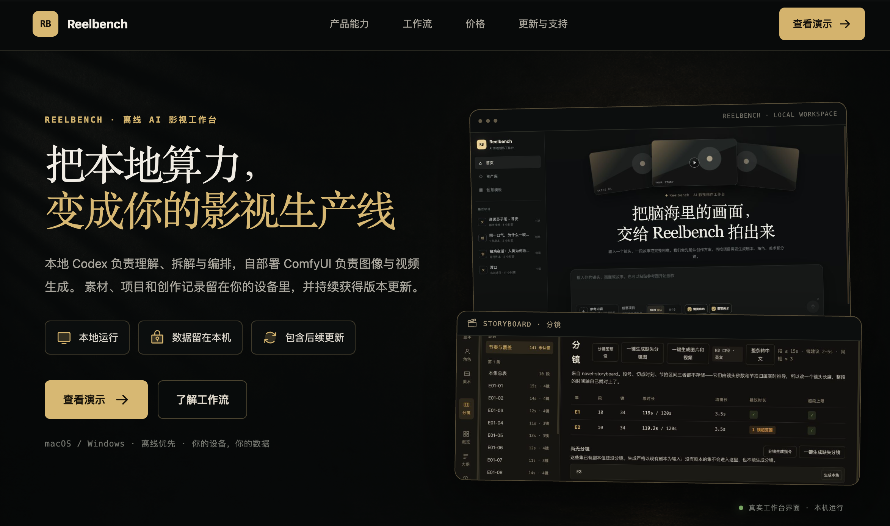
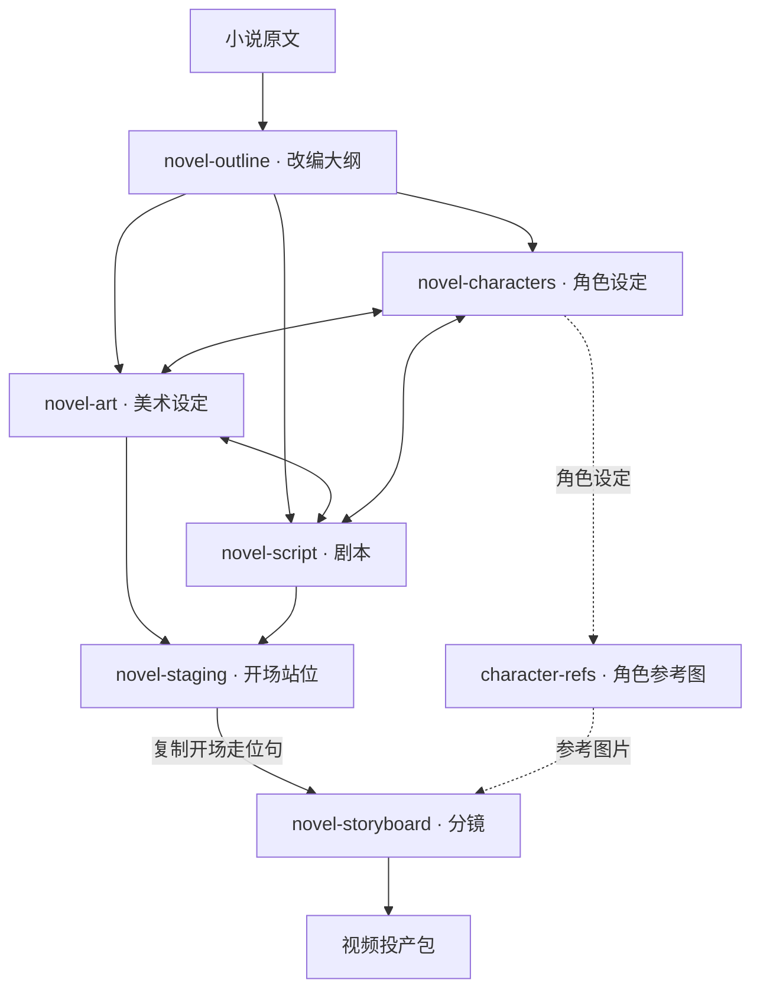
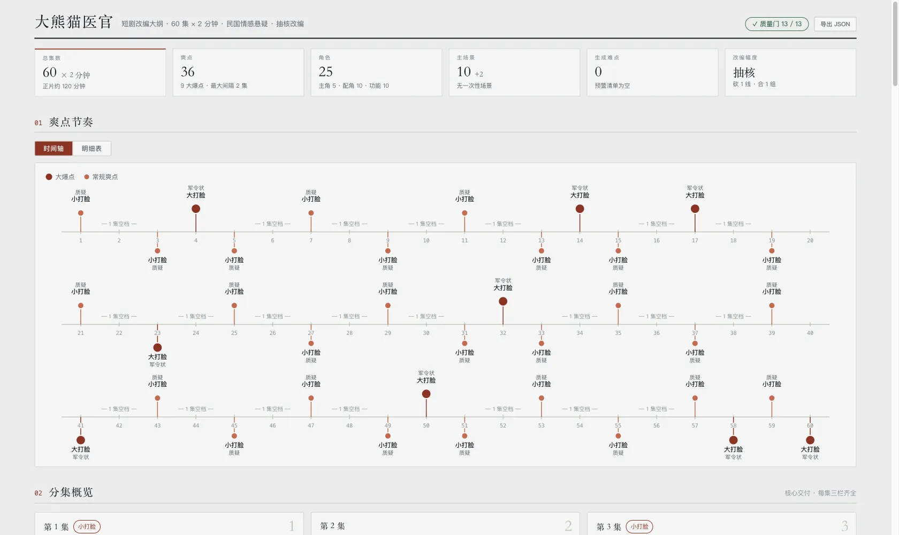
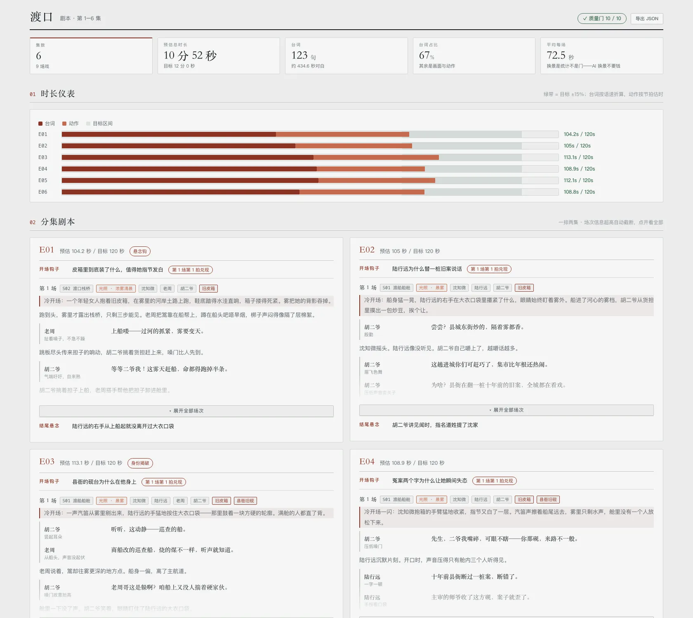
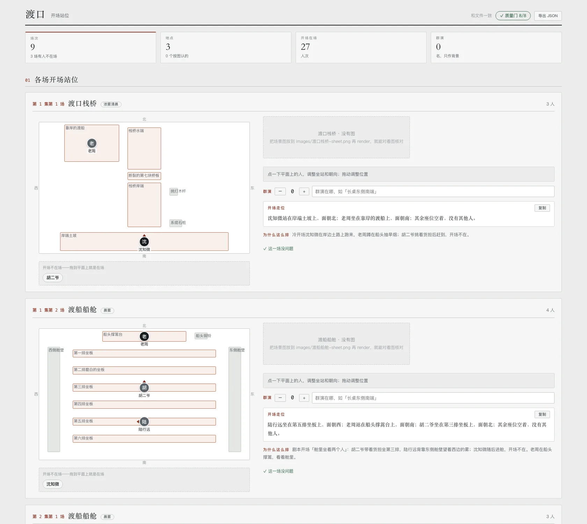
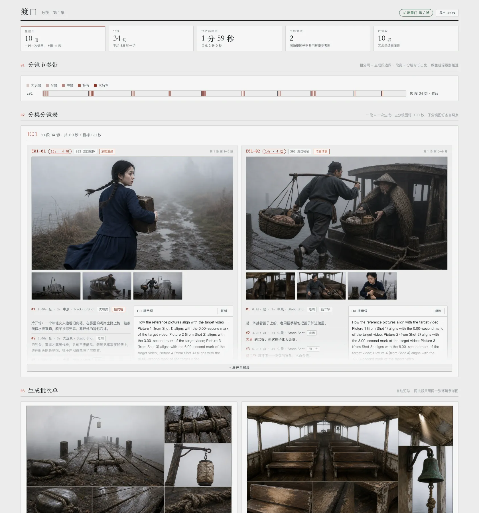

<div align="center">

# shuohao-skills

**面向各类 Agent 的 AI 短剧制作 skill 集合**

[English](README.md) | 中文 | [X @eternityspring](https://x.com/eternityspring)

**[Skill 一览](#skill-一览) · [安装](#安装) · [前置条件](#前置条件) · [仓库约定](#仓库约定)**

</div>

## ❤️ 赞助商

> [想出现在这里？](mailto:eternityspring@gmail.com)

<details open>
<summary>点击折叠</summary>

<table>
<tr>
<td width="180"><a href="https://go.apimart.ai/tw-shuohao-skills"></a></td>
<td>感谢 <a href="https://go.apimart.ai/tw-shuohao-skills">APIMart</a> 赞助了本项目！APIMart 是专注 AI 图片/视频生成的低价 API 平台，GPT-Image-2 低至 $0.006/张，1 美元可出图 160+ 张。图片、视频一套异步 API 通吃，提交任务拿 ID、回调取结果，跑批万张不超时、换模型不改代码。按量付费、无月费，通过<a href="https://go.apimart.ai/tw-shuohao-skills">此注册链接</a>注册即可开用。</td>
</tr>
<tr>
<td width="180"><a href="https://studio.reelbenchai.com"></a></td>
<td><a href="https://studio.reelbenchai.com">Reelbench Studio</a> 是本 skill 项目作者开发的付费 AI 影视工作台，交付的是能离线运行的源码。本地 Codex 负责理解、拆解与编排，自部署 ComfyUI 负责图像与视频生成，素材和项目都留在你自己的设备里。</td>
</tr>
</table>

</details>

## Skill 一览

**面向各类 Agent 的 AI 短剧制作 skill 集合**：从一本小说到直接交给生成管线的制作素材——排大纲、拆角色、出场景与道具设定、写剧本、排开场站位、切分镜。每个 skill 都是自包含目录，任何能够读取 `SKILL.md` 并执行随附脚本的 Agent 都可以使用；Claude Code 和 Codex 只是其中两个运行示例，并非使用前提。

仓库目前有 **7 个 skill：6 个制作阶段，加上可独立使用的角色参考图生成**。改编大纲收敛结构，角色、美术、剧本同步迭代；开场站位在分镜之前确定每场人物的位置。



| Skill | 做什么 |
| --- | --- |
| [**novel-outline**](skills/novel-outline) | 把一本小说改编成短剧大纲五件套：改编说明、人物表、爽点表、分集梗概、资产清单（含叙事道具表）。14 道质量门全部脚本检查，支持已有大纲的体检模式 |
| [**novel-characters**](skills/novel-characters) | 把大纲定下的角色做成角色设定集：人物画像、形象提示词、音色提示词、角色设定图。吃 outline.json 预填角色表，报告语言可选 |
| [**character-refs**](skills/character-refs) | 给任何故事里的角色**真出**参考图（不限小说，自己原创的故事也行）：一段话描述角色，拆字段、补全、确认后先出正面全身锚点，大头照、90° 侧面、背面、细节图都只参考这张锚点，按需分档。每张图带标识、可单独重出，过期自动标出。支持 Qwen Image（ComfyUI）、codex 出图、GPT Image 2 API、自定义命令 |
| [**novel-art**](skills/novel-art) | 给 AI 短剧出美术设定集（场景 + 叙事道具）：一致性锚点、光照与状态变体、尺度参照、无人无手白底提示词。吃 outline.json 预填清单，10 道质量门全部脚本检查 |
| [**novel-script**](skills/novel-script) | 给 AI 短剧写剧本：场次 + 节拍流（动作与台词交替），逐集时长按语速确定性折算，钩子前 3 拍冷开场兑现是门，台词本按角色聚合带音色提示词直接对接 TTS。10 道质量门全部脚本检查 |
| [**novel-staging**](skills/novel-staging) | 给 AI 短剧的每一场排开场站位：先从场景图里认出能站能坐的东西、推算到俯视平面上，再按剧本排谁在哪件东西的哪一侧、坐还是站、面朝哪，程序写出开场走位句交给分镜照抄；报告是能拖动调整的俯视平面，改完导出就是新的 staging.json。8 道质量门全部脚本检查 |
| [**novel-storyboard**](skills/novel-storyboard) | 给 AI 短剧出分镜：段（一次生成 ≤15 秒）→ 分镜（2–5 秒硬门）→ 分镜图（主图钉 0.00 秒、子图钉各自切点），MiniMax H3 提示词的对齐指令与切点时刻逐字对账；分镜图拿设定图当参考图真出图，export 一键出 H3 / Seedance 投产包。18 道质量门全部脚本检查 |

**六个制作阶段的报告都支持中英双语界面**：默认中文，`render --lang en` 出全英文报告（数据内容保持原文）。character-refs 的报告同样内置中英日界面，其他语言现场翻译。

## 付费 AI 视频交流社群

我建了一个付费AI视频交流群，讨论 AI 视频的工作流、工具和实操。**交流群 ReelBench AI 视频工作台是两项独立服务。**

有兴趣的加我：**微信 `hao_dev`**，添加时备注 **`github`**。


## 开场站位：输入、输出与分镜交接

`novel-staging` 放在剧本之后、分镜之前。必须提供 `script.json`，读取每场的出场人物和剧情；建议同时提供 `art.json`、`outline.json` 和场景图片，分别补充地点设定、人物名称，以及画面中实际存在的桌椅、门窗等。没有场景图片时，可以按美术设定推算，但会标成草稿。输入文件可以来自任何制作方式，不要求安装其他 skill。

| 输出 | 内容 |
| --- | --- |
| `staging.json` | 每场人物开场是否在场、对应物件、方位、位置、坐站、朝向，以及群演人数与位置 |
| `staging.md`（可选） | 按需导出的地点清单、人物站位表和开场走位句 |
| **`staging-report.html`（默认）** | HTML 工具报告：拖动调整俯视站位，检查实时更新，修改后导出 JSON |
| `blocking` 命令输出 | 每场一句开场走位，交给分镜每场第一段使用 |

Agent 负责识别场景图片并安排站位；随附的 Node.js 工具负责预填数据、检查 8 道质量门、渲染报告和生成走位句。默认向用户交付 HTML 工具报告，在本地浏览器打开；JSON 作为工作数据保存，Markdown 仅按需导出。可以从仓库根目录直接体验完整样例：

```bash
node skills/novel-staging/scripts/novel-staging.mjs validate skills/novel-staging/examples/渡口-staging.json --script skills/novel-staging/references/test-fixtures/upstream/渡口-script.json --art skills/novel-staging/references/test-fixtures/upstream/渡口-art.json
node skills/novel-staging/scripts/novel-staging.mjs render skills/novel-staging/examples/渡口-staging.json > staging-report.html
node skills/novel-staging/scripts/novel-staging.mjs blocking skills/novel-staging/examples/渡口-staging.json
```

**分镜目前不会自动读取 `staging.json`。**需要把确认后的开场走位句交给 Agent，要求复制到对应场景第一段的 `blocking`。这一阶段输出站位数据与报告，不生成图片或视频。新建站位方案的完整步骤见 [skill 使用说明](skills/novel-staging)。

## 合成五个阶段的报告

合成器目前支持**大纲、角色、美术、剧本、分镜**，尚未包含站位报告和 character-refs 图册。这五个阶段的报告可以合成一张单页，左侧导航切换——**支持的阶段中，有哪几个就出哪几个面板**：

```bash
node scripts/report.mjs --from <demo目录> --out report.html
```

`--from` 按下面的[工作目录约定](#端到端-demo-工作目录约定)自动发现五份 json；也可以逐个指定（`--outline` `--cast` `--art` `--script` `--storyboard`）。只跑了角色那一段就只有一个面板，不报错。

它是**组装器，不是独立 skill**：不 import 任何 skill 的代码，而是调各自的 `render --html` 拿产物再拼装。所以五个 skill 一行不改、各自仍然独立可跑、可以单独拷走；某个 skill 改了渲染，这边自动跟上。

合并时处理三件事——**这三件都在组装器里做，不侵入 skill**：

- **样式串味**。五份报告共用 57 个类名，其中 13 个同名不同定义（`.copy` `.kpis` `.badge` `.chip`……），所以给每份样式的每条选择器加作用域前缀
- **脚本串味**。各报告的脚本都是 `document.querySelector('.expo')` 这种全局查询，合成一页后只会命中第一个——五个导出按钮会全废。做法是给每份脚本套一层作用域代理
- **图片路径**。各报告的图相对自己那份 json 的目录（`images/…`、`E01-01/f1.png`），合成后按输出文件的位置重算

默认一次显示一个面板（五份加起来将近六十万字符）。左下角「平铺全部」把所有面板同时展开，Cmd+F 恢复全局搜索。数字键 `1`–`5` 切面板，`#pane-script` 这样的深链可以直接分享到某一屏。

```bash
node scripts/report-selftest.mjs   # 92 项断言，不起浏览器
```

六个制作阶段的报告预览：

**novel-outline · 短剧改编大纲**



**novel-characters · 角色设定集**


**novel-art · 美术设定集（场景 + 道具，设定图为 skill 实际生成）**


**novel-script · 剧本（时长仪表 + 分集剧本 + 台词本）**



**novel-staging · 开场站位（俯视平面能拖动调整，改完导出）**



**novel-storyboard · 分镜（分镜节奏带 + 主/子分镜图为 skill 实际生成 + H3 提示词）**



不从小说出发也行，给任何一个角色真出参考图：

**character-refs · 角色参考图（锚点 GPT 出、其余 Qwen 出，全部为 skill 实际生成）**


## 安装

```bash
git clone https://github.com/eternityspring/shuohao-skills.git
cd shuohao-skills
./scripts/install.sh
```

安装脚本目前会检测 Claude Code 和 Codex，并为它们创建**软链接**——`git pull` 之后立刻生效，不需要重新安装。Skill 本身不依赖这两个运行时；其他 Agent 可以把对应 skill 目录复制或链接到自己的 skill 目录，也可以直接加载其中的 `SKILL.md`。

```bash
./scripts/install.sh novel-characters   # 只安装某一个
./scripts/install.sh --codex            # 只安装到 codex
./scripts/install.sh --uninstall        # 取消软链
```

也可以手动创建软链接：

```bash
AGENT_SKILLS_DIR=/path/to/your-agent/skills
ln -s "$PWD/skills/novel-characters" "$AGENT_SKILLS_DIR/novel-characters"
ln -s "$PWD/skills/novel-characters" ~/.claude/skills/novel-characters
ln -s "$PWD/skills/novel-characters" ~/.codex/skills/novel-characters
```

## 前置条件

| | 必需？ | 说明 |
| --- | --- | --- |
| **Node** | 必需 | ≥ 18。skill 的脚本只用标准库，**没有 npm 依赖，不需要 install** |
| **模型额度** | 必需 | 用你当前会话的额度，**不需要任何 API key** |
| **Agent 运行时** | 必需 | 能够读取 `SKILL.md` 并执行随附的 Node.js 脚本。Claude Code、Codex 以及其他兼容 Agent 均可 |
| **出图模型** | 只有 character-refs 需要 | 四选一：自己的 ComfyUI（Qwen Image）、本机 codex 内置出图（吃 ChatGPT 订阅额度）、OpenAI API key（GPT Image 2）、自定义命令。第一次使用时选 |

## 仓库约定

每个 skill 一个目录，**自包含、可以单独拷走**：

```
skills/<skill-name>/
├── SKILL.md          给 agent 读的工作流（必需）
├── README.md         给人读的说明
├── scripts/
│   ├── <name>.mjs    确定性工具，零依赖
│   └── selftest.mjs  自测，不调模型（必需）
├── references/       按需加载的详细指令
├── examples/         自带样例，同时当测试夹具
└── assets/           截图
```

两条硬要求：

- 每个 skill 必须有 `SKILL.md`
- 每个 skill 必须有 `scripts/selftest.mjs`，**不调用模型、不花额度**，覆盖全部确定性逻辑

加新 skill 之前，先把全部自测跑一遍：

```bash
for f in skills/*/scripts/selftest.mjs; do node "$f"; done
```

没有配 CI——自测足够快（1 秒），本地跑一次比等 CI 更省事。**只在 macOS + Node 24 上验过**；代码没有平台相关调用，Linux 和更低版本 Node 理论上没问题，但没验。

## 端到端 demo 工作目录约定

把一本小说完成六个制作阶段（大纲 → 角色／美术／剧本迭代 → 开场站位 → 分镜），会产出大量 `*.json` / `*.md` / `*-report.html`。**不要平铺在根目录**，按六个 skill 各建一个目录归档：

```
<demo>/
├── outline/       ← novel-outline 产出：<剧>-outline.json / .md / -report.html
├── characters/    ← novel-characters 产出：<剧>-cast.json / .md / -report.html
├── art/           ← novel-art 产出：<剧>-art.json / .md / -report.html
├── script/        ← novel-script 产出：<剧>-script.json / .md / -report.html
├── staging/       ← novel-staging 产出：staging-report.html（主交付）+ staging.json；Markdown 按需导出
├── storyboard/    ← novel-storyboard 产出：<剧>-storyboard.json / .md / -report.html
│   ├── manifest.json  ← export 产出
│   ├── E01-01/        ← export 的分镜投产包，每段一个文件夹（prompt.md + f1..fN.png）
│   ├── E01-02/
│   └── …
├── docs/          ← 自己写的使用说明、PR 草稿等（与机器产物解耦）
└── scripts/       ← 跑管线的辅助脚本（探索期脚本用 _ 前缀保留溯源）
```

约定要点：

- **每个 skill 一个目录**，存放它自己的 `json` / `md` / `html` 三件套，加新角色/场景只往对应目录放，不污染根目录
- **分镜的 `manifest.json` 与 `E01-0x/` 投产包一起归 `storyboard/`**，就是 `export --out storyboard` 的原样产出。**段文件夹不要再往下收一层**（例如收进 `segments/`）：分镜报告里的图走相对路径 `<段号>/f<切序>.png`，默认要求报告 html 与段文件夹同级（放在别处就用 `render --frames <目录>` 指过去），多套一层目录又不指，报告里的图会**静默**全变成「未生成」占位——实测把 10 个段文件夹移进 `segments/` 之后，内嵌图从 2 张变 0 张，报告不会报错
- **报告 HTML 与生成的图/视频可由 `render` 重跑再生**——进版本控制时建议只提交 `json` / `md` / `docs` / `scripts`，报告 HTML 和分镜 `png` 用 `.gitignore` 排除，保持仓库轻量
- 用法类文档（如各报告的使用说明）放 `docs/`，与 skill 自动生成的产物分开，方便单独维护

> 这套结构来自《渡口》端到端 demo 的实际归档经验，demo 的工作目录在本仓库之外，这里只固化约定。


## Star 趋势

[](https://star-history.com/#eternityspring/shuohao-skills&Date)


## License

[Apache 2.0](LICENSE)
