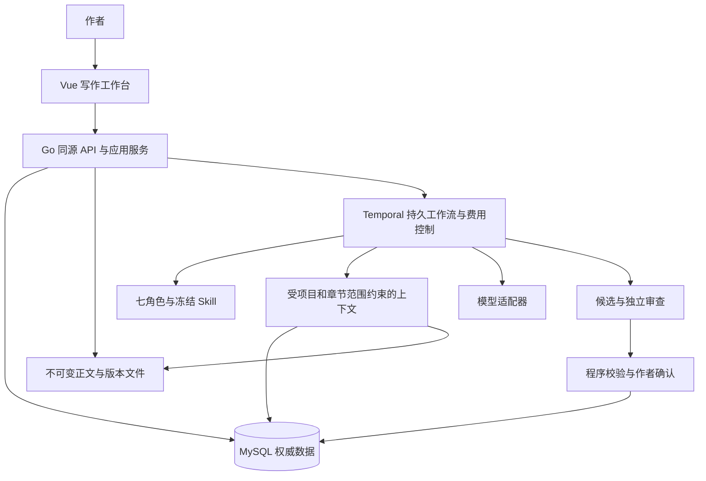
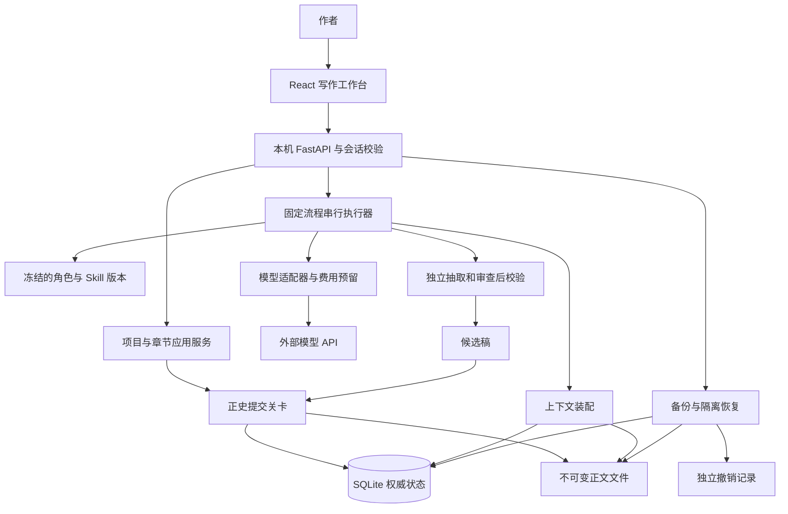
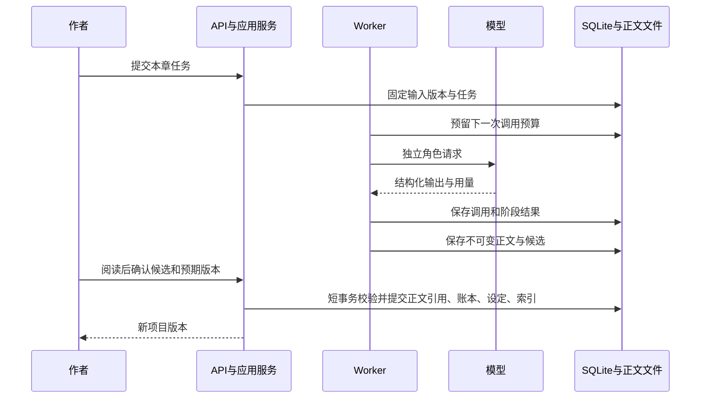

# 统一 IP 创作平台技术架构

文档版本：1.7。维护日期：2026-10-28。正式技术栈：Vue 3 + TypeScript、Go / Echo v5、MySQL。`backend/`与`web/`包含实际业务实现；八个内置预设、快速入口、小说工作台、材料卡与精修已实现。真实模型文学质量和长篇资格待验。旧栈原型核对基线`6f4fc37`仅用于迁移对照，具体功能状态见[实施状态](IMPLEMENTATION_STATUS.md)。

本架构面向统一IP创作平台，按公共底座、完整小说、完整漫剧、完整游戏、联合验收五期组织。范围见[分期实施方案](DELIVERY_ROADMAP.md)和[需求追踪表](REQUIREMENTS_TRACE.md)；第一章仅为中间验证，不是小说交付上限。采用模块化业务单体，专业执行工具受控独立。

本文同时说明当前实现和完整平台的后续契约。标注“当前”的内容可在代码中定位；标注“目标”的内容尚不是已上线功能。文档覆盖完整技术方向，不代表三个模块已经全部实现。

## 0 正式技术栈与迁移边界

MySQL、Vue和Go/Echo为正式技术选型，迁移边界见[迁移方案](STACK_MIGRATION.md)。下面标明“旧栈”的章节保留历史对照，不是继续建设旧栈的要求。当前实现和实际测试以[实施状态](IMPLEMENTATION_STATUS.md)为准；产品设计见[最终方案](FINAL_PLAN.md)。技术调整不改变小说优先、七角色职责和三条专业工作流。

| 层 | 正式目标 | 旧栈现状 |
|---|---|---|
| 界面 | Vue 3、TypeScript、Vite；Composition API、SFC、Pinia | React / TypeScript |
| 服务 | Go 模块化单体，Echo v5（基于 net/http） | Python / FastAPI |
| 数据 | MySQL9.7.4 LTS Community、InnoDB/utf8mb4；旧8.4数据待受控迁移；database/sql + go-sql-driver/mysql | SQLite |
| 检索 | 实体/别名精确匹配、MySQL ngram 全文检索、BGE-M3 dense、Go 精确向量融合、结构化前文装配 | jieba + FTS5 |
| 调度 | Temporal Go SDK 与 Activity Worker；事务保护状态与费用 | Python Worker |
| 内容 | 本地不可变正文文件、SHA-256 与数据库引用 | 继续保留这一设计 |
| 备份 | MySQL 一致读取下的版本化逻辑包、引用正文与撤销记录 | SQLite 快照 ZIP |



公共底座包含Go/Echo业务服务、MySQL、Temporal/Go Worker、本地BGE-M3嵌入工具与受控执行环境。Python只作为模型和文档工具，不恢复旧Python业务服务。本机MySQL/Temporal、嵌入与文档解析已有专项验证，准确版本见`deploy/locks/`。安装锁和当前凭据、进程隔离实现限定原生Windows：非Windows凭据保护返回`ErrVault`，工具进程要求Windows Job Object。服务保持loopback、Host和Origin限制，不能据此声称Linux、Docker或公网部署已就绪。对象层已有本机不可变内容与S3驱动，默认本机；S3契约使用本机测试服务验证，不等于云服务部署验收。

旧接口、七份方法和反例用于迁移参考。公共底座与小说N01—N12包含完整领域、交互及配套系统；新版已有数据库、页面和任务流程，但工程实现不等于真实文学质量或完整长篇资格。

框架决定：采用 Echo v5，当前 `backend/go.mod` 锁定 v5.4.2；具体比较、HTTP 边界与验收见 [框架选型](FRAMEWORK_DECISION.md)。此决定覆盖 v1.3 直接使用标准库 HTTP 的路线，不改变数据库和业务服务边界。

模型接入与小说入口的强制增补见 [模型与创建体验](MODELS_AND_NOVEL_ENTRY.md)。五家适配在第一期 F04 完成；五步向导及角色随时编辑在第二期 N01/N02/N04/N07 完成，不是远期可选项。

## 当前实施快照与版本边界

截至2026-10-28，Go/Vue/MySQL公共能力、记忆持久化与小说工作台已有实现。旧Python/React首章原型只能作为历史行为参考。版本、工程验证、真实模型质量与部署支持分别记录，不用构建成功替代业务验收。

| 项目 | 已有证据 | 尚未完成的边界 |
|---|---|---|
| Go 1.27.3 / Vue 3.5.44 | 官方包/依赖已升级；后端构建、领域/检索定向测试，前端类型/lint/构建通过 | 不是全仓回归、浏览器或真实模型质量验收；Node等配套未据此宣称全部最新 |
| MySQL 9.7.4 LTS Community | 新默认安装目标；独立13317通过schema35记忆HTTP与备份恢复 | 既有8.4业务数据仍待受控迁移；26.10仅历史实验，不再升级目标 |
| Python 3.12.15 | 现有embedding/OCR完整依赖闭包已有兼容证据；社区完整发行及独立venv | 详细运行状态与许可见[社区兼容基线](COMMUNITY_STACK_BASELINE.md)，不据此推断其他Python组合的兼容性 |
| 统一记忆 | 编译器/LRU、schema35三表、API、Vue面板、RAG/生成门禁、提炼与分层整理已有实现 | 真实文学质量、长篇性能及语义召回须按相应样本与规模验证 |
| 小说 | 八个内置预设、快速入口、工作台、材料卡、精修及规划/正文/审查相关业务已有实现 | 本地协议替身不能授予真实模型文学质量或长篇资格；专业图像与媒体模块另验 |

公开状态入口为[实施状态](IMPLEMENTATION_STATUS.md)，版本与兼容证据边界见[社区技术基线](COMMUNITY_STACK_BASELINE.md)。候选锁、安装完成和运行服务切换须分别核对，不能由锁文件推断既有实例已切换。

## 1 范围和依据

- 产品范围以[v1.1完整基线](reference/V1_1_BASELINE.md)和分期方案为准；早期首章计划仅为历史原型记录。
- 功能、规模与质量门全部纳入追踪；正式实现采用Vue/Go Echo/MySQL，本机部署先行。分期不删除需求，设计预算不构成实际支出许可。
- 小说优先，不开放空壳漫剧/游戏入口。付费默认关闭，真实模型调用由部署者明确启用；已有接口与测试夹具不能代替真实模型质量验证。
- 本文说明架构与边界，代码、迁移和测试的具体完成状态分别记录，不以文档更新代替工程交付。

### 选择理由

| 路线 | 取舍 | 结论 |
|---|---|---|
| 本地模块化单体 | 单进程容易启动、备份和排错；并发能力有限 | 当前采用，符合单人小说优先 |
| 云端模块化单体 | 便于远程访问，但增加账户、部署、数据外发与持续运维 | 出现跨设备需求时再评估 |
| 微服务与通用调度平台 | 可支撑复杂并发，但部署与一致性成本明显增加 | 不作为近期建设路径 |

## 2 旧栈原型的系统边界（迁移对照）



浏览器负责交互与编辑中的临时状态；后端负责版本、授权、任务、费用与正史；模型提出内容和审查候选。任何模型输出都不直接成为数据库操作或已确认游戏状态。

当前一个 Uvicorn 服务进程内运行一个 Worker 线程。HTTP 请求可同时到达，SQLite 操作通过应用锁与短事务串行化；不等于所有请求只在一个线程执行。启动器使用数据目录实例锁，禁止同一目录被多个工作台同时运行。

## 3 旧栈代码入口与目录职责

| 层 | 当前技术 | 代码入口 |
|---|---|---|
| 启动 | Windows CMD / PowerShell、Python | `Start.cmd`、`Start.ps1`、`run.py` |
| UI | React、TypeScript strict、Vite | `frontend/src/main.tsx`、`Dialogs.tsx` |
| API | FastAPI、Pydantic 输入模型 | `studio/api.py` |
| 领域校验 | Python、Pydantic 模型、证据检查 | `studio/models.py`、`checks.py` |
| 存储 | SQLite、JSON 记录、内容哈希文件 | `studio/store.py` |
| 检索 | jieba + FTS5 + 前文状态装配 | `Store.context` |
| 调度 | 串行 Worker、任务与调用记录 | `studio/worker.py` |
| 模型 | httpx、Responses 结构化输出 | `studio/provider.py` |
| Skill | 内置 Markdown + 项目派生记录 | `presets/`、`studio/skills.py` |
| 恢复 | SQLite backup API、ZIP、SHA-256 | `studio/backup.py` |
| 验证 | pytest、Playwright、本机 Chrome | `tests/`、`frontend/tests/` |

精确依赖以 `requirements.txt` 和 `frontend/pnpm-lock.yaml` 为准，而非在架构文档重复维护版本。当前未配置容器、云服务、向量库、消息队列或自动发布流水线。

旧栈领域服务与存储部分混合在 `Store`，不是已经完成依赖倒置的端口适配架构。迁移时将项目、章节和上下文用例放入 Go service/domain/storage 边界，保持对外契约；旧 Python Store 不再作为新增业务的正式基础。

## 4 完整平台的模块划分

以下是目标模块边界，不要求现在创建对应空目录或页面。

| 模块 | 拥有的权威数据 | 对外能力 | 不得越权 |
|---|---|---|---|
| IP 与正史 | 实体、规则、命题、事实修订、分支基线 | 查询快照、提出/确认变更、身份映射 | 不代替作品正文保存 |
| 作品与产物 | 小说修订、镜头、游戏工程与素材 | 版本、内容哈希、清单、来源绑定 | 不直接改正史 |
| 知识与上下文 | 来源、索引、片段、上下文清单 | 按项目/分支/时间/用途检索 | 不按相似度授予权限 |
| 任务与模型 | 任务状态、调用、费用预留 | 固定流程、取消、恢复、适配供应商 | 不凭模型文本确认成功 |
| Agent 与 Skill | 方法包、版本、适配与评测记录 | 角色装配、版本冻结、研究候选 | 不自行取得代码执行权限 |
| 小说 | 章卡、正文、章账本、审查、卷结构 | 完整写作闭环 | 不覆盖下游改编成品 |
| 漫剧 | 改编剧本、资产、镜头、声音、时间线 | 完整可编辑成片流程 | 不把临时供应商 URL 当素材归档 |
| 游戏 | 规则、数值、任务、运行版本、存档事件 | 工程、可玩切片、NPC 与 BOSS | 不让模型裁定胜负或奖励 |
| 变更与恢复 | 依赖、影响、撤销、备份清单 | 传播、局部重做、补偿修订、恢复 | 不因恢复而复活被撤销内容 |

模块依赖通过应用接口和固定版本引用传递：漫剧和游戏读取固定IP快照，不直接查询小说内部SQL或复制小说模块的事实解释逻辑。各模块是否已经开放以实施状态为准。

## 5 身份与版本

下表“当前状态”描述旧原型的迁移基线；正式实现的分支、身份、资源和发布状态以Go领域类型、有序迁移及实施状态为准。标识含义与引用约束继续适用。

| 标识 | 意义 | 当前状态 |
|---|---|---|
| `project_id` | 项目隔离边界 | 已有，UUID 十六进制字符串 |
| `entity_id` | 稳定对象身份；改名不换身份 | 已有角色 `Entity.id`；其他实体类型待扩展 |
| `branch_id` | 正史或改编分支身份 | 当前每项目一个；没有分支管理表 |
| `revision` | 项目单调递增版本，服务于乐观并发检查 | 已有整数 |
| `revision_id` | 具体作品/设定修订引用 | 已有，不能与项目整数版本混用 |
| `artifact_id` | 内容产物身份 | 候选已有；通用媒体产物注册表待做 |
| `blob` | 正文 SHA-256 | 已有，文件内容变化即产生新哈希 |
| `task_id` | 一次完整制作尝试 | 已有，不按角色拆成独立费用项目 |
| `skill_set_id` | 任务所用技能集合快照哈希 | 已有 |
| `source_anchor` | 对原文的证据定位 | 已有字符起止和引文，关联所在修订 |

跨模块引用采用项目、分支、实体/产物、修订的组合。不得只按名称关联人物，也不得只写“最新版本”。分支中合并两个人物需要新身份和多对多来源映射，不能复用任一原角色 ID 并混合其秘密。

## 6 旧栈持久化模型（迁移对照）

数据库：`data/studio.sqlite3`。正文：`data/blobs/<sha256>.txt`。管理记录：`data-management/`。

| 表 | 主键或约束 | 内容与职责 |
|---|---|---|
| `projects` | `id` | 书名、创作简报、版本、当前 lore、分支 |
| `candidates` | `id`；项目、章序号另存 | 正文引用、章卡、账本、问题、候选设定、任务/技能引用 |
| `canon` | `(project_id, chapter)` | 每章当前正式版本指针及 `needs_review` |
| `tasks` | `id` | 固定输入版本、Skill 快照、上下文、阶段输出与任务状态 |
| `calls` | `id` | 所属任务、调用状态、预留、用量估算、响应 ID 与结果 |
| `settings` | `key` | 应用设置；当前主要为费用控制，不存 API 密钥 |
| `skills` | `id` | 项目角色方法的追加版本 |
| `revisions` | `id` | 设定旧快照或章提交记录，不是完整事件溯源日志 |
| `search` | FTS5 虚表 | 分词索引及项目、候选引用；属于可重建派生数据 |

现有多数字段保存在 JSON 文本中。表中虽启用了 SQLite 外键开关，但当前 DDL 未声明这些业务引用的外键，完整性主要依靠程序校验与事务。后续增加共享实体表时应补正式迁移、必要索引和约束，不能把现有结构描述为已完全规范化。

现有记录的核心形状：

```text
Lore = brief + entities[{id,name,aliases,description}]
             + rules[{id,text,known_by}]
Plan = title + pov + story_time + goal + conflict
             + beats[] + ending_hook + target_chars
Draft = title + body
Ledger = entries[] + threads[] + summary
Entry = kind + subject + predicate + value + story_time
             + known_by[] + quote + start
Issue = severity + category + message + quote + suggestion
```

`Entry.kind` 区分 fact、belief、statement、intention、hypothesis、resource。当前 predicate/value 为文本，并没有可执行的资源守恒或数值规则引擎。`story_time` 是文字描述，独立的有效时间区间、角色获知时间和倒叙查询仍是目标能力。

## 7 IP 设定库与分支契约

完整库采用实体、命题、修订、证据四类记录：

- `Entity`：角色、地点、组织、物品、能力等；类型、名称、别名、生命周期。
- `Assertion`：主语、谓语、类型化取值、事实/信念等类别、知情者、有效故事时间、置信状态、来源与适用分支。
- `CanonRevision`：基线、变更集合、预期版本、校验结果、确认者/确认策略、提交时间。
- `Evidence`：来源产物和修订、字符区间或媒体时间码、原文/片段校验、提取版本。

复杂自然语言规则先保留为待审约束；只有被明确建模并有验证器的条件才是硬规则。权威事实不得来自未经确认的摘要或角色台词。

目标分支使用“固定基线 + 显式差异”：

```text
Branch(id, project_id, kind, parent_branch_id, base_revision_id)
AdaptationDelta(branch_id, source_entity_ids[], target_entity_id,
                change_type, before, after, reason, evidence_refs[])
```

小说正史与漫剧/游戏改编分别确认。原作人物 A、B 合并成改编角色 C，只影响目标分支。原作更新时先计算三方差异（旧基线、新基线、当前改编），不能把改编直接重置为最新正史。发布后的作品固定来源清单；回滚产生新修订，不让历史引用改指向。

## 8 旧栈小说工作流与事务边界（迁移对照）

以下为旧原型自动生成顺序；正式流程使用规划确认、正文候选、独立记账/审查与联合发布，不按旧原型的一轮修订限制实现：

1. 校验费用启用、密钥就绪、章序和前章待复核状态；冻结项目版本、ContextPackage、Skill 集合和单任务预算。
2. 没有角色设定时调用 Architect 生成候选 lore；不立即写入正史。
3. Planner 生成章卡，Writer 生成正文。
4. Bookkeeper 独立从正文抽取账本；程序校验结构、身份与原文锚点。
5. Critic 独立审查正文、上下文、账本与确定性检查结果。
6. 自动生成稿有阻断时最多调用一次 Writer 修订，再抽取与审查；仍有阻断则保留候选。
7. 作者确认后才提交正式版本。`ready` 只表示候选已保存，不表示正史已确认。

人工稿审查复用当前有效的候选设定和章卡，重新抽取账本，不自动改写作者正文。保存手改稿携带 `source_candidate_id`，同项目、同章、同基础版本时继承候选设定；已有正史变化时使用新正史重新审查，不盲目继承旧设定。



文件先临时写入、flush/fsync、哈希命名并原子替换；数据库再引用。确认时在一个 SQLite 事务中检查版本、已审查标记、阻断问题、章节顺序、前章复核状态，更新正史指针、版本、账本与索引。网络调用不在事务内。

任务候选保存会核对任务仍运行；任务含 `generation_token`，但当前未形成多 Worker 租约/代际比较机制。以后增加并行 Worker 前必须实现 fencing 检查，不能把现有字段的存在当成分布式正确性保证。

## 9 旧栈任务、调用与费用状态（迁移对照）

以下枚举、金额上限、token参数和浮点计算仅描述旧原型，不是正式费用配置。正式实现采用版本化价格卡、整数微货币单位、统一预留及对账；不得使用旧额度替代部署者启用。

任务状态：

```text
queued -> running -> ready
                  -> paused -> queued（显式继续）
                  -> outcome_unknown（核对前不自动重发）
                  -> failed
queued / running / paused / outcome_unknown -> cancelled
```

调用状态独立保存：`running / done / rejected / unknown`。取消后，已发出的请求仍可能产生费用；迟到结果不能成为已取消任务的新候选。

重启时进行中的调用转 unknown，任务转 outcome_unknown；没有未知调用的未完成任务安全暂停，用户继续后按阶段及输入哈希复用已完成结果。当前没有供应商自动对账、未知费用核销界面或自动恢复队列。

当前默认累计额度 ¥10、任务上限 ¥10，均不代表已授权付费。配置接口允许累计最多 ¥1000、单任务最多 ¥10；这是累计额度而不是已经实现的月预算。每次请求用 UTF-8 字节估算输入 token 上界，加输出上限和费用余量预留；实际使用量回传后计算估算费用。Writer 输出上限 10000 token，其他模型角色 6000；安全输入估算超过 120000 时暂停。

费用函数和价格版本目前在 `worker.py`，使用浮点数和固定参数；返回的 `actual` 是按用量计算的估算，不是支付平台已结算金额。目标增加版本化价格配置、整数微货币单位、显式对账、任务/批次/月额度分层。价格变化必须同步预留与结算逻辑，不能只改展示标签。

## 10 共享知识与 RAG

以下`Store.context`、jieba/FTS5行为仅属于旧栈迁移对照，不能作为当前Go混合RAG或v1.7完成状态：

1. 按项目读取当前 lore，只选择目标章之前且不待复核的正式章节。
2. 将有效前文的账本条目、伏笔最新记录直接加入上下文；不靠搜索猜测这些权威状态。
3. jieba 分词最多取 30 个非单字搜索项，通过 FTS5 取最多 5 个相关候选。
4. 合并最近两章的完整正文；其余前章保留摘要和来源 ID。
5. 记录 `revision / before_chapter / sources / omitted / stale_chapters`，不悄悄截断大上下文后继续生成。

旧栈 lore 已保存别名，但尚无完整的别名精确关联索引和应用专名词典；未实现向量检索、重排序或检索质量仪表盘。Writer 与 Critic 当前都接收同类上下文结构，通过指令区分作者约束与人物知识，尚未在数据层形成强制的双视图裁剪。

目标 ContextPackage 增加用途与信息分区：

```text
scope: project + branch + revision + story_time + role + pov
author_constraints: 必须遵守但不能自动进入人物叙述的规则
visible_knowledge: 该视角此时能知道的事实、信念和陈述
canonical_state: 已确认状态和来源
retrieved_evidence: 原文片段、修订与排名理由
open_threads: 未回收伏笔与承诺
omissions: 未纳入资料及原因
dependency_refs: 本次实际使用的实体、事实、产物和修订
```

事实记录保留来源；检索分数不是真实性置信度。第一期 F05 必须实现真实 BGE-M3 语义向量、MySQL 全文与结构约束；第二期做跨卷与30万字级评测。向量以 MySQL BLOB 保存，Go 在全部授权有效成员中分页精确搜索，并与全文结果融合；不以关键词筛选代替语义召回。索引删除、撤销与分支过滤在检索入口执行。

## 10.1 v1.7 统一记忆的正式契约

完整字段与选型见[统一记忆架构](UNIFIED_MEMORY_ARCHITECTURE.md)。Go负责MemoryCompiler与确定性权限/时间/预算；MySQL负责修订、来源、采用、session/checkpoint、manifest与任务投影，BlobStore负责不可变大内容；Temporal仍是唯一持久调度中心。BGE-M3继续专用受控工具，Python业务后端不复活；重排为可选且须资格验证。

L0原始档案→L1叙事核心→L2长期关系/阶段状态→L3场景/章/卷摘要→L4任务工作记忆相互引用而非覆盖。事实、作者未来计划、角色信念、外部参考、候选有不同权威；NarrativeContract与Highlight不是聊天消息。Writer可表达知识与隐藏作者约束分开，Bookkeeper从正文独立提炼，Critic另取受控上下文。

编译时固定workspace/project/branch/canon revision、actor/permission epoch、purpose/perspective、story position及游戏timeline/save、task session。先验权/可见性/时间/撤销，再按别名/SQL关系、关键词与语义检索。必要锚点和前置因果闭包优先；可选材料受预算筛选。MemoryManifest保存来源修订和定位、理由、预算、覆盖与缺口；无权限条目的排除信息不泄漏内容。必要输入超限时返回结构化缺口，不默默截断。

默认有界LRU，Valkey为可替换共享缓存；内容清单hash、编译/嵌入版本及全部范围键参与缓存身份。TTL/容量/singleflight控制效率，当前权限与版本仍需读取校验；缓存全失回源MySQL。正史、草稿、费用、任务状态不可只写cache。采用/发布事务写outbox，后台按(source revision, extractor, embedding, policy)去重更新；原始变更令摘要/向量/缓存stale，按原文重建。

新增memory表必须同时补齐schema指纹、列分类、外键顺序、snapshot导入导出、日志重放、retention和撤销/删除范围。恢复新namespace不复活旧权限；异步删cache不能代替读时验权。跨媒介共享entity_id、来源高光覆盖映射和获批资产修订；NPC读取当前存档的已知信息，模型不写权威结算。媒体/游戏专业适配保留原阶段。

编译器、LRU、持久化、API、Vue及小说记忆接入已有实现，具体工程验证范围见[实施状态](IMPLEMENTATION_STATUS.md)。长篇性能和真实语义质量待验；目标P95/压缩比例等只作为验收目标，不能当已测性能。

## 11 Agent 与 Skill 契约

旧原型五个模型角色分别绑定严格输出模型：Architect→Lore、Planner→Plan、Writer→Draft、Bookkeeper→Ledger、Critic→Critique。Director和QA是确定性执行职责，不额外产生模型调用；正式预设和能力版本沿用职责隔离原则并扩展相应用途。

内置方法位于`presets/`；项目编辑追加新版本，任务保存技能快照与哈希。八个产品预设、普通规划和首章试写不要求先完成600次资格评测。独立审稿、资格启用和正式发布使用[能力资格](CAPABILITY_QUALIFICATION.md)及[语义审查](F02_SEMANTIC_REVIEW_CONTRACT.md)门禁；能保存方法或得到试写结果不代表新方法已验证有效。

Skill文中的工具名不能授予执行权限；工具调用只能经过已登记、隔离且获准的执行路径。存储、检索和权威提交仍由Worker/服务代码控制。

目标技能包：

```text
skill_id + version + content_hash + role + instructions
input_schema_version + output_schema_version
examples + negative_cases + parameter_schema
allowed_tools + timeout_policy + source/license metadata
eval_report + parent_version + lifecycle_status
```

目标编辑流程：草稿 → 格式/schema 检查 → 隔离示例与反例 → 与旧版本比较 → 激活新版本。无付费授权时可完成静态检查，不能把未执行的模型评测记为通过；保持旧版本可用。

网上技能研究机制第一期 F06 实现、第二期 N10 完成小说真实评测，不能推迟到小说交付以后：登记允许来源 → 抓取固定版本与许可 → 去重和依赖分析 → 隔离适配 → 测试 → 入候选库 → 在预算策略内激活。外部内容是资料，不是操作指令；禁止从 Skill 文本任意安装依赖或运行脚本。来源不明或许可不清的能力保留分析记录，不自动执行。人工编辑采用项目派生版本，更新时三方合并，不覆盖用户修改。

## 12 统一持久化调度契约

第一期以 Temporal Go SDK 实现统一持久化调度，小说、漫剧、游戏保留完整专业工序。业务库拥有领域与费用，Temporal 拥有执行历史；不能另建第二套竞争调度器。父任务/卷章子流程/Activity 按真实粒度拆分，运行期 NPC 为独立短请求。

目标 JobEnvelope：`job_id / project_id / branch_id / workflow_type / workflow_version / input_refs / expected_revision / skill_set_id / model_config_version / tool_versions / budget_scope / attempt / cancellation_generation / status`。

目标 StepResult：输入哈希、产物引用、校验结果、调用 ID、用量、依赖引用、错误分类、开始结束时间。需要重试的外部操作固定同一业务操作 ID；对方不保证幂等时不得声称恰好一次。内部提交必须可去重，外部结果未知则先查询或停止。

第一期就验证 Temporal 重启、历史回放、父子任务、取消和 Continue-As-New。收费 Activity 默认最多一次尝试，未知结果先对账，不能因调度重试而重复付费。所有实现仍保留本地可复现失败用例；精确要求见分期方案和第一期任务计划。

## 13 跨模块变更传播

旧原型采用保守失效策略：修改lore会把现有正式章标记待复核；替换第N章正式版本会标记N之后的章节待复核。旧正文不覆盖，失效前文不能进入新任务上下文。正式实现使用版本化来源、依赖与变更计划；跨媒体传播仍受对应模块实现边界限制。

目标以显式依赖记录传播，不对所有下游直接重新生成：

```text
DependencyEdge:
  consumer_artifact_revision -> producer_entity_or_artifact_revision
  kind: factual | narrative | appearance | timing | rules | skill
  selector: 字段/证据/镜头范围
  policy: revalidate | regenerate_candidate | notify_only

ChangeEvent:
  event_id, project_id, branch_id, from_revision, to_revision,
  changed_refs, changed_fields, reason, source_transaction_id
```

处理次序：同事务写领域修订和 outbox → 执行器读取事件 → 按依赖做影响分析 → 为消费者建立待处理项 → 重新校验或生成候选 → 用户/已授权策略确认 → 形成新的产物修订。用 `(event_id, consumer_revision_id)` 去重，循环依赖不得无限触发。

| 变更实例 | 应传播范围 | 默认处理 |
|---|---|---|
| 人物年龄/身份改变 | 使用该事实的章、剧本、角色卡、NPC 背景 | 事实复核与候选修订 |
| 人物服装改变 | 相关角色资产、分镜、镜头 | 标记视觉重做，已冻结成片保留 |
| 一句配音时长改变 | 所属镜头、口型、字幕、剪辑时间线 | 重算定时并局部重做 |
| 游戏功法数值改变 | 规则配置、模拟、BOSS 对抗、存档兼容 | 数值/规则回归，不能改原作事实 |
| Writer Skill 更新 | 新任务；已有稿件有可选复审提示 | 不自动重写已确认小说 |
| 来源被撤销 | 直接和派生引用、索引、后续任务 | 阻止继续使用并记录影响 |

例如正史“林舟左手受伤”变更：先定位引用该事实的小说段落、漫剧动作镜头和游戏角色配置；右手无关镜头不重做，正在编辑的改编分支不被覆盖。冻结成品收到新基线通知，旧版本仍能追溯。这个例子说明目标传播机制，不代表目前已有这些媒体模块。

## 14 三条专业工作流

### 小说

第二期完整交付：立项/开篇选择 → 世界与事件图 → 全书/卷/章/beat → 上下文与正文/局部重写 → 独立抽取 → 硬校验与独立语义审查 → 最多两轮自动修订与复核 → 联合发布 → 持续跨章体检与卷审 → Markdown/TXT/EPUB/PDF。预置方法、研究编辑评测、长记忆、恢复/自动备份和变更传播全部随小说接通。详见 N01—N12，30 万字级及专业质量门不以一章替代。

旧原型仅覆盖单章闭环、基本续章装配、手改复核与MD/TXT。正式小说领域已扩展卷级计划、批量续写和成书导出等业务；实现与工程验收状态分别见[实施状态](IMPLEMENTATION_STATUS.md)，长篇检索及真实文学质量仍须对应证据。

### 漫剧目标

Showrunner、编剧、导演、美术、提示词编译、声音、剪辑七类职责，另有一致性、连续性、合规检查。

固定 IP/小说来源 → 改编差异 → 剧本与节拍 → 分镜 → 角色/服装/场景/道具/声音资产 → 配音与定时 → 关键帧与动态分镜 → 视频及适用镜头的口型 → 音乐音效字幕 → 剪辑检查 → 审片修订 → 成片与可编辑工程。

镜头有独立任务、来源、时长和预算；供应商结果立即归档为内容文件。交付同时保留时间线、源素材、音频分轨、字幕、参数与迁移损失说明；需在选定编辑器中实际打开和修改，不能用 MP4 或 JSON 冒充可编辑工程。

### 游戏目标

Producer、Intake、Ingest、Fact、Concept、World（含 Numeric）、Narrative、Art、Slice、QA、Critic 十一角色。

目标与边界 → 来源摄取覆盖账本 → Source Bible 与事实取证 → 玩法方案 → 世界/职业/功法/资源系统 → 互动叙事 → 数值模型与模拟 → 美术与真实 2D 切片 → 运行验证和改编审查 → 工程、构建、来源映射与试玩证据。

沿用既定 2D 首片方向；具体依赖在模块启动时再核对。共享 TypeScript 规则内核供表现宿主和无头模拟调用。模型只生成受约束的 NPC 对话/行动候选，确定性代码验证动作、资源、任务和存档版本；BOSS 的逐帧战斗不等待模型。第四期必须实现服务端权威：Go 接口调用受限 Node 进程中的同一规则内核，重放合法输入后提交，禁止直接信任浏览器上传的奖励或胜利结果。

生成游戏代码在隔离环境构建试玩，不获得工作台密钥或正式存档写权限。单个模块必须有真实可操作产物后才开放入口。

## 15 旧栈 API 契约（迁移对照）

以下路径、令牌头与错误体描述旧原型，不是当前API完整目录。正式接口以`backend/internal/httpapi/`和[编码规范](CODING_STANDARDS.md)为准。旧路径以`/api`开头，除`/session`外需要`X-Studio-Token`；旧错误体为`{"detail": ...}`，403为访问限制、409为版本冲突、422为输入或业务校验失败。迁移须保留相应业务约束，协议调整同步客户端。

| 方法 | 路径 | 作用 |
|---|---|---|
| GET | `/session` | 本地会话令牌与版本 |
| GET / POST | `/projects` | 列表 / 创建 |
| GET / DELETE | `/projects/{pid}` | 项目详情 / 撤销并删除项目记录 |
| PUT | `/projects/{pid}/lore` | lore + expected_revision |
| GET | `/projects/{pid}/candidates` | 候选与历史版本元数据 |
| POST | `/projects/{pid}/drafts` | 保存正文新版本，可携带 source_candidate_id |
| GET | `/candidates/{cid}` | 读取具体版本与正文 |
| POST | `/candidates/{cid}/confirm` | expected_revision 条件确认 |
| GET | `/projects/{pid}/context` | query、chapter 对应上下文 |
| GET | `/projects/{pid}/skills` | 七角色当前方法与版本 |
| PUT | `/projects/{pid}/skills/{role}` | instructions + expected_hash |
| GET / POST | `/projects/{pid}/tasks` | 任务列表 / 创建生成或审查任务 |
| POST | `/tasks/{tid}/cancel` | 停止后续阶段，保留已发请求费用 |
| POST | `/tasks/{tid}/resume` | 继续安全暂停且基础版本未变的任务 |
| GET / POST | `/budget` | 费用读取 / 有限额度配置 |
| POST | `/key` | 仅在服务进程内存设置模型密钥 |
| GET | `/projects/{pid}/export` | format=md 或 txt，导出当前正史 |
| GET | `/candidates/{cid}/export` | 导出指定版本，未确认稿标记草稿 |
| GET | `/projects/{pid}/backup` | 一致性项目 ZIP |
| POST | `/restore` | multipart file + allow_migration |

对外增加独立客户端或第二模块时，先定义版本与兼容策略，避免使现有UI失效；不从旧路由表推断当前接口或公共OpenAPI状态。

## 16 安全、备份与运行

本机服务绑定`127.0.0.1`；校验Host、Origin、跨站请求来源和应用令牌，不开放任意CORS。旧栈密钥仅环境变量或内存；正式实现使用后台自填与独立加密凭据库，业务库只存引用。当前凭据保护依赖Windows实现；未来其他宿主须单独实现并验证凭据管理。密钥不返回前端、不进入提示词/业务数据库/Temporal历史/项目备份或日志。

当前数据库和正文没有磁盘加密，管理目录也不是密码学防篡改系统。主要保护边界是本地账户和应用接口；不承诺抵抗同一操作系统账户下的恶意程序。

旧栈备份使用SQLite backup API，按项目清理快照、移除设置与调用记录，再打包实际候选引用的正文和SHA-256清单。旧包限制ZIP压缩大小50MB、解压总量100MB、最多2000项，拒绝重复路径、非法路径、缺失内容和哈希不符。正式MySQL备份采用同一一致读取事务的版本化逻辑包、对象引用和受保护撤销记录，具体契约见[迁移方案](STACK_MIGRATION.md)及[编码规范](CODING_STANDARDS.md)。

恢复建立新项目身份并保留来源关系和正文，原项目不覆盖。索引在权威数据导入后重建；恢复任务、资格、来源与费用遵守各领域的禁用及对账规则，不恢复供应商计费会话，不以旧资格授予新运行权限。崩溃原子性按恢复检查独立验证。

删除和撤销按项目、对象及依赖范围记录，恢复不会覆盖当前受保护管理日志。删除恢复副本只撤销副本身份，不删除来源项目。逻辑删除不等同于物理安全擦除；未引用blob清理、保留备份和撤销传播分别按实际实现与引用图检查。

## 17 可观测性与故障处理

可观察内容包括任务阶段、状态、输出、问题、模型响应ID、输入/输出用量、估算费用及暂停或失败原因。日志和关联字段的实际覆盖以代码与[实施状态](IMPLEMENTATION_STATUS.md)为准，不能由字段清单推断全链路均已覆盖。

目标日志记录 request_id、task_id、stage_id、project_id、错误码、耗时、版本和用量，不默认记录完整正文、提示词或密钥。诊断内容与给作者的提示分开：作者看到恢复方法，开发日志保留可追踪原因。

| 失败 | 处理原则 |
|---|---|
| 未授权付费 / 缺密钥 | 请求前拒绝，不进行试探调用 |
| 下一阶段超预算 | 保存已完成结果，暂停；不得自行提高额度 |
| 网络超时 / 结果未知 | 保留预留，不自动重发 |
| 输出格式或证据无效 | 保留结果与问题，禁止确认 |
| 项目版本变化 | 拒绝旧候选提交，基于新快照复核 |
| 磁盘/数据库失败 | 不返回保存成功，不覆盖既有正文 |
| 备份校验失败 | 拒绝接入当前项目，保留原数据 |
| 模型不可用 | 可以继续手工编辑、保存和导出；不伪造自动生成成功 |

## 18 验收、差距与实施次序

旧栈33项Python测试和2条Chrome流程仅是历史记录，不证明新栈、全平台底座或完整小说已经验收。文档维护不新增运行证据；当前工程功能和待验质量分别见[实施状态](IMPLEMENTATION_STATUS.md)。

正式次序为第一期 F01—F08公共底座及F09统一记忆 → 第二期 N01—N12 完整小说和配套 → 第三期 M01—M08 完整漫剧 → 第四期 G01—G09 完整游戏 → 第五期 J01—J03 联合验收。分支、语义检索、能力研究/编辑/评测、调度、自动备份和变更中心不能继续列为小说交付后的可选增强。

第一章、连续章节、整卷是逐步验证尺度。个人创作可用要求小说全部功能与支撑真实接通；30 万字级、标注集和独立人工审读另保留正式资格状态。没有真人评审记录时为 NOT_RUN，不用 AI 自评冒充。

详细阶段、接口、验收和原需求映射以[分期方案](DELIVERY_ROADMAP.md)、[追踪表](REQUIREMENTS_TRACE.md)与[实施状态](IMPLEMENTATION_STATUS.md)为准。待实现项目不能因写入文档而改成完成。

## 实施依赖与风险分层验收

下表说明阶段依赖与验收出口，不是待办状态。公共底座与小说工程已有实现，真实文学和长篇质量仍须独立证据；漫剧与游戏保留后续专业模块范围。自动化不能替作者确认作品主题、大纲、细纲或采用候选，创作确认必须有版本绑定的服务端记录。

| 节点 | 成果范围 | 集中出口 |
|---|---|---|
| U1 | 保存新版工具链与隔离数据库验证；记录Python兼容例外，生产数据升级按副本分段进行 | 升级、回退和关键驱动/解析兼容记录；不以换版本阻断可复用功能开发 |
| F09-A/B/C | 编译器→持久修订/checkpoint/manifest→API/Vue→RAG与生成接入→增量摘要和失效 | 一次真实数据库/浏览器纵向闭环，记忆隔离反例与长文本性能 |
| F-close | 合并已有F01—F08成果，关闭实际剩余缺口 | 底座出口及新增表备份/日志/删除/恢复的集中检查 |
| N-entry / N-plan | 小说持久领域、五步向导、批量角色/起名/专业资料、世界/主题/大纲/细纲反复确认 | 无Key手工编辑和草稿恢复可用；创作阶段门服务端生效 |
| N-write | 正文/续写/局改、独立记账/审查/修订、按授权连续章与角色修改传播 | 连续章节、取消/重启/过期采用/联合发布；真实模型资格另记 |
| N-book | 卷审、全书管理、图片、EPUB/PDF、自动备份和可用说明 | 文件实开/视觉检查/恢复；N12长篇、标注集和人工质量如实记录 |

平时只执行改动范围的编译/类型与有效行为反例；低风险文案/样式不重复全套测试。权限、跨分支/未来泄漏、并发采用、费用、不可变正文和恢复必须有定向验证。数据库迁移、浏览器、整卷、长篇压力、恢复与真实模型质量在相应里程碑集中验收；没有相关代码/依赖/数据改变时复用已有证据，不反复重跑全仓。失败修复后重跑受影响项，不能用“减少验证”跳过关键边界。

30万字夹具可用于容量/状态检查，不能代替真实文学质量。收费模型未启用或外部人工评审未安排时，精确列出待验、前置条件和费用上限；不能标为全部完成或静默降级质量门。未知收费结果不重发，任何调度或自动化都不自动增加费用权限。

## 19 维护责任

代码行为变化时同步本文件、`docs/CODING_STANDARDS.md`、`docs/STACK_MIGRATION.md`、`docs/DELIVERY_ROADMAP.md`、`docs/REQUIREMENTS_TRACE.md`和相关测试。重大选择记录问题、选择、代价和退出条件；不要把当前实现缺口改写成已经具备的能力。仓库内文档为公开维护源。


## 协作采用与小说阶段门

详见 [协作创作契约](ASSISTED_CREATION_AND_PLANNING.md)。所有创作字段及图片支持文字/附件、Agent 候选、意见迭代和用户确认。CreationDraft 自动暂存与 AdoptionRecord 明确分离；采用指向具体 revision/hash 和依赖版本。计划空间、权威事实、候选图像分离，不能提前泄漏未来剧情。世界与故事规划确认 → 全书/卷大纲及大概章节确认 → 细纲确认 → 正文 → 用户采用及质量发布，服务端启动与提交均检查门禁。

实现须保留持久作者等待、附件覆盖/失败状态、稳定章节ID、细纲范围进度、反馈锚点与影响重算。测试覆盖草稿误采用、伪造/过期确认、跨IP、迟到结果、重启等待、缺细纲直接API写章、三轮以上人工修改和图片能力缺失。真实图片生成/编辑及其质量另行验收，五家文本接入不构成生图资格。旧首章自动串行流程仅是历史实现说明，不能作为新版流程。


## 角色批量与局部修订契约

详见 [角色协作设计](CHARACTER_ASSISTANCE.md)。CharacterBatch 保持项级身份、关系依赖与幂等；标签、模板、趋势快照分离并锁版本。批量采用必须闭合关系，标签移除不删除手改属性。一句话完善和局部修订只产出差异候选。附近章节为预览优先级，全书依赖仍须核验；影响覆盖未完成不能宣称无影响。删除需要区分候选删除、归档、当前故事移除、后续退场和剧情死亡。

ScenePatch 冻结正文基准hash与锚点，独立复核、用户采用后以 RepairReleaseManifest 原子切换相关人物/正文/账本/索引引用。跨章依赖组不可任意拆开，无关hash不变，失败保持旧清单。验证批量部分失败、同名/别名、选中人物引用未采用候选、过期补丁、隐含远端伏笔、删除承接、抓取异常、角色与正文并发编辑。
