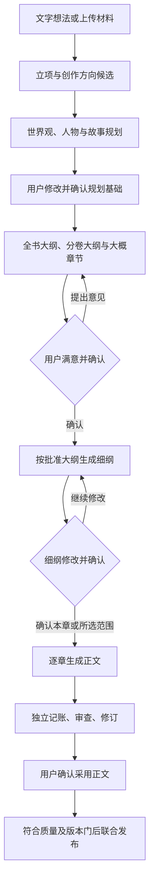

# 协作式内容完善、图片制作与小说规划

版本：1.4.3。状态核对：2026-10-28。本文为协作式创作、图片及规划的必需产品契约。当前入口与小说作者流程已有工程实现，真实模型和作品质量资格仍待验，详见 [实施状态](IMPLEMENTATION_STATUS.md)。与 [模型及小说入口](MODELS_AND_NOVEL_ENTRY.md)、[五期方案](DELIVERY_ROADMAP.md) 配套；规划和采用均须保留作者确认。

## 1 统一交互：用户提供材料，Agent 完善，用户确认

所有创作内容入口采用同一协作方式：输入简短文字、上传参考文件，或两者结合 → 提取资料并展示理解 → Agent 生成候选 → 用户直接编辑或提出修改意见 → 生成新候选并比较 → 用户满意后点击“确认采用”。适用于书名、简介、题材建议、世界观、人物、关系、文风、故事规划、大纲、章节安排、细纲、正文修改，以及封面、角色图、场景图等图片。后续漫剧和游戏沿用此机制。

当前入口使用八套完整预设、一句话或附件及一页可编辑方案；原五步向导仅保留为历史字段分组和草稿兼容来源。作者不必从零填写复杂表格，可先输入想法或上传材料，再由 Agent 提出字段建议；每项注明来源、推测及待补内容，用户可以逐项采用或确认一组内容。未说明的信息标记待定，不编造成用户要求。数字、枚举、预算等仍由后端校验；Key、权限、费用授权不交给 Agent 自动填写或确认。

私有草稿自动保存仅用于防丢失，界面标为“草稿已暂存”；它不等于用户确认、不进入正式设定、不替代当前采用版本。正式保存按钮为“确认采用”，同时显示采用对象与影响。用户可放弃候选、恢复上版、修改后再次确认。修改意见和历次候选可恢复，默认保留策略与平台一致，主动保留的候选受引用保护。

批量“确认采用所选内容”必须列明具体项目和差异，不是一键授权未来未知结果。每轮生成都产生独立版本，不能在用户阅读或编辑时替换当前画面。后台返回迟到结果时放候选列表并提醒；取消任务不自动采用其结果。收费仍受明确预算约束，不因用户上传文件或保存草稿自动调用模型。

## 2 文件作为来源，不能只提供一个上传按钮

当前资料入口支持建书附件及建书后的“管理本书资料”，复用后台解析、覆盖报告、私人改稿和候选检查/采用/发布；原文件可在解析前后下载核对，原文不会被编辑稿覆盖。导入用途进入草稿与不可变资料版本，默认“项目工作资料/仅作者”，可选作品证据、专业方法或待核实研究，沿用既有 RAG 用途与知情限制。旧稿未记录用途时保持历史解释。原文件、解析结果、私人稿及用途已纳入备份恢复验证；多格式/OCR 和真实模型理解效果按实际解析器与资格披露，不以入口存在代替覆盖验收。

首期公共摄取支持 TXT、Markdown、DOCX、PDF，以及 PNG、JPEG、WebP 参考图；发布安装包必须实际提供相应解析器和故障处理。纯文本/有文本层的文档直接提取；扫描 PDF 和图片中的文字走 OCR/视觉能力，未配置时显示具体未解析页，不能把空内容当成功。加密、损坏、超限及不支持格式给出可读错误；不执行宏、脚本和文件内指令，不自动访问附件中的外链。

上传后先展示文件列表、页数/单元数、解析进度、覆盖范围与失败单元，再让用户选择用途：创作要求、现有设定、正文、视觉参考或其他资料。同一文件可被多个内容对象引用，但必须有工作区/IP/分支作用域和来源锚点。原文件、提取结果和用户编辑分别保存；冲突并列展示，Agent 的总结不能覆盖原文或自动成为正史。私有上传材料默认只供本作品使用，不自动进入公共知识库或网上 Skill 研究。

文件读取、模型外发和生成是分开的动作。上传成功不表示全文已解析，也不表示获准向任意供应商发送；沿用资料级别和供应商授权规则。支持删除/替换来源和重试失败单元；替换后重新计算依赖影响。文件大小、页数、解压限制由版本化配置公布，超限支持分批并保留完整覆盖账本。

## 3 图片也必须反复完善、确认后采用

当前源码实现：角色卡使用三视图入口，小说工作台提供“封面与场景图”。后者以小说、用途与方案名称分组，可选角色、已发布资料和参考图；已确认世界观与全书规划自动进入依据。预置 `novel-visual-director` Agent/Skill 先整理可编辑的视觉说明，再按明确配置的图片模型准备任务。文字助手只收到文字与图片元数据，不宣称已看过图片像素；实际参考像素由图片生成/编辑请求读取。保存任务不调用模型，开始仍经过预算与调度。

图片采用保存独立参考资产，保留原图与生成任务来源，不自动改正文或人物事实。书籍设置、角色及选中资料变更后重新核对生成依据；过期任务/建议/图片不能直接继续执行或采用。封面和场景复用受管上传、候选、明确采用、区域修改与历史版本。专用上传与参考编辑现支持PNG/JPEG/WebP；原图不变，WebP仅在局部编辑或成书导出时转换兼容副本。EPUB/PDF可以选择本书具体已采用封面，预览固定图片hash和采用版本；新选择须重新预览，旧依据封面须核对提示。图片选版与历史稿本重导出分别按固定版本清单校验。实际模型资格与付费效果尚未验收。具体实现与验证状态见 [实施状态](IMPLEMENTATION_STATUS.md)。

文字需求或上传参考图 → Agent 整理用途、主体、构图、风格、尺寸及保留项 → 用户修改需求 → 调用具有相应能力的图片模型生成/编辑候选 → 并排查看、放大和继续提意见 → 用户选择满意版本确认采用。

支持文生图、以参考图生成和编辑已有图片；局部编辑提供区域选择，并记录源图版本和需保留的特征。每次生成记录输入图、提示词、模型配置、费用和来源。参考图与最终资产身份分开，生成图只是视觉表现，不自动反向修改人物身份、能力、剧情事实；冲突进入待确认变更。作者可直接上传成品图作为候选并采用，也可保留多版本用于不同分支。

五家默认文本模型接入不等于五家都具备生图、看图或局部编辑能力。模型目录明确 image_input / image_generate / image_edit / region_edit 能力，按实际协议和账号资格路由；仅能看图的模型不得充当图片生成器。第二期必须提供至少一个真实图片生成与编辑适配，完成封面、人物和场景参考图闭环；不推迟到漫剧阶段。具体版本在实施时按官方接口核实，无凭据或预算时保留需求与候选，不使用占位图冒充结果。

小说图片是可用的辅助能力，不强制每本书先生成图片才能规划或写作；作者选择了必需视觉资产时单独跟踪其状态。再次生成图片会使用预算，不能承诺无限免费重做。用户未满意可继续修改，系统不设固定两轮上限；自动连续尝试受预算和任务上限限制，到限暂停并保留全部结果。

## 4 小说的强制生产顺序

小说工作台已提供世界/故事规划、全书与分卷粗纲、章节细纲及正文的阶段流程、明确确认和规划助手。助手读取版本化上下文，输出可对照的字段/清单建议；作者明确加入私人草稿后仍可编辑，正式采用另行确认。内置规划 Skill 及四个 Agent 可在方法工作台编辑为新版本，并从助手受控试用。正文写作、独立记账、审查和采用已接入小说流程；预置方法或本地替身验收不授予真实模型质量资格，详见 [实施状态](IMPLEMENTATION_STATUS.md)。

内置助手试写与正式资格分开：已配置可用模型并启用相应预算后，可按受控试用流程生成私人候选，不要求先完成 N12 的 200 样例/600 请求资格套件。试写不授予专业资格；正式独立审稿及发布仍须通过对应模型、方法和版本的有效资格与质量门。真实供应商可用性、长篇文学质量和指定图片型号分别待验，不能由本地替身或一次试写推定。

| 层级 | 必须产出的实际内容 | 用户确认边界 |
|---|---|---|
| 立项方向 | 核心创意、题材、读者、主题、叙事方式、篇幅与希望避免的内容 | 接受或修改方向，不将一句想法当完整世界观 |
| 规划基础 | 世界规则/代价/边界、时空与势力、主要人物及关系、目标/阻碍/人物弧线、主线因果、重大转折与结局方向 | 世界观与故事规划均可对话修改；允许有意保留未知，但不得缺失开篇所必需的条件 |
| 大纲与大概章节 | 全书与分卷叙事，主要事件与节奏、伏笔铺设和回收；暂定章节列表，每章标题/摘要、视角、目标、关键事件、人物状态变化与衔接 | 用户反复调整事件顺序、节奏、增删合并章节；明确确认一个大纲版本后才进入细纲 |
| 细纲 | 章卡与场景/beat：故事时间、地点、在场人物、可知信息、场景目标、冲突、行动结果、情绪变化、伏笔、因果前置与结尾钩子、预计字数 | 先确认细纲，再生成正文；可批量确认实际已展示的细纲，不授权尚未生成的内容 |
| 正文 | 按该章已确认细纲及快照生成，独立记账、审查、至多两轮自动修订，显示问题与版本差异 | 用户可继续手改/要求修改，满意后确认采用；通过质量门才正式发布，不因满意跳过阻断问题 |

首次写作前必须完成全书/分卷大纲与完整的暂定章节安排；不要求一次把未来每个场景全部写死。默认按卷/用户选择范围生成细纲，逐批审阅；所有要生成正文的章节必须各自已有已确认细纲。用户可以选择全书细纲，长任务分批持久保存，不能仅生成前几章后宣称全书细纲完成。

世界观、故事规划和大纲可以在同一工作台反复协作，但不得跳过用户确认直接串行写正文。主动作随阶段显示“完善世界与故事”“生成大纲与章节安排”“修改大纲”“确认大纲并生成细纲”“确认细纲”“生成本章”。首次进入不提供绕过规划的“一键写第一章”。用户仍可随时手写、记录灵感和导入旧稿；这些草稿不会绕过 AI 生产门或直接进入已发布正史。

导入续写同样先抽取已有世界、人物、故事和章节，再展示来源与推断并由用户确认补齐规划，才能继续 AI 写作；不能擅自重写导入正文。未来情节与结局属于作者计划空间，不能提前成为已发生事实，也不能被角色视角 RAG 当成已知信息。

人物的批量创建、自然语言标签/属性和增删改后的章节修复详见 [角色协作设计](CHARACTER_ASSISTANCE.md)。该流程复用本文件的候选/采用与规划门，不绕过确认直接改正文。

## 5 修改大纲后如何继续

每个节点都有稳定 ID、不可变修订和上游版本清单。章节编号仅供排序，增删/合并/拆分不能把别章正文错绑。意见可绑定单字段、人物、事件、卷、章、场景或整份方案；Agent 明确当前候选的修改范围，展示已处理意见、未处理项和原因。重生成只产生候选；用户锁定的内容默认不动，存在冲突时列出变更建议。

修改世界规则/故事方向/大纲 → 生成影响报告 → 用户采用新版 → 受影响细纲和待写任务标记 NEEDS_REVIEW → 用户修订或确认仍适用 → 恢复正文生成。已写正文保留原文，按影响进入复核，不全书自动重写。无关节点及其确认记录保持；仅重排章节也检查时间、因果、视角与伏笔依赖，不能认为一定无语义影响。

运行中任务冻结原输入；新版被采用后，过期任务不能发布或自动推进下一阶段。任务启动及提交均在服务端检查有效的确认记录与依赖版本，旧结果仍可对照、重新基于新版本审查。规划确认、作者采用、内容质量审查与正史联合发布是不同记录，不能共用一个 approved 布尔值。

## 6 工程契约与预置能力

| 对象 | 关键约束 |
|---|---|
| SourceAttachment / IngestCoverage | 文件 hash、对象引用、权限、用途、页/段锚点、覆盖和失败状态；原文与解析结果分离 |
| CreationDraft / CandidateRevision | 内容类型、目标字段/节点、父版本、输入引用、反馈、模型/Skill 快照、候选内容；自动暂存不改 adopted_head |
| Feedback / RevisionProposal | 意见锚点、修改范围、保留项、差异、未解决项；不能凭 Agent 自述算意见已处理 |
| AdoptionRecord | 用户、目标 ID、具体候选 revision/hash、依赖清单、采用时间；服务端校验权限及 expected_revision，重复操作幂等 |
| PlanNode / PlanDependency | 世界/故事/全书/卷/章/场景层级，稳定 ID、计划空间和前置；需复核状态可精确到节点 |
| ImageAssetRevision | 原图、参考图、局部区域、提示词、模型能力、输出 hash、来源、费用、采用范围；与 IP 事实分离 |

候选状态为 DRAFT → GENERATING → REVIEWABLE，意见修改产生新候选；采用由独立 AdoptionRecord 指向特定修订。正式发布沿用 PREPARED → READY → PUBLISHED；采用不自动满足发布质量门。需要用户确认时任务持久等待，可跨重启恢复；信号仅携带引用，Go 重新验证确认记录，不信任客户端或模型传来的 approved=true。

业务实现集中在 `backend/internal/service/novel_setup_assistance.go`、`novel_source_review.go`、`novel_planning.go`、`novel_planning_assistance.go`、`novel_images.go` 与公共摄取/产物/发布服务。Vue 的 `NovelSetupAssistant.vue`、`NovelMaterials.vue`、`NovelPlanning.vue` 和 `NovelImages.vue` 提供资料输入、候选比较、意见编辑、确认及阶段导航；文档/图片预览须保留实际错误和覆盖状态。

预置 Architect 的素材理解、字段完善、世界规则与故事发展方法；Planner 的大纲、章节分配、细纲、意见落实与影响重算方法；Writer 只消费确认后的有效细纲；Critic 检查因果、视角、伏笔及意见落实；图片能力提供需求整理、参考约束、提示词编译、生成/编辑和一致性检查。每项必须含输入输出 Schema、正常样例、反例、工具和失败恢复，复用共享角色/能力注册，不额外造只有名称的 Agent。

第一期 F03/F04/F05/F06/F07 完成候选/采用、持久等待、文图摄取与覆盖、能力契约和影响传播；F08 完成附件权限/限额/回收。第二期 N01/N02/N03 接通字段协作、世界故事、大纲章节及细纲，N04/N06/N07 实现确认门和逐章生产，N02/N09 提供人物/场景图与封面完整闭环，N10/N12 完成预设实评。三至五期沿用统一交互；不是将这些小说必需能力推迟到后续模块。

## 7 必须验证的行为

- 一段文字或多份附件能产生带来源的字段建议；选择采用前，现有正式设定不变。扫描失败/部分解析明确可见。
- 用户连续提出三轮以上修改意见、直接编辑和比较旧版均可用；不受“两轮自动纠错”上限误限。刷新、断线、重启可恢复。
- 自动暂存、Agent 完成、任务重试均不能代替用户确认；拒绝客户端伪造确认、跨作品采用、过期版本和重复提交。
- 无已确认世界/故事规划与大纲不得生成细纲；无该章有效细纲不得启动正文。界面按钮及直接 API 调用都受校验。
- 全书暂定章节可增删、重排、拆分/合并；细纲批量进度真实，未生成部分不标完成，人工稿可始终暂存。
- 修改大纲使相关细纲/任务需复核，无关内容保持；旧任务和晚到结果不能覆盖新版本或跨过下一阶段。
- 参考图生成、整图/局部修改、历史比较和确认采用均生成真实产物；无图像能力时明确阻断，不把文本或占位图当图片。
- 图片外貌变化不自动写成正史；候选图不覆盖采用资产，已有引用可追溯；无 Key/预算时可上传、手改、保存草稿。
- 意见落实检查、规划质量、真实图片及供应商资格分别记录；无收费授权时真实生成记待验。本节定义验收标准；实际结果见 [实施状态](IMPLEMENTATION_STATUS.md)。
