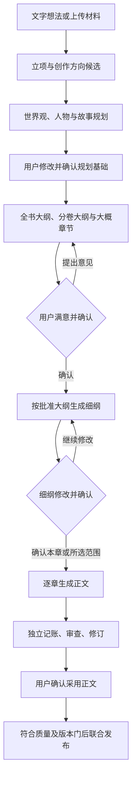

# 统一 IP 创作平台最终实施方案 v1.7

版本：1.7。状态核对：2026-10-28。本文件定义统一产品范围、项目决定及验收边界；实际实现、安装与模型资格见 [实施状态](IMPLEMENTATION_STATUS.md)。

连续创作与润稿范围：作者写作台支持连续1—10章与逐章精修两种节奏，预置番茄投稿前润稿Skill，区分官方规则与编辑经验，保留前章候选状态、主线/高光保护、显式采用及独立审稿。详见[连写与润稿契约](NOVEL_BATCH_AND_EDITORIAL.md)，纳入R151—R154，不降低原规划和发布门禁。

v1.6 新增名字素材/批量起名、题材专业知识采集与写作 RAG、shuohao 外部 Skill 下载编辑和持续更新，详见 [完整增补与实施边界](CREATIVE_RESEARCH_AND_NAMING.md)。这些均为必需范围，按公共底座→完整小说→漫剧/游戏的原顺序实施；方法包接入不能代替小说专业交互验收。

本文件统一 v1.1 完整范围及 v1.4.1—v1.7 新增需求，是当前产品实施入口。技术栈 Vue 3/TypeScript + Go/Echo v5 + MySQL，Temporal 持久调度。完整保留三条专业产线；先 F01—F08公共底座及F09统一记忆，再 N01—N12 完整小说及支撑，后续漫剧、游戏与联合验收。

## v1.7 统一记忆与小说优先决定

角色与视觉资产范围：小说与漫剧共用可视化角色库，包含卡片、姓名/关键词检索、时间化关系图、直接编辑、完整常用属性及头像/三视图/服装/道具资产；漫剧批量导入保留稳定 ID 和版本来源，改编造型独立版本，更新经差异与确认传播。详细契约及实现边界见 [角色库与跨媒介视觉资产](CHARACTER_ASSISTANCE.md#0-共用可视化角色库)，R147—R150 为新增必需项，不替换既有范围。

新增F09为F02/F03/F04/F05/F07/F08之间的记忆集成工作包，不另起事实数据库、调度器或替代原工作包。完整契约见[统一创作记忆架构](UNIFIED_MEMORY_ARCHITECTURE.md)，实际交付状态见 [实施状态](IMPLEMENTATION_STATUS.md)。R001—R130全部保留，R131—R146追加追踪。

采用Go上下文编译器、MySQL权威持久化、混合RAG与版本化关系、默认有界本机LRU；Valkey是可替换共享缓存，Windows没有经过核实的官方原生发行时不强制引入。缓存不可用或全失仍须正确回源，不独占短期草稿、任务或费用状态。首期不增加必需Neo4j/Qdrant服务；只有真实容量指标证明必要才扩展检索基础设施。

| 记忆层 | 解决的问题 | 正确性边界 |
|---|---|---|
| L0原始档案 | 原文、附件、获批正文和媒体资产可回查 | 不可变hash及定位，摘要可下钻 |
| L1叙事核心 | 主线、主题、人物核心、世界硬规则、必保高光不被长文冲淡 | 作者确认版本；必要项不依赖向量top-k |
| L2长期结构/阶段状态 | 关系、认知、事件因果、伏笔、服装/伤势/道具随故事变化 | 分支、发生/知情时间和来源明确，不覆盖历史 |
| L3中期摘要 | 场景/章/卷/全书压缩，保留未兑现承诺 | 来源修订与覆盖范围，源变更则失效，从原文重建 |
| L4短期工作记忆 | 当前任务、近文、作者反馈、草稿和执行进度跨重启 | MySQL checkpoint持久保存，缓存仅加速 |

作者意图/未来计划、已发生事实、外部专业知识、未采用候选分别管理；人物信念不等于事实。先做权限、分支、时间、视角与撤销过滤，再混合实体/别名、结构化关系、关键词与语义检索。Writer的隐藏创作约束和可表达知识分开；Bookkeeper从实际正文独立提炼，Critic用独立上下文复核。生成与摘要只能提出候选，不能自行改正史。

每次生成输出可审计MemoryManifest，列出来源/版本、纳入理由、预算与缺口；被排除原因不得泄露秘密内容。必要锚点及依赖闭包放不下时拆任务、选已确认短版本或明确阻塞，不静默删掉人物/主题/高光。跨媒介使用同entity_id和明确资产版本，建立源高光到目标场景/镜头/任务的覆盖映射；省略或意义改写需要作者决策。图像参考和固定seed不是视觉一致性保证。

主题/高光覆盖既检查ID与前置条件，也需要独立语义审查；不把“出现同一个关键词”或一次召回命中当成作品不变味的证明。最新版本技术升级、记忆schema变更和文学质量分别验收，方便定位回归。

## v1.7 当前实施快照与版本边界

截至 2026-10-28，Go/Vue/MySQL 公共能力与小说作者流程已有代码和本地验证；八套完整原创预设、免费的一句话入口、一页可编辑方案确认及阶段写作台已实现。工程实现、安装状态、供应商资格和作品质量分别记录，详细状态见 [实施状态](IMPLEMENTATION_STATUS.md)。旧 Python/React 首章原型仅作历史参考。

| 项目 | 当前技术与产品范围 | 验收边界 |
|---|---|---|
| 工具链与运行 | Go 1.27.3 / Vue 3.5.44、MySQL 9.7.4 LTS Community；Python 3.12.15 用于嵌入/OCR 等专用工具 | 版本与组件依赖见 [社区免费基线](COMMUNITY_STACK_BASELINE.md)，安装步骤见 [本地安装](LOCAL_INSTALL.md)；构建不证明业务或模型质量 |
| 统一记忆 | 上下文编译、持久修订/checkpoint/manifest、RAG、生成门、摘要与依赖传播接入小说流程 | 本地验证不替代真实长篇容量、语义保真和文学质量验收 |
| 小说作者流程 | 建书、角色、资料、规划、连续写作、精修、独立记账/审查、卷审、图片及成书导出已有工程实现 | N12 真实供应商、连续章/完整短卷、30 万字级长篇及独立人工审读仍待验 |
| 漫剧与游戏 | 共享身份、资产和变更契约保留 | 专业生产流程分别属于第三、四期，当前未交付 |

本表提供范围概览；具体检查结果、部署边界及未验证项由 [实施状态](IMPLEMENTATION_STATUS.md) 统一维护。环境切换须保留原数据、副本恢复和回退记录。

## v1.7 执行顺序与风险分层验收

实施顺序为公共底座及完整小说优先；漫剧、游戏保留后续阶段完整范围，不自动并行开展专业产线。常规维护按既定约束执行，作者对主题、大纲、细纲及内容采用的确认由服务端单独记录，研发推进不代替作者决定或费用授权。

| 节点 | 交付成果 | 集中出口 |
|---|---|---|
| U1 | 保存新版工具链与隔离数据库验证；记录Python兼容例外，生产数据升级按副本分段进行 | 升级、回退和关键驱动/解析兼容记录；不以换版本阻断可复用功能开发 |
| F09-A/B/C | 编译器→持久修订/checkpoint/manifest→API/Vue→RAG与生成接入→增量摘要和失效 | 一次真实数据库/浏览器纵向闭环，记忆隔离反例与长文本性能 |
| F-close | 合并已有F01—F08成果，关闭实际剩余缺口 | 底座出口及新增表备份/日志/删除/恢复的集中检查 |
| N-entry / N-plan | 小说持久领域、八套预设与一页确认入口、批量角色/起名/专业资料、世界/主题/大纲/细纲反复确认 | 无Key手工编辑和草稿恢复可用；创作阶段门服务端生效 |
| N-write | 正文/续写/局改、独立记账/审查/修订、按授权连续章与角色修改传播 | 连续章节、取消/重启/过期采用/联合发布；真实模型资格另记 |
| N-book | 卷审、全书管理、图片、EPUB/PDF、自动备份和可用说明 | 文件实开/视觉检查/恢复；N12长篇、标注集和人工质量如实记录 |

平时只执行改动范围的编译/类型与有效行为反例；低风险文案/样式不重复全套测试。权限、跨分支/未来泄漏、并发采用、费用、不可变正文和恢复必须有定向验证。数据库迁移、浏览器、整卷、长篇压力、恢复与真实模型质量在相应里程碑集中验收；没有相关代码/依赖/数据改变时复用已有证据，不反复重跑全仓。失败修复后重跑受影响项，不能用“减少验证”跳过关键边界。

30万字夹具可用于容量/状态检查，不能代替真实文学质量。收费模型或外部人工评审没有授权时，先完成全部不依赖它们的开发，精确列出待验和费用上限；不能标“全部完成”，也不能靠静默降级质量门结束。未知收费结果不重发，恢复执行不扩大已有费用范围。

## 统一决定与冲突消解

| 检查项 | 最终决定 |
|---|---|
| 首章快速原型与完整交付 | 首章仅为历史原型/开发样例；不替代完整小说和公共底座 |
| 必填表单与一句话/附件 | 必填的是需要确定的答案；Agent 可代拟字段，用户确认后采用 |
| 自动保存与满意才保存 | 自动保存为私有草稿；正式采用必须明确指向具体候选版本 |
| 自动调度与作者确认 | 调度可自动执行已授权步骤，到世界/故事规划、大纲、细纲和产物采用点持久等待；不代选 |
| 先规划与随时手写 | AI 正文必须依赖有效已确认细纲；随时允许手写/导入草稿，草稿不绕过发布质量门 |
| 全书规划与长任务 | 首次写作前完成全书大纲和暂定章节；细纲可分卷分批，当前章必须已确认 |
| 两轮修订与反复修改 | 两轮仅限制单次自动纠错；用户继续修改不受限制，但实际费用受授权预算控制 |
| 角色删除与历史保留 | 支持当前故事移除、职责承接和相关修文；不是仅归档，也不等同剧情死亡；历史修订留存 |
| 附近修文与全书一致 | 附近优先预览和局部改动，仍检查远端伏笔/因果；未完成覆盖不得报无影响 |
| 用户采用与质量发布 | 作者选择、独立审查、正史发布分别记录；有阻断不能因用户满意而宣称一致发布 |
| 五家模型与图片 | 五家文本协议必备；图片按能力实际路由，至少一个真实生图/编辑适配在小说阶段交付 |
| 分类与热门 | 版本化官方分类与模板先可离线使用；热门须有时间/来源/样本/指标，抓取失败不伪造热度 |
| 单人开发与权限/独立审读 | 简化部署和操作，不取消项目隔离及基本角色；AI不冒充真人质量审读 |
| 本机环境与隔离工具 | 可用原生 Windows MySQL/Temporal 完成核心验证；受限外部脚本仍需真实隔离运行环境，不把普通进程当沙箱 |
| 自动研究与安装执行 | 允许来源的研究候选可入库和编辑；资格通过后才启用，不自动执行网上文件指令 |
| 研发执行与实际消费 | 开发、下载及本地验证遵循项目流程；付费模型、云服务和外部审读分别配置范围与上限 |

## 审查结果与实施次序

原R001—R125范围审查及R126—R130增补继续有效；统一记忆需求 R131—R146 及后续增补持续追踪：原15个章节、41项必要角色/服务、40个工作包全部保留；新增模型、协作生成、图片、批量人物、分类及章节修复均归入 F/N 必需项。上述冲突已有明确规则，范围冲突按本节项目决定处理。这是设计审查，不是可运行性或文学效果证明。

验收范围包括 MySQL/Temporal 版本兼容、五家真实账号与任务质量、图像编辑、BGE-M3 本机容量、文图解析、隔离工具、长篇及人工质量门。已有工程结果与未验范围见实施状态；真实供应商、指定图片型号和长篇文学资格仍待验，不因外部条件缺失削减需求或将未测记为通过。

实现顺序：F01真实数据库/身份/项目/运行环境 → F02共享IP/分支 → F03候选采用与联合发布 → F04调度/模型/预算 → F05摄取与混合RAG → F06能力中心 → F07变更 → F08运维；公共底座出口通过后再完成N01—N12。不用静态下拉框、固定样文、占位图或空方法代替真实能力。

详细技术、编码规范、需求追踪分别见 [技术架构](ARCHITECTURE.md)、[编码规范](CODING_STANDARDS.md)、[完整需求追踪](REQUIREMENTS_TRACE.md)。[v1.1范围基线](reference/V1_1_BASELINE.md)保留原业务范围和验收标准；其被上述明确决定替代的技术与组织安排不再生效，其余完整专业工序与质量门保留。

## 一、完整范围、阶段与验收

本方案以《统一 IP 创作平台最终设计方案 v1.1》为完整功能与质量基线，按“公共底座 → 完整小说 → 完整漫剧 → 完整游戏 → 全平台联合验收”实施。分期安排建设顺序，不删减专业工序、必要支撑系统或正式验收目标。首章样例只用于纵向验证，小说模块保留完整交付范围。

原业务范围与历史设计见 [v1.1 基线](reference/V1_1_BASELINE.md)。逐项归属见 [需求追踪表](REQUIREMENTS_TRACE.md)，第一期的执行任务见 [第一期实施计划](engineering/plans/2026-10-24-platform-foundation.md)。

新增必需体验见 [五家模型、小说向导与角色管理](MODELS_AND_NOVEL_ENTRY.md)：后台自填 Key，默认支持 ChatGPT/OpenAI、Claude Opus、DeepSeek、Qwen、Gemini；新建小说采用八套完整预设、一句话或附件输入及一页可编辑方案确认；必要信息仍须明确，角色可随时新增与版本化编辑。

协作式创作完整契约见 [内容完善、图片与先规划后写作](ASSISTED_CREATION_AND_PLANNING.md)：输入文字/附件，Agent 完善，用户满意后采用；大纲和章节确认后生成细纲，细纲确认后才写正文。此规则覆盖旧版本默认代选和直写第一章路径。

角色协作详见 [批量角色、标签属性及章节修复](CHARACTER_ASSISTANCE.md)：自然语言批量创建和一句话完善，分类参考与热度证据分开，增删改角色能生成局部章节修订而非只提示影响。

### 1 范围解释与优先级

范围解释以本方案的现行项目决定和需求追踪表为准；v1.1 保留完整业务范围与验收基线。v1.2 的“最小底座、首章先用”和 v1.3 系列的技术迁移计划只保留已实现成果及有效技术决定，不再限定完整产品范围。

| 事项 | 项目决定 |
|---|---|
| 功能需求 | 保留 v1.1 的 IP、正史/分支、共享知识/RAG、调度、变更传播、能力中心和三条专业产线 |
| 开发组织 | 采用精简维护方式；人员配置不构成启动前置条件，权限角色与独立质量审读要求保留 |
| 使用身份 | 首位所有者可兼任内容与技术维护角色；保留基本登录、角色权限、项目隔离与审计，不因目前只有一个人而删掉权限模型 |
| 主技术栈 | Vue 3 + TypeScript、Go + Echo v5、MySQL；Echo v5.4.2；Go 1.27.3 / Vue 3.5.44已验证构建，其他版本边界见v1.7快照 |
| 调度 | 恢复 v1.1 的 Temporal 设计，改用 Go SDK；不再以自制串行队列替代统一持久化调度 |
| RAG | 完整保留结构化约束、关键词、语义向量、依赖补充和上下文水位；不能只有全文搜索 |
| 部署 | 优先本机私有部署，统一启动管理；保留可迁移 Linux 部署与对象存储适配。云开通和外发不自动发生 |
| 专业质量 | 保留 v1.1 阈值和真实成品证据；独立人工审读不能用多个 AI 角色冒充 |
| 预算 | v1.1 的团队人月和总预算是历史估算，不适合作为单人现金支出额度；所有收费继续默认关闭 |

技术更换属于实现适配，不改变业务语义。原文要求的两轮自动小说修订、长篇容量、完整导出、技能研究与评测均恢复为正式范围；旧原型的一轮修订与单章能力只作历史对照。

### 2 五期总览

| 阶段 | 交付目标 | 必须交付的实际能力 | 退出依据 |
|---|---|---|---|
| **第一期：全平台公共底座** | 后续模块共享一套真实服务 | 身份/项目、IP 与分支、发布/产物、混合 RAG、Temporal、模型预算、依赖变更、能力中心、审计/备份，以及这些能力的 Vue 操作页面 | 三个隔离 IP 和带分支的真实测试资料完成摄取、检索、版本发布、变更、重启恢复、技能入库与编辑；故障/越权反例通过 |
| **第二期：完整小说及支撑** | 用户能持续创作、修订、管理和导出一部长篇 | 七角色完整方法，立项/开篇、事件图、卷章/beat、正文、独立记账、审查修订、整卷体检、成书导出；小说使用到的公共系统全部生产接通 | 真实连续章节与整卷闭环，持久恢复、改稿传播、EPUB/PDF 实开；另完成 30 万字级和原质量门资格，不以第一章替代 |
| **第三期：完整 AI 漫剧** | 同一 IP 可制作并继续编辑漫剧 | 七类专业职责、三哨兵、来源/改编、资产、声音定时、分镜、真实镜头、剪辑、局部重做、可编辑工程 | 60—120 秒困难试片，再完成 10 集各 2—3 分钟系列与 Resolve 编辑回出；无缺失工序 |
| **第四期：完整游戏与运行期 AI** | 同一 IP 形成真实互动战斗切片 | 十一角色及 Numeric、全范围取证、规则/数值、叙事、美术、Phaser 工程、可信存档、两个有记忆 NPC、BOSS 和隔离试玩 | 20—30 分钟切片、4 技能、2 NPC、双阶段 BOSS、至少 2 结果；仿真/实际操作/状态防伪/试玩标准通过 |
| **第五期：联合版本与全平台长跑** | 三条产线协作且能长期维护 | 同 IP 联合发布、全类型局部变更、技能撤销影响、全量恢复、升级与清理、容量和费用复盘 | 三类正式产物对应同一兼容清单；跨模块故障及变更演练、干净安装和全平台恢复证据齐全 |

第二期交付不依赖第三、四期的专业生产界面。第三至五期不能成为补做小说必需功能的借口。第五期验证的是跨媒介组合，公共依赖、撤销、恢复和变更机制在第一期就实现，小说中的实际传播在第二期验收。

第一期完整并不意味着先完成漫剧导演或游戏引擎：公共机制必须实际工作，专业适配在所属模块实现。测试用产物只能证明公共机制，不得展示为真实生成的漫剧或游戏。

### 3 第一期的公共底座

| 工作包 | 必须完成的行为 | 首期操作与证据 |
|---|---|---|
| F01 环境与工作区 | 锁版本、MySQL 迁移、Temporal 持久化、身份/角色、项目隔离、健康检查、配置与密钥管理 | 从干净环境启动；所有者/编辑/发布维护/只读权限反例；3 IP 数据隔离 |
| F02 IP 与分支 | 稳定实体，事实/信念/陈述/意图/假设，事件、能力/职业功法，发生/记录/可知时间，锁定项，单父分支与三方合并 | 同名角色、谎言、倒叙、分支例外、组合角色映射可表达；冲突与语义待定可见 |
| F03 版本与产物 | 不可变内容、来源锚点、作品/正史/产物/能力版本、候选和发布清单、依赖就绪检查 | PREPARED → READY → PUBLISHED 分开；旧任务与重复操作不覆盖；失败后旧发布版可用 |
| F04 统一调度 | 父子任务、阶段落盘、等待/暂停/取消/恢复、执行代号、幂等、预算；五家模型适配、后台 Key/目录/角色绑定和配置快照 | 真 Temporal 重启与业务库对账；取消后晚到结果拒绝；未知付费结果不自动重发 |
| F05 知识与 RAG | 四类知识空间，导入覆盖账本，全文+向量+结构约束，别名，权限/视角双过滤，原文证据与水位 | 实际本地向量生成；相同专名跨 IP、角色秘密、旧版索引、无答案、长上下文反例 |
| F06 Agent 与 Skill 中心 | Agent/Skill/Tool/Recipe 分离，预设清单、完整包导入、研究/分析/适配/隔离评测、编辑/差异/发布/回滚、血缘撤销 | 真实公开来源候选抓取与人工附件；不可执行候选不激活；上游冲突不覆盖本地编辑 |
| F07 变更与发布 | 六类依赖边、差异闭包、语义补查接口、四类影响、估算、冻结、局部重建、outbox 与去重 | 一个能力约束变更只影响相关资料；冻结仍可见；无关内容 hash 不变 |
| F08 安全与运维 | 资料等级/供应商白名单、审计、限权下载、指标、备份/删除/恢复、执行隔离、任务维护页面 | 自动备份和隔离恢复真实执行；撤销不复活；调试包不含密钥；时间控制测试清理期限 |
| F09 统一记忆集成 | 五层记忆、核心契约/高光、时间/视角上下文编译、持久checkpoint/manifest、有界缓存及增量失效 | 复用F02—F08；真实持久/API/Vue闭环、关键隔离反例、恢复登记；单元通过不等于整包交付 |

F06 在第一期交付完整的管理和研究机制、公共能力方法与测试，第二期补齐所有小说专业评测和可发布能力基线。未来媒体/游戏角色在能力总账中有明确责任与交付阶段；没有真实工具和证据的角色不得激活，不能放一个名字就算预置完成。用户不用自行搜索或补写缺失方法。

#### 保持 Go/MySQL 的技术实现

正式数据库基线为 MySQL 9.7.4 LTS Community；升级须在独立副本验证并保留旧数据和回退路径。新安装默认9.7.4，旧目录不得直接交给另一版本，26.10不再是目标。详细版本及兼容策略见[社区免费基线](COMMUNITY_STACK_BASELINE.md)。JSON用于扩展字段，关系、版本、金额、权限与索引用显式类型；Temporal使用Go SDK与独立持久化/可见性库和账号。

Temporal 1.32.1/mysql8驱动已在MySQL9.7.4 LTS两个随机隔离库通过持久化schema1.19及visibility schema1.14的真实建表、升级和重入检查，共8次调用成功；测试库已清理。此证据只覆盖空库DDL，不代替Temporal服务、工作流历史、重启回放或存量数据迁移资格。最终切换前集中验证这些组合，不因驱动名称推断兼容。[Temporal 持久化说明](https://docs.temporal.io/temporal-service/persistence)。

RAG 保留 BGE-M3 dense 1024 维。首期采用本地受控嵌入工具进程，使用模型官方支持的 Python 推理路径；Go 仍拥有 API、权限、编排和所有业务写入，嵌入进程只接收限定文本并返回向量，不能访问业务数据库和供应商密钥。这明确覆盖此前“新版运行完全不含 Python 工具”的过度限制，不恢复 Python 业务后端。[BGE-M3 模型卡](https://huggingface.co/BAAI/bge-m3)。

向量按固定编码存入 MySQL BLOB，记录维度、归一化、模型 revision、原文 hash 与所属版本。Go 对权限和有效快照允许的完整候选集合分页执行精确相似度计算，与 MySQL ngram 全文结果作 RRF 融合；不能先用关键词筛掉全部语义候选。必要约束独立装配，不参加相似度淘汰。正式 30 万字级场景实测内存与延迟；没有指标不得宣称性能达标。此方案保留语义能力而不增加独立向量数据库，也不假定 MySQL 社区版具有未核实的向量索引功能。

对象层第一期同时实现本机不可变目录驱动和 S3 接口驱动，具有一致的内容校验、引用和撤销语义。本机驱动是默认可用配置；S3 用本机兼容服务或隔离测试端点完成契约验证，真实云账户端点的资格另记，不自动采购 Amazon S3。Windows 使用可控的 WSL2/Linux 工具执行环境，安装器做预检与统一启动；隔离环境不可用时不运行外部脚本，不能用普通宿主进程伪装隔离。

#### 长任务与外部费用

Temporal 是唯一持久编排中心；MySQL 保存领域任务投影、调用账本、预算和提交状态，不再维护第二套竞争的调度器。Workflow 不执行直接网络/文件/数据库 IO，实际工作在 Activity；历史只存引用与 hash，卷章分段，并按需要 Continue-As-New。[Go SDK](https://docs.temporal.io/develop/go)、[历史分段](https://docs.temporal.io/develop/go/workflows/continue-as-new)。

收费 Activity 的自动尝试默认限制为一次。调用先写 operation ID 与费用预留；响应丢失进入 outcome_unknown，通过供应商查询和账单对账解决；Temporal 重放或 Activity 重试不能重新发送同一个不明收费请求。可重复的本地索引、校验和 outbox 消费可有限重试。小说仍可串行生产，未来单批次外部媒体作业最多 2 个，不需要为每个 Agent 起服务。

### 4 第二期完整小说工作台

第二期包含小说专业功能以及所有在实际写作中需要的配套能力。单章、连续章、整卷和全书是同一数据与版本模型的不同尺度，不能拼成互不关联的工具。

| 工作包 | 作者实际能做什么 | 必需后台能力 |
|---|---|---|
| N01 立项与导入 | 以新建小说为入口，通过八套预设、一句话或附件与一页方案确认作品信息、故事方向、叙事篇幅、初始角色及创作模式；自动辅助立项与开篇，导入已有小说继续写 | 文图附件覆盖、字段候选、Brief 推导、开篇比较与用户确认、全部指定素材的覆盖账本、原文锚点、导入失败定位 |
| N02 世界与人物 | 自然语言批量新增、编辑、归档或从故事删除角色；标签联动属性、模板与一句话完善；编辑关系/组织/地点/职业功法/秘密/时间线，查看版本和章节影响 | 独立 IP 库、事实/认知区别、能力约束、事件因果图、来源及锁定项；人物/场景参考图生成编辑与采用 |
| N03 全书卷章规划 | 看全书/卷/章结构、人物弧线、伏笔计划；改章卡、beat、视角、前置条件、目标变化和结尾钩子 | Planner、世界/故事规划确认、全书/卷大纲及大概章节反复修改、确认后细纲、逐章细纲确认门、事件依赖与跨卷状态 |
| N04 正文创作 | 自动写、手写、续写，选择段落或 beat 局部重写；角色增删改后协助修复附近及有依赖章节；保存草稿、比较并采用局部补丁、恢复旧稿；重开继续 | Writer、精确改动区、版本校验、持久自动保存、编辑与轮询隔离、断线恢复 |
| N05 记账与审查 | 看到事实、信念、事件、资源、伏笔的实际变化，以及有位置和依据的问题 | 独立 Bookkeeper、确定性规则、独立 Critic；结构和语义结论分开，不把歧义当事实 |
| N06 修订与发布 | 自动按问题最多修订两轮，失败保留稿件；手改后重新审查；按授权推进普通章节 | 新上下文、局部差异、重抽取、独立复核、角色/正文/账本/索引联合发布；跨章补丁依赖组不能部分形成假一致版本；重大锁定项变化保留完整变更单 |
| N07 长篇连续生产 | 批量规划、逐章生成、暂停/取消/隔日恢复；章/卷摘要下钻原文；处理前章改动 | Temporal 卷/章流程、长记忆、费用累计、过期上下文失效、影响范围和局部重做 |
| N08 卷审与全书体检 | 看人物发展、因果、关系、伏笔回收、节奏及跨卷矛盾；按报告定向修订 | QA、整卷与全书上下文策略、独立质量报告、严重问题关闭记录 |
| N09 成书与导出 | 设置书名/作者/简介/目录，导出 Markdown、TXT、EPUB、PDF；重新导出指定已发布版本 | 封面文字/参考图协作生成编辑、用户确认采用；目录和正文一致、中文字体与分页、完整文件校验、EPUB 实开、PDF 视觉检查 |
| N10 能力与知识维护 | 在工作台编辑方法、查看新技能建议、比较评测、发布/回退；资料自动更新与失效可见 | 四研究角色、项目私有派生、三方合并、保留集、资格/撤销、公共方法脱敏推广 |
| N11 日常可靠使用 | 看任务、预算、模型配置、失败恢复和备份；管理多部小说，不丢稿、不串库 | 首期全部公共系统实际接线，自动备份、恢复演练、升级迁移、可读故障提示 |
| N12 正式资格 | 使用真实模型完成连续章、完整卷和正式长篇，核对成品和长期状态 | 固定能力清单、质量样本、独立标注与审读、30 万字级运行、真实费用与时长 |

#### 七角色不能降为提示词壳

Director 控制生产、预算、恢复与关卡；Architect 负责立项、开篇和世界事件；Planner 负责卷章和 beat；Writer 负责正文和局部修订；Bookkeeper 从实际正文独立抽取；Critic 用独立上下文审查；QA 包含确定性校验、整卷专业评价与导出验证。Director/QA 中确定性部分由程序执行，QA 的文学评价不能仅凭硬规则伪装已实现。

每个角色交付完整方法、输入输出 Schema、工具绑定、正常例子、关键反例、失败路径、模型配置、预算、恢复和交接规则。小说 Recipe 默认最多两轮自动修订；同一任务的尝试、模型更换和修订合并计费。角色不因换框架失去专业工序，必要能力随安装包提供，关闭网上发现也可正常生产。

#### 一次实际写作体验

作者选择预设，以一句话或附件完善并在一页方案中确认建书设置（无 Key 也可建书和手写）→ Agent 完善世界观、人物、故事规划并供反复修改 → 用户确认规划基础 → 生成全书/分卷大纲和大概章节 → 按用户意见反复修改并确认大纲 → 生成细纲并修改确认 → 按本章有效细纲装配可知信息和隐藏约束 → 逐章写正文 → 独立记账、检查与审查及至多两轮自动修订 → 用户满意后确认采用 → 通过质量/版本门联合发布 → 更新账本/摘要/伏笔。后续章节仍须具有已确认的有效细纲。用户继续修改的次数不受自动修订上限限制；不会在候选生成后未经确认自动推进。

作者随时可以手改、局部重写、切回旧稿或中断任务。系统保留版本与未保存内容，改前章时明确标出哪些后章需复核，按计划重做受影响内容，不重新生成全书。到卷末主动给出卷审报告，完成后导出真正可读的 EPUB/PDF。用户主要做创作选择和阅读，不需要先配置七个 Agent 或为每章调提示词。

### 5 能开始写与正式资格分别记录

| 记录 | 达成条件 | 可以宣称什么 |
|---|---|---|
| 工程闭环 | 真数据库、任务、检索、编辑、导出、恢复测试通过；模型传输可用夹具测试故障 | 代码与本地机制通过，不能宣称真实文学效果 |
| 创作流程可用 | N01—N11 必需功能接通，阅读、手改、续章、复核、导出与恢复具有本地验证；真实模型连续章/完整短卷效果单独验收 | 可使用既有创作流程；实际生成效果与质量资格按所选模型状态披露 |
| 小说正式资格 | 完成 v1.1 规定的 30 万字级约 3 卷、语义保留集和人工质量门 | 完整小说模块在规定范围取得正式验收资格 |

内置助手试写与正式资格分开：已配置可用模型并启用相应预算后，可按受控试用流程生成私人候选，不要求先完成 N12 的 200 样例/600 请求资格套件。试写不授予专业资格；正式独立审稿及发布仍须通过对应模型、方法和版本的有效资格与质量门。真实供应商可用性、长篇文学质量和指定图片型号分别待验，不能由本地替身或一次试写推定。

这三个记录不能相互顶替。第二期交付不能留下 N01—N11 的必需空缺；正式资格尚未通过时保持待验，不能把一章成功改名为长篇验收。创作流程可用后可以开始自己的作品，正式规模和质量验证仍属于第二期工作，不甩到第五期。

原质量门保留：至少 100 个标注缺陷与 100 个正常/允许样例，总体 precision 和 recall 均至少 90%，并披露分类表现；编辑审读正式 30 万字级作品，第二审阅者抽读至少 20% 章节和全部关键转折，五项平均至少 4/5、无维度低于 3，严重矛盾和泄密关闭。分歧超过 1 分增加第三方裁决。AI 独立上下文评测不能冒充两名真人审读；尚无有效独立审读证据时，相关记录为 NOT_RUN。

不让真人评审缺位阻止草稿编辑或掩盖功能缺失。需要外部付费审读时先给具体候选方案、范围和报价，再取得费用授权；外部审读安排和费用须由项目维护者确认。用户不承担修复基础技能的研发义务。

### 6 第三至五期保留的完整范围

第三期按 v1.1 顺序完成来源/分支 → 剧本/节拍 → 分镜 → 人物服装场景道具声音资产 → 配音和专名 → 定时关键帧 → 动态分镜 Draft → 真实视频与适用口型 → 音乐音效字幕 → 三哨兵 → 审片返工 → Final → 可编辑工程。默认轻动画，必要动作不能用静帧隐藏失败；镜头原尝试加至多两次定向重做。交付 OTIO、源素材、音频分轨、SRT/ASS、时间线 IR、MP4、迁移损失报告，固定 Resolve 实际修改镜头、字幕和配音后回出。正式范围为 10 集、每集 2—3 分钟、竖屏 1080×1920/24 fps、最多 6 名主要重复角色；保留原审片质量门。

第四期保留 Producer/Intake/Ingest/Fact/Concept/World/Narrative/Art/Slice/QA/Critic，Numeric 为 World 专业能力；完成覆盖账本、Source Bible、玩法候选、职业功法技能与资源规则、互动叙事、数值模拟、完整资产、实际 Phaser 工程及运行证据。正式切片 20—30 分钟，1 职业、1 功法、4 技能、2 个可记忆 NPC、双阶段 BOSS、至少 2 个可达结果和存档恢复。

游戏规则继续为同一 TypeScript 内核供浏览器与受限 Node 重放器使用，Go 负责会话、接口、任务和权威提交，不重写第二套伤害公式。运行期 NPC 按 project/branch/build/save/npc 隔离，保存回退不带入未来记忆；每会话一轮在途，默认每分钟最多 6 次、最近 12 轮、输入 6,000/output 400 tokens，8 秒超时回退。BOSS 用预验证战术；对话在非战斗点进行，主线不依赖云模型可用。保留至少 60 个 NPC 场景、5 名独立试玩者中至少 4 名完成引导、原评分和状态可信性标准。

第五期验证能力条件、服装、台词、游戏数值、组合人物、Skill 更新/撤销等不同变化的实际闭包；冻结不断开影响，回滚创建补偿版本。先验证每模块实际适配，再验证联合兼容清单；不通过一次强制重生成三产线冒充局部更新。完成 3 IP、1 批次生产、最多 2 个外部媒体作业、最多 5 个内部试玩会话的容量记录，以及跨模块升级、恢复、删除、权限和费用对账。

后续工作包的范围固定如下。临近实施时细化文件与测试步骤，不能以尚未细化为由删掉工序。

| 工作包 | 固定交付 |
|---|---|
| M01 | 来源绑定、改编分支与多对多角色映射 |
| M02 | Showrunner、集结构、剧本、节拍、Shot IR 与镜头预算 |
| M03 | 风格手册、人物/服装/场景/道具资产、参考图及版本 |
| M04 | 声音指导、专名读音、配音、对白时间、默认音乐/音效来源 |
| M05 | 关键帧、定时分镜、真实视频、适用口型和受控重做 |
| M06 | 剪辑加工、音画字幕与三哨兵、问题归因和定向返工 |
| M07 | Final、完整源素材/分轨/字幕/OTIO/IR 与 Resolve 实改回出 |
| M08 | 试片及十集正式资格、媒体技能实评、变更/故障/费用验收 |
| G01 | Intake、全范围摄取、素材覆盖账本 |
| G02 | Fact、Source Bible、来源证据和改编映射 |
| G03 | Concept、候选否决与可执行玩法承诺 |
| G04 | World、职业功法技能、资源、NPC/BOSS 及 Narrative 叙事图 |
| G05 | Numeric、模型范围、约束搜索、共享规则、仿真与不确定性 |
| G06 | Art、完整资源、Phaser 切片、输入反馈、胜败和交互 |
| G07 | Go 运行接口、受限规则重放、可信存档、NPC 对话/记忆/回退 |
| G08 | 隔离构建、独立来源试玩、受限桥接、工程与构建发布 |
| G09 | 正式游戏/60场景NPC/独立试玩资格、技能实评与变更恢复 |
| J01 | 同 IP 联合清单、跨媒介变更和能力撤销/回滚 |
| J02 | 正式容量长跑、总尝试费用与 P50/P95 记录 |
| J03 | 新装/升级、全平台备份恢复、删除与交付证据归档 |

### 7 支撑系统必须何时完成

| 支撑项 | 第一期 | 第二期退出前 | 后续扩展 |
|---|---|---|---|
| IP/正史/分支 | 数据、解析、锁定、合并、提升提案与界面可用 | 章节和全书实际引用、联合发布与重审 | 漫剧/游戏差异与多对多表现 |
| 混合 RAG | 真实向量、全文、权限、快照与上下文水位 | 长篇/视角/跨卷评测、索引恢复与不混版 | 媒体时间码、游戏/NPC 用途 |
| 技能中心 | 注册、编辑、研究候选、隔离评测、资格和撤销机制 | 全部小说预设、实际对照、上游合并和公开方法去私有化 | 媒体/游戏的真实产物评测 |
| 统一调度 | 真 Temporal、预算、恢复、父子流程和版本冻结 | 全书/卷/章生产，未知调用对账，停机恢复 | 外部视频等待、构建与短请求并行 |
| 变更中心 | 依赖类型、闭包、冻结、outbox、影响计划 | 改前章/人物/能力/伏笔/方法后的小说局部复核 | 逐镜、规则、资产及联合清单 |
| 发布和导出 | PREPARED/READY/PUBLISHED 与对象引用 | 真 Markdown/TXT/EPUB/PDF、完整书目目录 | 视频/编辑工程/可玩构建 |
| 运维 | 身份、审计、指标、自动备份、隔离恢复、删除策略 | 新装升级迁移，长篇丢稿/崩溃恢复演练 | 媒体大对象与存档恢复 |

网上研究默认每日增量发现、每周汇总评测，空闲且授权预算内执行；单缺口最多两轮，随后形成具体研发任务。候选入库不等于生产激活。没有收费许可时继续免费抓取、静态分析和本地检查，收费评测待授权，不能悄悄切成无评测发布。该频率属于产品内调度策略，部署时需显式启用相应任务。

备份/删除沿用 v1.1：发布引用项目有效期间保留；无引用候选 30 天、失败媒体 7 天、临时目录 24 小时、运行原始对话 30 天、调试材料 7 天、审计费用元数据 1 年、滚动备份 35 天。删除 T0 撤销访问，7 天限权回收、在线最迟 30 天、备份最坏 65 天到期；独立删除/撤销记录至少 1 年。RPO ≤15 分钟、RTO ≤8 小时为演练目标，不能用手动下载 ZIP 充数。磁盘损坏保障需要独立备份介质；未配置独立故障域时只能声明已验证的恢复范围。

### 8 费用、进度与完成纪律

不承诺固定几天完成全部平台。按 F/N 工作包给出完成证据，阶段内按独立可验证结果逐项推进；底座的真实贯通样例用于尽早发现集成问题，但不替代公共服务完整交付。

继续复用旧原型的业务反例、七份基础方法、已有接口语义和原创测试数据；不把旧 Python/React/SQLite 的测试成绩当成 Go/Vue/MySQL 结果，不为了复用原型而保留缩水功能边界。旧数据迁移包含原费用账本与未知调用，不能只导入正文。

免费开发与测试可自主执行。实际收费前给出这一次或这一阶段的任务范围、供应商、预估和硬上限，请用户授权；不把原 5,000 元小样、75 万元总投入或任何新预算当成授权。已有首章小额建议不能覆盖 30 万字质量验证。先用真实小批次的全尝试成本估算后续阶段，不凭最终字数承诺总费用。

当前实现、安装与资格状态见 [实施状态](IMPLEMENTATION_STATUS.md)，使用与启动步骤见 [本地安装](LOCAL_INSTALL.md)。旧栈首章、本地协议替身与工程验收均不能替代正式长篇质量资格。

## 二、模型配置、小说入口与角色基础

本节与 [模型及入口契约](MODELS_AND_NOVEL_ENTRY.md) 同步。

### 1 默认提供五家模型

后台“设置 → 模型与 Key”默认出现以下五家供应商，不需要用户安装插件、改代码或自行补适配器。只配置一家即可开始使用该家可胜任的小说能力，不要求同时购买五家服务。

| 界面名称 | 接入方式 | 产品约束 |
|---|---|---|
| ChatGPT / OpenAI | OpenAI API，默认 Responses 适配 | 显示真实 API 模型 ID；不把 ChatGPT 作为一个可发送的 model 参数 |
| Claude Opus | Anthropic Claude Messages API | 默认入口为 Opus 系列，不因账号无权限而悄悄换成其他 Claude 系列 |
| DeepSeek | DeepSeek 官方 Chat Completions API | 独立鉴权、用量、思考/输出参数与错误适配 |
| Qwen / 通义千问 | 阿里云百炼 / Model Studio 的兼容 Chat 接口 | Key、地域、工作区和端点必须配套，不能把兼容接口当成完全相同的模型能力 |
| Gemini | Google Gemini API，原生 GenerateContent/流式适配 | 保留原生内容块、停止/拒绝状态、用量与模型能力差异 |

协议依据：[OpenAI API](https://developers.openai.com/api/reference/overview)、[Claude 鉴权](https://platform.claude.com/docs/en/manage-claude/authentication)、[DeepSeek 鉴权](https://api-docs.deepseek.com/api/deepseek-api/)、[DeepSeek Chat](https://api-docs.deepseek.com/api/create-chat-completion/)、[Qwen 兼容接口](https://www.alibabacloud.com/help/en/model-studio/compatibility-of-openai-with-dashscope)、[Gemini GenerateContent](https://ai.google.dev/api/generate-content)。这些说明接口路线，不证明当前项目已完成接入或账号有权限。

界面以“ChatGPT”作为熟悉的品牌名称，实际填写 OpenAI API Key；本产品不读取用户的聊天登录会话或借用 Codex 的凭据。Key 由用户在后台输入，不发到聊天里。接口支持、账号可调用和小说任务质量资格是三个不同状态。

#### 后台配置

每家卡片提供：启用开关、连接名称、API Key、按供应商需要出现的地域/工作区、模型选择、默认角色用途、预算范围、保存、替换/清除 Key、检查配置和受控试用。普通界面使用官方端点预设；自定义兼容服务为明确的高级连接，不能篡改官方卡片后仍沿用原有资格。

具体模型由随产品提供的版本化目录和账号可访问列表共同确定。目录保存实际模型 ID、能力、参数范围、上下文/输出上限、价格来源/时间和已通过的任务评测；不在代码中只有五个品牌名。软件发布时必须附五家实际协议适配与已核对模型目录，不能让用户补模型协议。账号不可用或接口不支持列模型时，允许从预置目录选择或高级录入实际 ID，并明确待验证状态。

保存 Key 只执行保存，不自动生成文字、调用模型评测或测试扣费。配置检查先做本地字段与端点校验；仅在确认供应商该检查接口不计费时请求鉴权/目录，未知时不把生成请求伪装成免费连通检查。真实试用显示输入范围、模型与费用上限，按用户启用的预算执行。

状态分别显示：未配置、已保存未验证、鉴权可用、模型有访问权、任务资格通过、不可用/已停用。不能把 Key 非空、HTTP 200 或模型目录可见写成“小说能力已验证”。供应商失败时显示原因和可恢复动作。

#### Key 保存与权限

后台由工作区所有者或获授权的连接维护者配置。普通创作用户只能选择获授权连接，不能读取或导出 Key。保存响应只返回凭据引用、版本和脱敏状态，不返回明文；密码输入框保存后清空，不支持通过“显示已保存密钥”再次取回。

需支持应用重启后继续使用。凭据放独立加密凭据库，业务 MySQL 只保存引用。默认采用随机主密钥加密凭据文件，主密钥由宿主系统凭据存储或部署 Secret 管理，与密文分离；Go 在调用时按最小范围解密。Windows 本机与 WSL2/容器的服务身份和 Secret 注入路径分别实测，不能声称 Windows 系统凭据在 Linux 中天然可读。凭据库不可用时只允许明确的会话内保存，不能静默退成明文；该连接的正式持久保存状态应标为不可用，修复并验证后恢复。

Key 不进入浏览器存储、任务输入、Temporal 历史、提示词、日志、Git、业务数据库或项目备份。项目迁机后要求重新绑定凭据，不把解密密钥和密文打进小说备份。修改端点不得自动带着旧 Key 请求新域名；重定向不转发凭据。环境变量可以作为部署连接来源，后台只显示只读引用，不能读出值。

替换 Key 创建新凭据版本；停用/删除立即阻止新调用，在途请求保留已发生的结果与费用状态。凭据更新不改变模型、地域或资料外发范围，也不重发结果未知的收费调用。

#### 模型如何用于小说

作品默认有三个用途配置：创作规划与正文、独立抽取、独立审查。简洁模式选择一个主模型，抽取与审查继承其配置但使用独立角色上下文；高级模式可分别选择五家中的不同模型。无需用户逐一给七个角色写配置。Director 的预算/状态控制、硬规则 QA 不调用模型；文学评价走独立审查配置。

作品创建时继承工作区默认连接。只有一个已配置且任务能力合适的连接时自动选中；多个时优先工作区明确默认值，否则要求选一次。无 Key 时仍可新建作品、规划、手写和保存；AI 生成前明确提示配置模型并启用预算。不能把缺 Key 当成不能创建小说，也不能用固定样文假装生成成功。

每个任务冻结供应商连接 ID、模型 ID/版本、参数、能力与价格版本、Recipe/Skill、资料权限和预算，不冻结明文凭据。模型切换影响新任务；已启动任务保留原配置。若要重做，创建有来源关系的新尝试，累计原任务费用。默认无跨供应商自动回退；以后只有用户明确授权的备选清单可用于失败后新尝试，outcome_unknown 一律先对账。

五家共用 `ModelGateway`，各有实际适配器。统一结果至少包含文本/结构化数据、finish/refusal 状态、response ID、分项用量、实际模型标识及费用是否已确定。结构化输出、工具、流式、思考参数、token 计费按模型能力适配；不支持的参数不得盲发。只返回 JSON 不等于通过领域 Schema 或证据校验。价格缺失、用量不明、上下文不足要显示可处理状态，不能记为免费或零消耗。

内置助手试写与正式资格分开：已配置可用模型并启用相应预算后，可按受控试用流程生成私人候选，不要求先完成 N12 的 200 样例/600 请求资格套件。试写不授予专业资格；正式独立审稿及发布仍须通过对应模型、方法和版本的有效资格与质量门。真实供应商可用性、长篇文学质量和指定图片型号分别待验，不能由本地替身或一次试写推定。

### 2 新建小说作为主入口

首页主按钮为“新建小说”，旁边可选择“继续创作”。默认后台为新书建立 IP 和小说作品；也可显式选用已有 IP 的指定分支与快照。当前入口已实现八套完整原创预设、免费的一句话输入及一页可编辑方案确认；高级设置按需展开，附件和 AI 完善继续可用。纯本地预设建议不调用模型，不等于真实 AI 定制。设置草稿可保存、恢复及继续编辑，既有五步草稿兼容恢复。

历史五步向导已由当前入口替代。下表保留原方案的五组必要信息、默认值与记录契约，表示信息覆盖要求，不要求作者逐步填表；采用建书设置也不代替世界/故事、粗纲、细纲和正文的后续确认。

“必填”表示创建前有明确答案，可以采用预设值并确认；不强迫手填长篇材料。纯本地默认值不收费，AI 代拟按钮只有在模型和预算可用后执行。未选择和选择“不限制/由 AI 拟定”是不同值，后者保存为作者明确意图。

| 信息组（历史五步字段） | 必须明确或选择 | 预设与可选内容 | 完成后的实际记录 |
|---|---|---|---|
| **1 作品信息** | 书名；题材（可自定义）；从零创作/导入续写；新 IP/沿用已有 IP | 默认简体中文、新 IP；导入时必须有文件/文本，沿用 IP 必须选分支和基础版本 | NovelSetupDraft 的名称、来源和作品归属 |
| **2 故事方向** | 核心梗概或创作想法；主线目标/主要冲突；目标读者（可选大众读者） | 世界背景、主题、希望出现/避免的内容可补充；支持由已有想法辅助拆分后确认 | Brief、创作范围和禁止项，不直接生成已确认正史 |
| **3 叙事与篇幅** | 叙事视角；文风/基调；目标总字数；卷数；单章字数范围 | 默认第三人称限知、中文类型小说表达、30 万字/3 卷、每章 2,000—4,000 字，均可改 | 版本化创作配置；字数是规划目标而非强凑字数 |
| **4 初始角色** | 选择“我来设置主角”或“按故事方向让 AI 拟定主角” | 手动方式需至少一名主角的姓名/暂名、身份、核心目标；性格、背景、关系、秘密等可后续补充 | 人物候选或明确的待拟定任务；手动填入不等于模型评审通过 |
| **5 创作方式与确认** | 人工/AI 辅助模式；采用当前设置；核心设定保护策略 | AI 模式选已配置模型，或明确“稍后配置”；默认继承抽取/审查模型，预算默认关闭；保护策略默认锁定已确认核心身份/生死/世界上限 | 原子创建作品、初始设定候选和版本化配置，进入工作台 |

“由 AI 拟定主角”不在点创建时暗中付费。可以先完成创建；进入工作台后，生成流程先执行 Architect，产出真正的人物与设定候选并通过相应关卡，Writer 不得在必需角色和世界候选缺失时继续。手动方式也不要求一次建齐所有配角。

创建操作本身不启动全书生成。工作台按阶段提供“完善世界与故事”“生成大纲与章节安排”“确认大纲并生成细纲”“确认细纲”“生成本章”；始终可手动写作和导入正文。AI 动作共享已授权预算，但世界/故事规划、大纲与章节、细纲和生成结果必须由用户明确确认采用，不能自动代选。可反复提出意见并生成候选，自动暂存不等于正式保存；关键改动按版本传播影响。

#### 验证、保存与编辑

- 必填文本去空白后不能为空，错误就近标注；总字数、卷数和章字数需为正数，下限不得大于上限。自定义范围与当前产线能力冲突时给出明确原因，不偷偷改数字。
- 建书设置的编辑结果保存为私有草稿，服务端按版本更新；刷新或退出能恢复，保存失败保留输入。自动保存不包含 Key，不触发收费研究或生成。
- 最终创建用 operation ID 去重；重复点击、网络回执丢失不产生两本书。创建失败不留下已发布半本作品或孤立的新 IP；已有 IP 不被修改为新书内容。
- 创建后仍可编辑这些设置。书名/标签等展示信息与视角/大纲/锁定项等创作规则分开处理；后者形成新配置版本和影响报告，不把所有设置永远锁死。
- 导入长篇必须给出覆盖进度、未处理/失败单元及原文来源；导入成功不能仅表示读到了第一段。旧稿保留原文，不在导入时自动重写。

### 3 角色随时加入和编辑

扩展契约见 [角色批量创作、标签属性与章节修订](CHARACTER_ASSISTANCE.md)：一句话批量拟人设并编辑，选择题材/人物标签联动属性；增删改后可直接请 Agent 修复相关章节，用户比较并确认。

小说工作台常驻“角色”入口，编辑正文时也能打开角色侧栏。支持新增、搜索、修改、关系编辑、历史比较、恢复版本和归档；角色字段不局限于一张固定简介。

角色资料至少覆盖稳定 ID、姓名/别名、主要/配角等作品职能、身份与组织、外貌、性格和说话习惯、目标/动机、背景、能力/限制/代价、关系、秘密、信念、首次出现与有效故事时间、来源和锁定项。已确认事实、角色自认、传言与作者计划分别存储；角色年龄要绑定时间，不能被当成永久恒定的数字。

“随时编辑”允许随时创建变更，不表示能无痕覆盖历史：

| 情况 | 默认行为 |
|---|---|
| 尚未发布的初始角色候选 | 保存新候选版本，更新相应规划；正在生成的任务仍使用其冻结输入 |
| 新配角/后续角色 | 新稳定 ID、出场范围与时间，关系引用现有 ID；与锁定项冲突时显示问题 |
| 改名/新增别名 | 保留 ID，更新检索别名和未来配置；已写正文仅列影响，不全库替换字符串 |
| 作者备注/卡片排序 | 保存展示/备注，通常无需重审正文；不得把实质性身份修改伪装为备注 |
| 身份、亲属、生死、能力、秘密或知情时间变化 | 形成类型化变更，显示前后差异、受影响章节/伏笔/规划；按锁定与发布策略确认新修订 |
| 改编分支角色变化 | 只修改选定分支，保持原作人物不变；来源映射继续有效 |
| 归档角色 | 隐藏日常管理列表但保留历史检索，归档不等于剧情死亡或移出故事 |
| 从当前故事删除已引用角色 | 提出删戏/合并/指定人物承接方案，局部修复出场、关系、线索与因果；用户采用并联合发布后不再属于当前故事有效角色，保留历史实体和旧正文 |
| 回退角色资料 | 基于当前头建立补偿修订，重算影响；不恢复旧数据库覆盖后来内容 |

角色更新调用共享 IP 服务，不维护一套与设定库脱节的人物 JSON。提交同时产生依赖事件：相关章卡、章节、角色关系、伏笔和上下文缓存更新或标记复核，无关内容 hash 保持。任务提交时比较基础版本；旧任务结果保留为候选，不自动升为新正史。

### 4 数据与接口落点

| 对象 | 主要字段与约束 |
|---|---|
| ProviderConnection | provider、region/workspace、endpoint_profile、credential_ref、enabled、revision、权限；五家预置 |
| ModelProfile | actual_model_id、能力、参数/上下文范围、price_version、qualification_refs、catalog_revision |
| ModelBinding | work_id、用途、connection/profile/version；任务冻结，不含 Key |
| NovelSetupDraft | owner/workspace、历史向导 step、字段状态、revision、updated_at；未完成草稿不是正式作品 |
| NovelBrief / NovelConfig | 故事方向、风格、结构规模、保护策略、来源；版本化 |
| Character / CharacterRevision | 复用 IP Entity，作品职能、类型化属性/时间/证据与分支；稳定 ID |
| CharacterChange | expected_revision、差异、影响、锁定检查与发布状态 |

当前实现位于 `backend/internal/models/`、`backend/internal/credentials/`、`backend/internal/novel/`，通过 `backend/internal/service/models.go`、`novel_entry.go`、`novel_settings.go` 和 `novel_characters.go` 提供业务服务。界面入口为 `web/src/features/models/ModelsPage.vue`、`web/src/features/novel/NovelSetupWizard.vue`、`NovelWorkspace.vue` 及角色工作台；名称中的 Wizard 不表示当前界面仍要求五步填表。领域契约与代码对象不要求一一同名，实际资格仍按验证记录判定。

API 用例包含：保存/替换/停用连接、读取脱敏配置、读取模型目录、受控验证、设置作品用途绑定、保存/恢复建书设置草稿（兼容旧向导）、原子创建小说、读取/修改角色候选、预览角色影响、提交角色变更。所有有副作用操作采用鉴权、expected_revision 与 operation ID；不在 GET 中测试模型或生成角色。

### 5 分期归属与验收

第一期 F01/F04/F08 实现五家适配器、后台配置、持久凭据、模型目录/能力、网关和费用；F02/F03/F07 提供角色版本/分支/变更机制。第二期 N01 实现预设、一句话/附件与一页确认入口，并保留原五组信息与草稿恢复，N02/N04/N07 实现角色管理与写作联动，N05/N10/N12 完成不同模型的角色任务与质量资格。五家默认支持是必需范围，不因为只配置一家而删掉其他适配器。

| 场景 | 通过条件 |
|---|---|
| 五家协议 | 五个真实适配器分别验证请求、结构化结果、拒绝/截断、流式用量、未知结果和不重发；不能只有五个选择框 |
| 凭据生命周期 | 保存/替换/清除/权限/重启都正确；API 响应、日志、MySQL、Temporal 和项目备份无明文 Key |
| Qwen 地域与模型权限 | 不匹配明确提示，不能静默转发到其他地域/供应商 |
| 混合模型与独立角色 | Writer、Bookkeeper、Critic 可不同配置；相同模型也有独立上下文；切换不改变运行任务 |
| 模型验证费用 | 保存与本地检查零生成请求；收费试用受授权及预算控制，未知用量不记零 |
| 预设与一页建书 | 八套完整预设、一句话/附件、编辑确认和高级设置可用；必要字段校验、旧草稿恢复、缺 Key、导入失败及重复提交均可恢复且不重复建书 |
| 主角两种方式 | 手动主角字段校验；AI 拟定不暗扣费，生成正文前人物候选真实齐备 |
| 角色管理 | 新增/改名/同名/关系/秘密/分支/归档/回退均保持身份与历史，权限和锁定校验有效 |
| 角色改动与写作并发 | 编辑中不丢稿，旧生成结果不覆盖新头，受影响章可复核，无关章节不重写 |
| 真实供应商资格 | 有相应 Key 和费用授权后逐家真实连通与小说任务验收；没有 Key/授权记待验，不伪造通过 |

本增补不改变 v1.1 的任何既有专业工序、正式规模或质量门；只补充明确默认模型、后台操作和小说入口/角色的实际体验。

## 三、协作完善、图片及规划生产流程

本节与 [协作式创作契约](ASSISTED_CREATION_AND_PLANNING.md) 同步。

### 1 统一交互：用户提供材料，Agent 完善，用户确认

所有创作内容入口采用同一协作方式：输入简短文字、上传参考文件，或两者结合 → 提取资料并展示理解 → Agent 生成候选 → 用户直接编辑或提出修改意见 → 生成新候选并比较 → 用户满意后点击“确认采用”。适用于书名、简介、题材建议、世界观、人物、关系、文风、故事规划、大纲、章节安排、细纲、正文修改，以及封面、角色图、场景图等图片。后续漫剧和游戏沿用此机制。

当前入口使用八套完整预设、一句话或附件及一页可编辑方案；原五步向导仅保留为历史字段分组和草稿兼容来源。作者不必从零填写复杂表格，可先输入想法或上传材料，再由 Agent 提出字段建议；每项注明来源、推测及待补内容，用户可以逐项采用或确认一组内容。未说明的信息标记待定，不编造成用户要求。数字、枚举、预算等仍由后端校验；Key、权限、费用授权不交给 Agent 自动填写或确认。

私有草稿自动保存仅用于防丢失，界面标为“草稿已暂存”；它不等于用户确认、不进入正式设定、不替代当前采用版本。正式保存按钮为“确认采用”，同时显示采用对象与影响。用户可放弃候选、恢复上版、修改后再次确认。修改意见和历次候选可恢复，默认保留策略与平台一致，主动保留的候选受引用保护。

批量“确认采用所选内容”必须列明具体项目和差异，不是一键授权未来未知结果。每轮生成都产生独立版本，不能在用户阅读或编辑时替换当前画面。后台返回迟到结果时放候选列表并提醒；取消任务不自动采用其结果。收费仍受明确预算约束，不因用户上传文件或保存草稿自动调用模型。

### 2 文件作为来源，不能只提供一个上传按钮

当前资料入口支持建书附件及建书后的“管理本书资料”，复用后台解析、覆盖报告、私人改稿和候选检查/采用/发布；原文件可在解析前后下载核对，原文不会被编辑稿覆盖。导入用途进入草稿与不可变资料版本，默认“项目工作资料/仅作者”，可选作品证据、专业方法或待核实研究，沿用既有 RAG 用途与知情限制。旧稿未记录用途时保持历史解释。原文件、解析结果、私人稿及用途已纳入备份恢复验证；多格式/OCR 和真实模型理解效果按实际解析器与资格披露，不以入口存在代替覆盖验收。

首期公共摄取支持 TXT、Markdown、DOCX、PDF，以及 PNG、JPEG、WebP 参考图；发布安装包必须实际提供相应解析器和故障处理。纯文本/有文本层的文档直接提取；扫描 PDF 和图片中的文字走 OCR/视觉能力，未配置时显示具体未解析页，不能把空内容当成功。加密、损坏、超限及不支持格式给出可读错误；不执行宏、脚本和文件内指令，不自动访问附件中的外链。

上传后先展示文件列表、页数/单元数、解析进度、覆盖范围与失败单元，再让用户选择用途：创作要求、现有设定、正文、视觉参考或其他资料。同一文件可被多个内容对象引用，但必须有工作区/IP/分支作用域和来源锚点。原文件、提取结果和用户编辑分别保存；冲突并列展示，Agent 的总结不能覆盖原文或自动成为正史。私有上传材料默认只供本作品使用，不自动进入公共知识库或网上 Skill 研究。

文件读取、模型外发和生成是分开的动作。上传成功不表示全文已解析，也不表示获准向任意供应商发送；沿用资料级别和供应商授权规则。支持删除/替换来源和重试失败单元；替换后重新计算依赖影响。文件大小、页数、解压限制由版本化配置公布，超限支持分批并保留完整覆盖账本。

### 3 图片也必须反复完善、确认后采用

当前源码实现：角色卡使用三视图入口，小说工作台提供“封面与场景图”。后者以小说、用途与方案名称分组，可选角色、已发布资料和参考图；已确认世界观与全书规划自动进入依据。预置 `novel-visual-director` Agent/Skill 先整理可编辑的视觉说明，再按明确配置的图片模型准备任务。文字助手只收到文字与图片元数据，不宣称已看过图片像素；实际参考像素由图片生成/编辑请求读取。保存任务不调用模型，开始仍经过预算与调度。

图片采用保存独立参考资产，保留原图与生成任务来源，不自动改正文或人物事实。书籍设置、角色及选中资料变更后重新核对生成依据；过期任务/建议/图片不能直接继续执行或采用。封面和场景复用受管上传、候选、明确采用、区域修改与历史版本。专用上传与参考编辑现支持PNG/JPEG/WebP；原图不变，WebP仅在局部编辑或成书导出时转换兼容副本。EPUB/PDF可以选择本书具体已采用封面，预览固定图片hash和采用版本；新选择须重新预览，旧依据封面须核对提示。图片选版与历史稿本重导出分别按固定版本清单校验。实际模型资格与付费效果尚未验收。具体实现与验证状态见 [实施状态](IMPLEMENTATION_STATUS.md)。

文字需求或上传参考图 → Agent 整理用途、主体、构图、风格、尺寸及保留项 → 用户修改需求 → 调用具有相应能力的图片模型生成/编辑候选 → 并排查看、放大和继续提意见 → 用户选择满意版本确认采用。

支持文生图、以参考图生成和编辑已有图片；局部编辑提供区域选择，并记录源图版本和需保留的特征。每次生成记录输入图、提示词、模型配置、费用和来源。参考图与最终资产身份分开，生成图只是视觉表现，不自动反向修改人物身份、能力、剧情事实；冲突进入待确认变更。作者可直接上传成品图作为候选并采用，也可保留多版本用于不同分支。

五家默认文本模型接入不等于五家都具备生图、看图或局部编辑能力。模型目录明确 image_input / image_generate / image_edit / region_edit 能力，按实际协议和账号资格路由；仅能看图的模型不得充当图片生成器。第二期必须提供至少一个真实图片生成与编辑适配，完成封面、人物和场景参考图闭环；不推迟到漫剧阶段。具体版本在实施时按官方接口核实，无凭据或预算时保留需求与候选，不使用占位图冒充结果。

小说图片是可用的辅助能力，不强制每本书先生成图片才能规划或写作；作者选择了必需视觉资产时单独跟踪其状态。再次生成图片会使用预算，不能承诺无限免费重做。用户未满意可继续修改，系统不设固定两轮上限；自动连续尝试受预算和任务上限限制，到限暂停并保留全部结果。

### 4 小说的强制生产顺序

小说工作台已提供世界/故事规划、全书与分卷粗纲、章节细纲及正文的阶段流程、明确确认和规划助手。助手读取版本化上下文，输出可对照的字段/清单建议；作者明确加入私人草稿后仍可编辑，正式采用另行确认。内置规划 Skill 及四个 Agent 可在方法工作台编辑为新版本，并从助手受控试用。正文写作、独立记账、审查和采用已接入小说流程；预置方法或本地替身验收不授予真实模型质量资格，详见 [实施状态](IMPLEMENTATION_STATUS.md)。

内置助手试写与正式资格分开：已配置可用模型并启用相应预算后，可按受控试用流程生成私人候选，不要求先完成 N12 的 200 样例/600 请求资格套件。试写不授予专业资格；正式独立审稿及发布仍须通过对应模型、方法和版本的有效资格与质量门。真实供应商可用性、长篇文学质量和指定图片型号分别待验，不能由本地替身或一次试写推定。

| 层级 | 必须产出的实际内容 | 用户确认边界 |
|---|---|---|
| 立项方向 | 核心创意、题材、读者、主题、叙事方式、篇幅与希望避免的内容 | 接受或修改方向，不将一句想法当完整世界观 |
| 规划基础 | 世界规则/代价/边界、时空与势力、主要人物及关系、目标/阻碍/人物弧线、主线因果、重大转折与结局方向 | 世界观与故事规划均可对话修改；允许有意保留未知，但不得缺失开篇所必需的条件 |
| 大纲与大概章节 | 全书与分卷叙事，主要事件与节奏、伏笔铺设和回收；暂定章节列表，每章标题/摘要、视角、目标、关键事件、人物状态变化与衔接 | 用户反复调整事件顺序、节奏、增删合并章节；明确确认一个大纲版本后才进入细纲 |
| 细纲 | 章卡与场景/beat：故事时间、地点、在场人物、可知信息、场景目标、冲突、行动结果、情绪变化、伏笔、因果前置与结尾钩子、预计字数 | 先确认细纲，再生成正文；可批量确认实际已展示的细纲，不授权尚未生成的内容 |
| 正文 | 按该章已确认细纲及快照生成，独立记账、审查、至多两轮自动修订，显示问题与版本差异 | 用户可继续手改/要求修改，满意后确认采用；通过质量门才正式发布，不因满意跳过阻断问题 |

首次写作前必须完成全书/分卷大纲与完整的暂定章节安排；不要求一次把未来每个场景全部写死。默认按卷/用户选择范围生成细纲，逐批审阅；所有要生成正文的章节必须各自已有已确认细纲。用户可以选择全书细纲，长任务分批持久保存，不能仅生成前几章后宣称全书细纲完成。

世界观、故事规划和大纲可以在同一工作台反复协作，但不得跳过用户确认直接串行写正文。主动作随阶段显示“完善世界与故事”“生成大纲与章节安排”“修改大纲”“确认大纲并生成细纲”“确认细纲”“生成本章”。首次进入不提供绕过规划的“一键写第一章”。用户仍可随时手写、记录灵感和导入旧稿；这些草稿不会绕过 AI 生产门或直接进入已发布正史。

导入续写同样先抽取已有世界、人物、故事和章节，再展示来源与推断并由用户确认补齐规划，才能继续 AI 写作；不能擅自重写导入正文。未来情节与结局属于作者计划空间，不能提前成为已发生事实，也不能被角色视角 RAG 当成已知信息。

人物的批量创建、自然语言标签/属性和增删改后的章节修复详见 [角色协作设计](CHARACTER_ASSISTANCE.md)。该流程复用本文件的候选/采用与规划门，不绕过确认直接改正文。

### 5 修改大纲后如何继续

每个节点都有稳定 ID、不可变修订和上游版本清单。章节编号仅供排序，增删/合并/拆分不能把别章正文错绑。意见可绑定单字段、人物、事件、卷、章、场景或整份方案；Agent 明确当前候选的修改范围，展示已处理意见、未处理项和原因。重生成只产生候选；用户锁定的内容默认不动，存在冲突时列出变更建议。

修改世界规则/故事方向/大纲 → 生成影响报告 → 用户采用新版 → 受影响细纲和待写任务标记 NEEDS_REVIEW → 用户修订或确认仍适用 → 恢复正文生成。已写正文保留原文，按影响进入复核，不全书自动重写。无关节点及其确认记录保持；仅重排章节也检查时间、因果、视角与伏笔依赖，不能认为一定无语义影响。

运行中任务冻结原输入；新版被采用后，过期任务不能发布或自动推进下一阶段。任务启动及提交均在服务端检查有效的确认记录与依赖版本，旧结果仍可对照、重新基于新版本审查。规划确认、作者采用、内容质量审查与正史联合发布是不同记录，不能共用一个 approved 布尔值。

### 6 工程契约与预置能力

| 对象 | 关键约束 |
|---|---|
| SourceAttachment / IngestCoverage | 文件 hash、对象引用、权限、用途、页/段锚点、覆盖和失败状态；原文与解析结果分离 |
| CreationDraft / CandidateRevision | 内容类型、目标字段/节点、父版本、输入引用、反馈、模型/Skill 快照、候选内容；自动暂存不改 adopted_head |
| Feedback / RevisionProposal | 意见锚点、修改范围、保留项、差异、未解决项；不能凭 Agent 自述算意见已处理 |
| AdoptionRecord | 用户、目标 ID、具体候选 revision/hash、依赖清单、采用时间；服务端校验权限及 expected_revision，重复操作幂等 |
| PlanNode / PlanDependency | 世界/故事/全书/卷/章/场景层级，稳定 ID、计划空间和前置；需复核状态可精确到节点 |
| ImageAssetRevision | 原图、参考图、局部区域、提示词、模型能力、输出 hash、来源、费用、采用范围；与 IP 事实分离 |

候选状态为 DRAFT → GENERATING → REVIEWABLE，意见修改产生新候选；采用由独立 AdoptionRecord 指向特定修订。正式发布沿用 PREPARED → READY → PUBLISHED；采用不自动满足发布质量门。需要用户确认时任务持久等待，可跨重启恢复；信号仅携带引用，Go 重新验证确认记录，不信任客户端或模型传来的 approved=true。

业务实现集中在 `backend/internal/service/novel_setup_assistance.go`、`novel_source_review.go`、`novel_planning.go`、`novel_planning_assistance.go`、`novel_images.go` 与公共摄取/产物/发布服务。Vue 的 `NovelSetupAssistant.vue`、`NovelMaterials.vue`、`NovelPlanning.vue` 和 `NovelImages.vue` 提供资料输入、候选比较、意见编辑、确认及阶段导航；文档/图片预览须保留实际错误和覆盖状态。

预置 Architect 的素材理解、字段完善、世界规则与故事发展方法；Planner 的大纲、章节分配、细纲、意见落实与影响重算方法；Writer 只消费确认后的有效细纲；Critic 检查因果、视角、伏笔及意见落实；图片能力提供需求整理、参考约束、提示词编译、生成/编辑和一致性检查。每项必须含输入输出 Schema、正常样例、反例、工具和失败恢复，复用共享角色/能力注册，不额外造只有名称的 Agent。

第一期 F03/F04/F05/F06/F07 完成候选/采用、持久等待、文图摄取与覆盖、能力契约和影响传播；F08 完成附件权限/限额/回收。第二期 N01/N02/N03 接通字段协作、世界故事、大纲章节及细纲，N04/N06/N07 实现确认门和逐章生产，N02/N09 提供人物/场景图与封面完整闭环，N10/N12 完成预设实评。三至五期沿用统一交互；不是将这些小说必需能力推迟到后续模块。

### 7 必须验证的行为

- 一段文字或多份附件能产生带来源的字段建议；选择采用前，现有正式设定不变。扫描失败/部分解析明确可见。
- 用户连续提出三轮以上修改意见、直接编辑和比较旧版均可用；不受“两轮自动纠错”上限误限。刷新、断线、重启可恢复。
- 自动暂存、Agent 完成、任务重试均不能代替用户确认；拒绝客户端伪造确认、跨作品采用、过期版本和重复提交。
- 无已确认世界/故事规划与大纲不得生成细纲；无该章有效细纲不得启动正文。界面按钮及直接 API 调用都受校验。
- 全书暂定章节可增删、重排、拆分/合并；细纲批量进度真实，未生成部分不标完成，人工稿可始终暂存。
- 修改大纲使相关细纲/任务需复核，无关内容保持；旧任务和晚到结果不能覆盖新版本或跨过下一阶段。
- 参考图生成、整图/局部修改、历史比较和确认采用均生成真实产物；无图像能力时明确阻断，不把文本或占位图当图片。
- 图片外貌变化不自动写成正史；候选图不覆盖采用资产，已有引用可追溯；无 Key/预算时可上传、手改、保存草稿。
- 意见落实检查、规划质量、真实图片及供应商资格分别记录；无收费授权时真实生成记待验。本节定义验收标准；实际结果见 [实施状态](IMPLEMENTATION_STATUS.md)。

## 四、角色批量、标签属性与章节协同

可视化角色库、属性、关系图和跨媒介图片契约见 [角色库完整设计](CHARACTER_ASSISTANCE.md#0-共用可视化角色库)。本节保留角色批量创作及章节协作要求。

### 1 用户直接表达，系统形成可编辑结果

角色页提供“新增角色”“批量创建”“一句话完善”“修改并修订相关章节”“删除/移出故事”。均支持自然语言、已有模板及上传资料；Agent 先提出候选，用户可逐字段编辑、锁定满意部分、只重新生成选中部分，最后确认采用。不能要求用户先配置 Skill 或手动写齐人物卡。

例如：“给这本仙侠小说补五个同门：两位朋友、一位竞争者、一位师姐和一位暗中帮助主角的人，性格不同，不要都围着主角转。”系统提取人数、职能、关系、差异化要求及禁止项，结合已确认世界规则、已有角色和故事规划生成五张候选卡与关系图。没有明确的人数或关键含义，展示可编辑的拟定方案；不把推断包装成用户原话，也不因可用默认值反复阻塞。

“把他完善成一个嘴硬心软、害怕欠人情的年轻剑修”可以触发标签建议、目标、恐惧、行为表现、说话方式、能力限制、关系冲突和人物弧线候选。未要求重写的姓名、已确认身份、关键事件和锁定项保持；冲突列为建议，不偷偷把旧设定改掉。

### 2 批量创建的完整流程

自然语言/文件 → 意图与数量解析 → 按题材选择预置模板和已发布 Skill → 拟定角色分工 → 批量生成 → 独立检查 → 表格/卡片/关系图编辑 → 选择采用 → 影响检查与保存。

- 同一批次有稳定 batch_id，每个候选有独立 ID、状态、来源、模板/Skill/模型版本。按指定人数检查结果，失败项可单独重做；断线或重试不能重复创建人物。
- 默认以五人为生成分块，作者可指定其他人数；大批次按块推进并显示总数、已生成、失败、待采用数量。分块仅为运行策略，不限制用户创建人数；每块都使用已有候选摘要及关系约束。
- 检查同名/近名、别名冲突、人物职责重复、性格和语言同质化、无动机关系、能力超出世界规则、背景时间矛盾及角色被错误合并。同名不自动判为同一人物；人物差异也不等于机械地给每人一个相反标签。
- 用户可单个采用、批量采用选中项、删除候选、手改或按意见重做；默认只改未锁定字段。批量关系必须引用稳定 ID，不靠姓名字符串。若采用人物引用未采用的同批候选，先补选依赖、改为已有角色，或明确保留为未生效提案，不能写入悬空关系。
- 已选人物及所需关系以一个领域事务提交，不出现一半人物保存、一半关系断裂。生成耗时和失败不占用数据库长事务；费用按原尝试累计，未知结果不自动重发。
- 批量导入可用已有文档中的角色表；每张卡标注来源与 AI 补充内容，不把资料中的传闻、假身份和作者计划当成已确认事实。

### 3 分类调研与“流行”的证据边界

2026-10-24 查阅的官方入口：

| 来源 | 实际可确认内容 | 本平台如何使用 |
|---|---|---|
| [起点中文网首页](https://www.qidian.com/) | 作品分类包含玄幻、奇幻、武侠、仙侠、都市、现实、历史、军事、游戏、体育、科幻、诸天无限、悬疑灵异、轻小说；另有不同榜单 | 提供题材映射，榜单与分类分开；作品数量不能当阅读热度 |
| [晋江作品库](https://www.jjwxc.net/bookbase.php) | 原创性、性向、视角、时代、类型，以及包含/排除标签是不同检索维度 | 采用多维分类，不把恋爱方向、人物性别、视角和题材混成一个枚举 |
| [晋江移动分类](https://wap.jjwxc.com/assort) | 可见成长、群像、强强、业界精英、美强惨、腹黑、毒舌、学霸等标签 | 作为通用标签词汇参考；下面的属性展开是本平台设计，不是其官方人物模型 |
| [番茄小说书库](https://fanqienovel.com/library) | 现有采集结果未取得可信完整分类，不作为有效分类证据 | 预留平台映射；实现时重新验证官方页面，不导入异常结果或冒充最新榜单 |

这些证据证明分类/标签可见，不证明它们是全网“最流行”或最有商业价值。默认先提供有出处的常用分类和本平台原创模板；“平台热门”页必须有对应榜单、时间、样本与口径，不能给无依据标签贴热度排名。

分类目录与趋势快照分别维护。趋势发现复用产品内已有研究任务：按允许公开来源获取分类及榜单元数据，记录 URL、获取时间、平台、榜单类型、样本覆盖、排名、指标单位、解析版本和失效状态。默认显示单平台/单榜单观察；作者可选择偏好的平台、题材与时间范围。

榜单标签出现频率计算为“该次可见样本中含此标签的不同作品数 / 该次有效作品数”，展示样本量与多标签可重叠说明；它不是全站阅读份额。不能把月票、在读、收藏直接相加，不跨榜单伪造统一热度；跨期趋势仅比较相同口径。没有可靠指标时显示“分类参考”或“待刷新”。安装版带可离线使用的已核实词表，在线刷新失败不影响写作。

网上新增分类先进入候选目录，验证后发布新版本；作品绑定既有版本，不自动重标人物或改正文。支持本地自定义、合并别名、禁用标签和项目派生模板。外部 Skill 的获取与更新沿用 F06 来源、许可、隔离评测与人工编辑机制，不能因为搜索到方法就直接执行。

### 4 人物标签与属性联动

所有角色共用稳定身份、姓名/别名、故事职能、目标/动机、内在矛盾、底线、缺点、语言习惯、能力/代价、关系、秘密/知情时间、出场与发展弧线、来源和锁定项。题材扩展为可选属性组，不做一张数百项必填表。

| 维度 | 初始示例 | 自动建议的配套内容 |
|---|---|---|
| 作品题材 | 仙侠、玄幻、都市、历史、悬疑、科幻、言情、游戏、体育、轻小说 | 引用作品世界和规则；不因角色选标签改变全书题材 |
| 叙事职能 | 主角、盟友、对手、导师、线索提供者、群像成员 | 独立目标、与主线的作用、出场阶段、可替代性与人物弧线 |
| 身份与处境 | 学霸、业界精英、继承人、流亡者、调查者 | 所属组织、可用资源、职责/技能、地位来源与现实限制 |
| 性格与表现 | 腹黑、毒舌、外冷内热、谨慎、冲动、嘴硬心软 | 行为触发条件、对不同关系的表现、台词示例、反例与底线 |
| 关系与叙事模式 | 师徒、竞争、相互救赎、强强、相爱相杀 | 双方目标与依赖、冲突来源、关系阶段和变化事件；关系引用双方 ID |
| 发展方向 | 成长、逆袭、堕落、救赎、身份揭示 | 起点、错误信念、关键选择、代价和终点；尚未发生的部分放计划空间 |
| 特色与反差 | 天赋突出但怕承担责任、毒舌但行动可靠 | 可验证的具体行为和局限，避免仅堆标签；“反差”不得抵消既定底线 |

“甜文/爽文”等主要是作品风格或体验标签，不自动赋予所有角色同一种性格；“无 CP”是作品关系取向，不推断每个角色的生理或人格属性。外部平台面向读者的频道不约束作者或人物性别。标签不是现实人群画像，也不决定角色必然采取某个行为。

| 题材属性组 | 预置配套字段 |
|---|---|
| 仙侠/玄幻 | 宗门/势力、修行路径、境界与有效时间、功法/兵器、资源、突破条件、代价、禁忌；引用共享规则 ID |
| 都市/职场/现实 | 职业与技能、组织职级、经济资源、生活压力、社会关系、职业与个人目标冲突 |
| 历史/权谋 | 身份阶序、时代锚点、家族/阵营、合法性来源、政治诉求、资源与风险；架空与史实证据分开 |
| 悬疑/推理 | 公开身份、隐藏目标、时间线、线索接触、可知范围、不在场信息、陈述与事实区别；读者/角色可见性分别标记 |
| 科幻/末世 | 专长、技术/装备、资源与生存限制、组织、世界技术边界、能力成本 |
| 言情/情感 | 个人事业目标、关系需求、依恋表达、边界、误解来源、关系进展；不强制固定性别配对或结局 |
| 游戏/体育 | 队伍/职业位置、技能与短板、训练/成长、规则限制、竞争对手、赛事/任务目标 |

以上是本平台可编辑初始模板，不宣称为平台官方或流行度排名。轻小说、群像、跨题材作品组合适用属性组，不强行套唯一模板。标签修改先生成属性建议，移除标签不删除已填写属性；模板升级不覆盖手改值。字段记录 user_explicit / source_supported / agent_proposed 来源；推荐强度与事实可信度分开。

### 5 增删改角色后，Agent 快速修好相关章节

变更候选 → 影响预览 → 选择处理范围与方案 → Agent 生成局部修改候选 → 独立抽取/审查 → 用户比较并确认 → 一致发布角色与相关修订。角色新增、性格/身份/关系修改、标签引发的实质属性变化、删除/替换均进入这一流程；仅卡片排序等展示变化无需改正文。

#### 影响如何找

先查稳定角色 ID、别名、关系/事件/伏笔依赖、有效故事时间和细纲引用，再用语义检索补查代词、身份称呼和隐含影响。附近章优先：有直接引用的章节及其前后各一章作为默认预览窗口，作者可扩大或缩小编辑范围；检查仍涵盖全书依赖，窗口绝不是正确性边界。按直接、间接、疑似影响分组，列出章节/段落锚点、旧新设定、原因、严重程度及检查覆盖。

快速路径先返回确定性引用，再异步补充语义与远处依赖；显示“影响检查尚未完成”。完整检查失败或尚未完成不能宣称无影响，也不能发布依赖它的一致版本。远处暂不修改的内容仍保留待复核，不因用户只选附近章节而解除阻断。

#### 如何修而不破坏原稿

优先改最小必要段落，使用上下文处理称谓、台词、反应、动机、动作、因果和前后衔接；不能全库替换人名或每次重写整章。提供“只润色表达”“修复设定/情节一致性”“替换/移除角色的剧情职责”三种范围。改动超出锁定情节时提出具体扩展建议并等待采用，不暗改结局和人物核心。

每份候选列出修改前后、修改理由、涉及事实和未解决问题。能安全独立应用的段落可单独采用；跨段/章共同成立的修改形成依赖组，需一起采用或重新生成一致方案。独立 Bookkeeper 重新抽取受影响内容，Critic 检查语言、动机、因果、伏笔、知情范围和风格；最多两轮自动纠错后仍有问题就保留待修改。用户继续提出意见不受两轮限制。

已发布作品使用不可变修订及联合发布清单，角色新版本、章卡/正文、事实账本、摘要/依赖索引引用在校验就绪后切换。多章候选先准备再用清单原子切换，不在一次模型调用或数据库事务里生成全书。修复未完成时保持旧正式清单可读，候选可暂存；不能把新人物设定与旧正文混成已通过一致性的新发布版。无关正文 hash 保持。

#### 删除必须真的支持移出故事

| 删除意图 | 产品行为 |
|---|---|
| 删除未采用且无引用的候选 | 从候选列表移除，按平台保留/回收规则处理；不改正文 |
| 从管理列表归档 | 隐藏日常列表，仍可搜索历史；不改变其在故事中的存在或生死 |
| 从当前版本故事中删除 | 提出删戏、合并或由指定角色接替职责的方案，修复出场、对话、关系、线索与因果；采用并发布后角色不再作为当前故事有效角色 |
| 今后不再出场 | 记录出场截止和未来计划，保留过去剧情；不自动写成死亡 |
| 让角色在剧情中死亡 | 作为情节事件单独规划，检查时间与后果；不等同删除按钮 |

界面“删除”明确上述作用，不能把从故事移除的操作偷换成仅归档。已被正文引用的人物 ID、旧版文本、证据留在历史；当前版本删除不从备份和所有分支抹去。分支限定、替代人物选择、名字重用、删除后恢复均需明确，恢复创建新修订，不把后来内容恢复成旧库。已采用的跨角色关系和未回收伏笔不能成为悬空引用。

### 6 预置 Agent / Skill 的可执行职责

复用现有角色体系，不新建只有名称的 Agent。Architect 负责人设与群像，Planner 负责角色在事件/章卡中的职责及调整，Writer 负责局部修订，Bookkeeper/Critic 独立复核，Director 负责预算与持久等待，确定性 IP 服务拥有版本与提交。

| 必需 Skill | 输入 → 操作 → 输出 | 必须失败或降级的情况 |
|---|---|---|
| character-batch-compose | 意图/人数/世界/已有角色/模板 → 分工、差异化、关系依赖、分块 → 带来源的角色候选批次 | 数量不符、重复身份、能力越界标问题，不直接采用 |
| character-enrich | 指定人物/一句话/锁定字段 → 标签候选、属性填充、行为与反例 → 字段级差异 | 用户旧值或锁定项冲突只提案，不覆盖 |
| character-taxonomy-map | 官方分类快照/项目题材 → 多维映射、别名与适用模板 → 版本化建议 | 来源异常/过期不生成“实时热门”结论 |
| character-impact | 角色修订/故事时间/依赖 → 引用、附近窗口、远端语义补查 → 位置与原因的影响清单 | 检索未完成/覆盖不足保持待查 |
| character-scene-repair | 选定影响组/旧文/新角色/有效细纲 → 最小局部修改和衔接 → 带段落锚点的补丁候选 | 补丁基准过期、越过锁定或范围即拒绝自动提交 |
| character-remove-or-replace | 删除意图/事件职责/替代选择 → 提出删戏或承接方案 → 人物及剧情联合修订 | 线索/因果/关系未闭合则不能发布 |
| character-consistency-review | 候选差异/独立抽取/新快照 → 人设、关系、知情、伏笔、语言核验 → 证据化问题与恢复建议 | Agent 说“已修好”不等于规则或语义审查通过 |

安装包须提供这些方法的完整 SKILL 内容、输入输出 Schema、绑定工具、正常例子和关键反例，关闭网上研究也能使用。用户可编辑和派生模板/Skill；新版本经评测再发布，运行批次冻结版本。网上成熟方法只补充质量，不替代默认可用基线。本文是实施契约，不把方法表当作已安装或已验证的 Skill。

### 7 数据、工程归属与验收

新增领域对象：CharacterBatch（分块/项级状态/幂等）、CharacterTemplateRevision（字段Schema/规则/默认值/来源）、TagDefinition/TagMapping（维度/别名/来源/版本）、TrendSnapshot（平台/榜单/时间/样本/指标）、CharacterChangePlan（删除语义/范围/影响/检查覆盖）、ScenePatch（基准hash/段落锚点/差异/依赖组）、RepairReleaseManifest（角色/正文/账本/索引版本与用户采用记录）。复用现有 CharacterRevision、AdoptionRecord、PlanNode 和发布服务，不建另一份脱节人物库。

Go 实施落点为角色服务、批量生成/标签目录服务、影响分析及局部修订服务；Vue 角色页提供批量表格、模板/标签属性面板、关系图与章节差异面板。第一期 F02/F03/F04/F06/F07 承担稳定关系、发布、分块、能力和影响机制；第二期 N02/N03/N04/N05/N06/N07/N10/N12 完整接通角色创作及联动。仅保存人物JSON或展示影响数不算完成。

验收必须覆盖：

1. 一句话生成指定数量且职责不同的角色；部分失败只补失败项，重试无重复，选择采用不会产生悬空关系。
2. 一句话完善人物能给标签及配套属性；用户原值、锁定值保留，模板/标签调整不清空手改字段。
3. 同名不同人、隐藏身份、谎言、倒叙、别名、远处伏笔均能进入影响核验，无法判定的明确列为疑似，不能宣称零影响。
4. 新增/改动/删除在附近章节产生真实可读修订，正文风格与不相关内容保留，远端待复核不隐藏。
5. 删除是移出当前故事时，事件与线索有人承接或被合理删除；旧版本保留，归档和剧情死亡不混淆。
6. 补丁基准已被手改、用户撤回、任务取消、角色同时修改、分支差异、网络回执丢失均不会覆盖新稿或重复提交。
7. 跨章依赖组部分采用不能形成假一致版本；新清单失败仍读旧正式版，正文/账本/索引不混版。
8. 分类/热度来源与日期可见，抓取异常/失效时回退离线词表；无数据不展示伪实时排名。
9. 完成真实模型人设、局部修订与独立质量评估后才记录资格；未取得费用授权时记待验，不以文档检查冒充业务完成。
