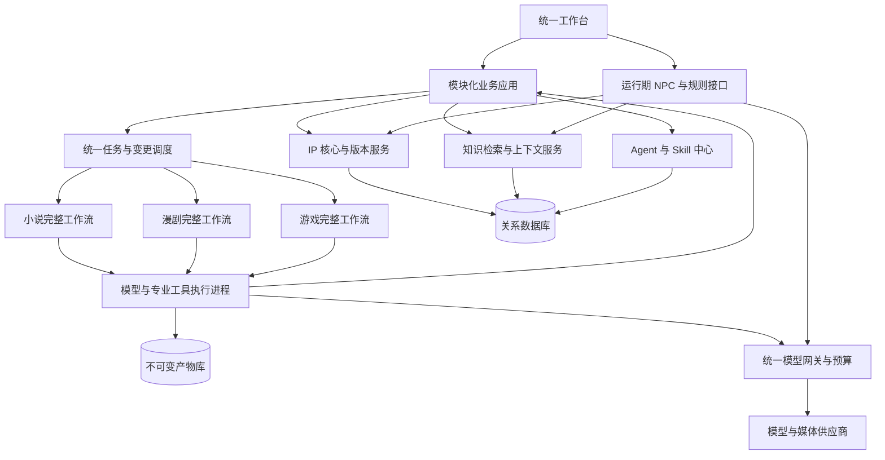

# 统一 IP 创作平台需求与设计基线 v1.1

基线版本日期：2026-10-24。文档核对日期：2026-10-28。本文保留 v1.1 的完整业务范围、专业工序、数据权威、质量门与历史估算假设。现行技术栈、分期和入口决定以 [最终方案](../FINAL_PLAN.md) 与 [需求追踪](../REQUIREMENTS_TRACE.md) 为准；当前代码、安装及资格状态见 [实施状态](../IMPLEMENTATION_STATUS.md)。本文中的 React/Python 业务层/PostgreSQL、新加坡云部署和研发团队成本均属历史方案，不代表当前实现；漫剧与游戏仍为后续交付范围。

**推荐实施路径：一个共享 IP 核心，三条完整专业产线，一套持久化调度，一套可编辑、可研究、可验证的 Agent 与 Skill 能力库。先打通同一 IP 的真实跨媒介闭环，再扩大内容规模和表现复杂度。**

本基线按完整首版范围和可控工程复杂度记录产品取舍；供应商可用性、成品质量、成本和恢复能力须按验收关口验证。所有金额均为建议或估算，不构成支出授权；本方案批准与实际开发、采购、付费调用分别处理。

最终选择为内部生产平台、完整三产线、受控实时 NPC、规则执行的 BOSS、项目私有技能默认值，以及可测量的生产范围。本文 §12 记录决策，§15 给出预算和测算。研发全成本建议按 **75 万元人民币**规划，参考区间 **60—90 万元**；其中付费验证及建设期非人力费用建议总额 **3 万元**，先分配 **5,000 元**的小样额度。交付后基础设施和调用费用建议 **8,000 元/月**，拟议硬上限 **10,000 元/月**。以上额度当前全部未启用，详细包含关系与人力假设见 §15。

## 1 产品交付与首版边界

用户从一个 IP 项目进入，能创建或导入设定和小说，生成漫剧与游戏设计，查看同一角色在各媒介中的表现，修改任一设定后看到影响范围、预计费用和更新结果。默认预设随产品交付；用户不需要先搭 Agent、写提示词、找 Skill 或配置工作流。

| 产线 | 首版必须完整交付 | 用来控制风险的首个生产配置 |
|---|---|---|
| 小说 | 立项、设定、事件图、卷章规划、正文、审查修订、记账、卷审、导出 | 中文长篇的分章生产；先验证连续章节与一整卷，再扩大篇幅 |
| AI 漫剧 | 改编剧本、资产、分镜、配音、关键帧、真实视频、剪辑、三哨兵、成片及可编辑工程 | 漫画式轻动画，关键表演和动作采用短镜头视频；先做 60—120 秒完整试片，验证后扩集 |
| 游戏 | 素材取证、概念、系统、职业功法、技能、NPC/BOSS、叙事、数值、美术、真实可玩切片、QA | Web 端 2D 俯视互动战斗，先完成“调查—选择—战斗—结果”闭环 |

规模受限的是首轮验证内容量，所有专业工序都保留。轻动画是明示的产品风格：允许关键帧运镜、局部运动和反应镜头；剧情必须表现的施法、交接或命中仍要可读。不能把失败动作静帧化后冒充动作验收通过。

首版采用单工作区、基本身份与角色权限，支持项目隔离、任务恢复和版本审计。多人实时协作、离线双向合并、通用 3D 游戏、任意风格全动态长片作为后续扩展。系统独立部署运行，不依赖开发者的 Codex 桌面会话。

### 正式交付范围

定位为供 3—5 名内部创作人员使用的生产工具，首版不承担对外 SaaS 收费、客户租户管理或面向公众的游戏平台运营。保留基本多人登录和审计；同一对象通过版本比较提交，暂不做多人同时编辑同一正文。

| 项目 | 首版正式支持与验收范围 | 与小样的关系 |
|---|---|---|
| 项目数量 | 同时管理 3 个独立 IP；1 个跨媒介生产批次运行，其余排队；单批次最多 2 个外部媒体生成作业并发，受供应商配额约束 | 不把“可建无限项目”当规模承诺 |
| 小说 | 单 IP 30 万汉字级、约 3 卷的连续作品；常规每章 2,000—4,000 字，以结构需要为准 | 先通过连续章与一卷，再实跑到 30 万字级验证长期状态、检索和卷间一致性 |
| 漫剧 | 单系列 10 集，每集 2—3 分钟；默认竖屏 1080×1920、24 fps 交付；最多 6 名主要重复角色，常规镜头 1—2 人 | 60—120 秒困难镜头试片先行，正式资格须完成整系列；非原生规格经加工并披露，不宣称原生生成 |
| 游戏 | 20—30 分钟的单人 2D 互动战斗切片；1 职业、1 套功法、4 项技能、2 个可对话记忆的 NPC、1 个双阶段 BOSS、至少 2 个可达结果及存档恢复 | 先实现 2 技能、1 NPC 的最小闭环，再完成正式范围 |
| 运行期 AI | 最多 5 个内部试玩会话；每会话仅一个 NPC 对话轮次在途；战斗关键路径不调用云模型 | 用于验证互动价值，不承担公众大规模并发 |

上述是容量和功能验收目标，不是每月产量或固定工期承诺。漫剧保持漫画式轻动画，计划时可按约 30%—50% 的时长使用生成动态镜头，其余使用可编辑运镜与局部表现；实际比例服从叙事和动作要求，不能为了费用达标而删掉必要动作。月度预算按较小的持续使用情景测算，整系列可以跨月完成。

首个贯通样例由实施团队制作原创武侠/玄幻题材 IP，覆盖职业、功法、错误信念、秘密揭示和能力限制；研究不需要用户提供完整世界观。实现方法不能硬编码该样例的人名或剧情；正式资格另外使用独立小样检验迁移能力。

## 2 总体结构与唯一技术路线

图中最后一条回路表示执行结果通过业务服务校验和提交，执行进程不能直接修改权威状态。

| 层 | 选定方案 | 选择理由及边界 |
|---|---|---|
| 工作台 | React + TypeScript | 三个专业工作区共享版本、任务、变更与能力管理界面 |
| 业务应用 | Python + FastAPI 模块化应用 | 便于文本处理、检索、评测与媒体工具整合；领域接口明确，首版不拆微服务 |
| 数据 | PostgreSQL + JSONB + pgvector | 结构化版本和事务为主，领域扩展字段和向量共用底座 |
| 内容存储 | Amazon S3，保留 S3 接口适配层 | 正文、素材、技能包、构建包按内容哈希保存；元数据与引用在数据库 |
| 调度 | Temporal Python SDK | 统一承担长任务、等待、恢复、父子任务与超时；不再叠加 LangGraph 作为第二调度中枢 |
| 中文检索 | jieba 专名词典 + PostgreSQL 全文检索 + BGE-M3 dense + pgvector | 关键词、语义、明确依赖相互补充；先精确向量检索，规模增长后再评估近似索引 |
| 执行 | 通用模型 Worker、媒体 Worker、隔离构建/评测 Worker；短请求运行服务 | 构建不持生产密钥；实时 NPC 与长任务分开执行，共用权限、预算和审计 |
| 视频加工 | FFmpeg + 时间线 IR + OTIO 导出适配 | 可恢复的逐镜加工和确定性组装，目标编辑器实际导入验证 |
| 游戏 | Phaser + TypeScript，共享战斗规则包 | 与 Web 工作台和 2D 首片匹配；仿真与游戏运行使用同一规则实现 |
| 开发与部署 | Windows 上 WSL2/Linux 容器；Linux 部署 | 统一运行环境；确需桌面编辑器的验收另用 Windows 执行机 |

首版不引入 Kafka、专用图数据库、独立向量数据库、Kubernetes 或多套 Agent 编排框架。关系依赖用显式边表与递归查询表达；对象存储不承担业务提交。Temporal 业务历史与业务数据各有归属，其数据库和业务数据库使用独立数据库与账号，可以先共用一台 PostgreSQL 实例。

采用 Temporal 是因为系统需要等待外部视频、跨天恢复和模块子流程；自建队列状态机会把这些责任转回团队。它仍需要运维和数据库迁移，不能使外部收费调用天然“严格一次”。[Temporal 子流程](https://docs.temporal.io/child-workflows)、[Activity 幂等](https://docs.temporal.io/activity-definition)、[自部署](https://docs.temporal.io/self-hosted-guide/deployment)。

### 默认模型与工具配置

以下是进入实施验证的明确默认配置，不能直接标注“已验证生产可用”。研发负责验证账号地域、输入输出、价格版本和质量；发布基线必须填写实际通过测试的精确配置，禁止留给首个用户补齐。

| 用途 | 默认选择 | 运行政策 |
|---|---|---|
| 规划、写作、语义抽取、常规专业任务 | OpenAI Responses API，`gpt-6.1-sol` | 分任务固定提示、输出契约、上下文和调用上限 |
| 高难度冲突与独立复核 | `gpt-6-astra`，独立上下文与审查标准 | 与写手角色隔离；同供应商不等于独立错误分布，以标注集检验漏错 |
| 本地语义向量 | `BAAI/bge-m3`，dense 1024 维 | 下载锁定 revision；模型变更建立新索引并重新验证 |
| 图像生成与参考图编辑 | Qwen Image 2.0 Pro，候选固定版 `qwen-image-2.0-pro-2026-06-22` | 先建立角色与场景参考，再作受约束编辑；固定模型、地域、参数 |
| 中文配音 | MiniMax `speech-2.8-hd` | 默认平台提供的声音，按句生成，固定 voice_id 和专名读音 |
| 关键镜头视频 | Wan 2.7 图生视频 API，候选固定版 `wan2.7-i2v-2026-04-25` | 首帧或首尾帧约束；需要口型的单人镜头优先音频驱动 |
| 非生成视频工序 | FFmpeg | 运镜、拼接、字幕、混音、编码；保留可编辑源轨 |

选择这套文本配置是减少首版接入与运维变量的工程判断，并非中文小说质量排行榜。官方目录确认相应文本模型和接口存在；结构化输出有助于约束格式，不能证明内容正确，拒绝、截断和不适用输入仍需处理。[OpenAI 模型目录](https://developers.openai.com/api/docs/models)、[结构化输出](https://developers.openai.com/api/docs/guides/structured-outputs)。

BGE-M3 的模型卡给出其多语言和向量能力；本平台中的专名、长篇与分支检索效果另行实测。[模型卡](https://huggingface.co/BAAI/bge-m3)。媒体默认来自已公开 API；账号可用性与动漫表演能力须经样片验证。[Qwen API](https://help.aliyun.com/en/model-studio/qwen-image-edit-api)、[MiniMax API](https://platform.minimax.io/docs/api-reference/speech-t2a-http)、[Wan API](https://help.aliyun.com/en/model-studio/image-to-video-general-api-reference)。

供应商失败时先保留已完成结果并恢复任务；只有通过同一能力评测的备选配置才可接替。接口兼容不等于表现兼容，不能静默换模型后沿用原质量资格。第二供应商在首轮样片或质量证据表明有必要时加入，不把多供应商全接入作为首版前提。

工具预设同时覆盖产线的起点和出口：没有参考图时先调用 Qwen 文生图生成初始设定图，再进入参考图编辑；声音包随产品提供可使用的默认音乐、环境声、动作/命中音效及逐项来源记录，音乐生成不作为首版必需依赖；小说使用固定版排版/EPUB 工具输出并检查实际文件；游戏随首片模板附完整基础动作、UI 和声音资源。第三方资源不合条件时由实施方替换为有权使用或内部制作的资源，不能把空资产栏留给用户。

### 部署与资料外发默认规则

业务服务、主数据库和对象库默认部署在新加坡，便于统一运维；模型推理地域按供应商实际端点和合同配置分别登记，不能据主库位置声称全部数据只在新加坡处理。首版允许普通自有创作资料经白名单 API 作最小必要处理，禁止自动切到未登记供应商。

| 资料等级 | 默认处理 |
|---|---|
| 公开资料与已发布内容 | 可用于检索、来源研究及已登记模型任务，仍按来源条件管理 |
| 自有未公开、无特别保密限制的创作内容 | 项目内私有；允许将必要章节、设定片段、图片或音频发送给指定模型服务，不默认上传整库 |
| 合同限制、特殊保密或含无关个人资料的内容 | 默认不外发；可使用脱敏替代样本或纯本地确定性处理，不自动降低资料等级 |

模型网关记录资料级别、用途、发送范围和供应商配置版本；日志默认只存 ID、哈希与必要摘要，完整调用材料限权访问。私有 IP 不进入公开搜索查询，也不成为共享 Skill 的示例。实施预检核实账号条款、保留策略与适用端点；不满足本项目外发规则则该配置不能启用。严格全本地生成不属于首版完整云能力配置，受限任务在执行前显示能力边界。

## 3 IP 设定库与权威边界

IP 核心是独立领域。小说是主要创作入口和证据来源，正史不等于小说中每一句话；漫剧和游戏也可以提出新设定，但须经过相同发布规则。

| 信息 | 权威归属 | 例子 |
|---|---|---|
| 跨媒介共享设定 | IP 正史版本 | 身份、种族、组织、历史、能力成立条件 |
| 角色认知与叙述命题 | 带主体、时点、类型和证据的命题库 | 角色误认、说谎、猜测、不可靠叙述 |
| 媒介差异 | 改编分支 | 漫剧合并人物、游戏新增试炼、提前揭示秘密 |
| 小说表达 | 小说作品版本 | 正文、章卡、beat、伏笔及叙事顺序 |
| 视觉与声音 | 媒介资产版本 | 服装、配音、造型、镜头表演；外观语义仍映射 IP |
| 玩法与数值 | 游戏设计版本 | 冷却、伤害、技能动作、AI 状态机、经济与成长 |
| 玩家现场状态 | 单次游戏存档 | 血量、任务选择、NPC 信任变化；不会自动成为正史 |
| 方法与工具 | Skill 和工具版本 | 写作方法、分镜方法、校验器与生成适配器 |

### 对象模型

所有实体使用稳定 ID，姓名只是可变属性。统一覆盖人物、组织、种族、地点、事件、物品、职业、修炼体系、功法、能力、关系及概念。职业和功法是有结构的对象，不能全部塞入人物简介。

核心记录包括：

- `Entity`：身份、类型、别名、所属 IP；
- `Assertion`：主语、谓词、宾语/值、命题类型、有效时间、证据、确定性与状态；
- `Belief`：谁在何时相信什么、依据与置信度，允许错误；
- `Event`：前提、参与者、发生时间、状态变化、叙述位置；
- `Ability`：发动条件、效果语义、代价、限制、反制与成长；
- `SourceAnchor`：不可变原文版本、位置与片段哈希，或媒体时间码；
- `BranchDelta`：明确覆盖、增加或禁用的字段/命题及理由；
- `Artifact/Dependency/ReleaseManifest`：产物、实际依赖与发布集合。

时间至少区分故事发生时间、平台记录时间和读者/角色可知时间。倒叙、梦境、传言与假设分支显式标注。角色说出一句话，不代表他相信它，更不代表它是事实；撒谎和引用他人的话必须能正常表达。

冲突按“命题类型—适用范围—时间区间—发布来源”判定。不同人物的矛盾信念可以共存；同一正史范围内互斥的权威断言进入冲突流程，不按最新时间戳盲目覆盖。

新增设定默认先进入当前工作版本候选。通过确定性约束与独立语义复核、且落在项目预先授权的创作范围内，可自动发布到相应正史工作线；涉及推翻已发布设定、全局身份合并或跨作品重大追溯改写时，只准备完整变更单，不自动抹掉已有事实。

### 自动扩写与锁定规则

项目创建时自动生成核心设定锁定表，由项目内容负责人随首次立项基线发布。默认锁定核心角色身份/亲属关系、关键角色生死、世界与力量上限、主要能力代价、核心历史因果、主线终局和已经明确的重大揭示条件。

系统可以自动补充不矛盾的环境、日常动作、普通对话、非关键配角和局部事件；不得以“补充细节”为名改变锁定项。已批准大纲中的死亡或反转可以按计划写入，执行已授权事件不需要重复审批；偏离大纲才进入变更。冲突判断不确定时保留草稿，暂停受影响的发布，无关产线继续。

### 职业功法与游戏表现

共享能力定义“它是什么、什么条件下能做什么”；游戏定义“玩家怎样操作、资源怎样变化”。一项能力可以有多个版本化游戏实现，也可以对应多个视觉表现。

例如“借火术必须接触外部火源”是设定约束；输入按键、施法前摇、冷却和伤害是游戏表达。游戏不能以平衡为由悄悄删除火源条件，只能实现条件、明确申请分支差异，或换一种玩法设计。原作明确且适用的数值保持来源约束，其余参数作为设计变量经模拟和试玩调整。

NPC、BOSS 是角色在游戏中的功能，不是另一个身份。BOSS 契约包括感知、决策、动作、可读前摇、阶段转换、反制窗口、胜败条件及奖励；NPC 契约包括目标、信念、关系、任务条件和允许行动，不能只有聊天提示词。

## 4 正史与改编分支

每个作品分支固定一个正史基础版本，加一组明确差异。平台用确定性解析器生成唯一的“有效设定快照”，输出最终值、覆盖理由、来源和冲突；任务、检索、缓存及审查都绑定这个快照。

### 复杂规则的解析边界

确定性解析针对已有结构化字段和受支持规则：主体、条件、效果、时间区间、否定、代价以及有明确适用范围的例外。规则采用受限结构表达，不执行模型提供的任意代码。自然语言原文保留为证据，模型抽取的是待确认规则候选。

检查结果明确分为“无已知冲突”“明确冲突”“语义待定”。同一范围内存在互斥规则、歧义量词、无法形式化的比喻或冲突例外时，不根据新旧时间或模型置信分强行选一个。阻断其影响对象的发布，由内容负责人依据原文作选择；临时生产可继续使用已发布旧快照。发布快照表示已解决已知冲突和适用规则，不声称证明所有自然语言命题在逻辑上完备一致。

一条分支只有一个连续性父分支。其他作品可以作为美术或表达参考，但不成为第二套隐形真相。分支中的显式删除、替换与禁用也要参与解析，不能只合并新增字段。

版本分成四类：正史版本、作品版本、产物版本、能力基线版本。一次发布清单同时固定它们及有效快照、模型配置、输入依赖、工具镜像和检索索引状态。使用浮动的“最新”只能出现在发现页面，不能出现在已开始任务的执行清单。

改编合并角色时创建新的分支角色，通过 `composite_of`、`split_from`、`represents` 等有类型的多对多映射连接原角色，不合并原角色的身份、秘密与信念。小说章、漫剧集/镜头、游戏任务/遭遇之间同样允许多对多映射。

正史更新后，旧分支首先获得“可升级”的影响报告。旧版作品若仍与自身固定基础一致，保持可读可播可玩；不能仅因存在新版本就判为内部错误。选择升级时做基础旧版、基础新版、分支本地差异的三方合并，并生成新的有效快照。

下游优秀创作回流正史走提升提案：提取可复用语义、核对范围和来源、评估其他作品影响，再发布新正史版本。游戏平衡值、玩家一局结果和偶然生成的画面细节不会自动提升。

## 5 共享知识库与 RAG

共享的是检索设施与知识关联，不是一个所有 Agent 都能任意读写的大文本池。

| 空间 | 默认内容与使用方式 |
|---|---|
| IP 权威与作品证据 | 已发布设定、指定作品版本、原文证据；按分支和知情范围检索 |
| 项目工作资料 | 草稿、候选、制作注释；仅在任务明确允许时参与 |
| 专业方法库 | 已发布 Skill、工具说明和内部方法参考；提供方法，不充当剧情事实 |
| 外部研究候选库 | 新发现网页、仓库、未评测 Skill；研究任务可读，生产默认不可激活 |

检索顺序固定为：解析任务范围 → 直接取得必要结构化约束 → 在允许证据集合内做全文与语义检索 → 按明确依赖补充 → 去重排序 → 组装上下文 → 记录覆盖和遗漏。

IP、工作区、分支、有效快照、主体权限、故事时间和视角是强条件；必须在交给模型前执行。必要的身份、能力限制、资源状态与秘密边界不参加相似度淘汰。密集向量只能帮助找相关内容，不能决定权限或事实级别。

### 权限与叙事视角分别控制

访问权限决定某个任务有没有资格读取资料，叙事视角决定某种输出允许表现哪些信息。角色不知道秘密，不代表获授权的连续性审查员也不能看到秘密。

| 上下文用途 | 可用信息 | 输出限制 |
|---|---|---|
| 作者规划 | 项目授权范围内的完整设定、未来事件与揭示计划 | 输出计划，不直接把未来真相写入当前角色对白 |
| 正文生成与修订 | 作者约束区可含防止泄密所需的真相；表述区按叙述者、时间和揭示规则筛选 | 明确区分“用于遵守的隐藏约束”和“可以写出的信息”，生成后检查泄密 |
| 运行期 NPC | 该存档中此 NPC 的已知信息、信念、目标、已观察事件和获准公共知识 | 默认不提供未获知的客观秘密；谎言、猜测分别标注，不变成世界事实 |
| Critic/QA 审查 | 在项目授权范围内取得完整事实与已发表正文，比较角色知情和叙事边界 | 审查报告留在创作后台，按权限控制，不自动展示给玩家或普通读者 |

ContextPackage 增加用途、读权限版本、表述范围、隐藏约束清单和报告可见范围。缓存键包括这些字段，禁止将审查上下文直接复用为 NPC 上下文。事后泄密检查是补充措施，不能替代输入隔离。

中文正文与查询采用同版 jieba 分词，维护 IP 专名词典；分词结果进入 PostgreSQL `simple` 全文索引，保留原文及原始位置。简繁与别名可生成检索规范化形式，但不能改写证据原文。全文与 BGE-M3 dense 结果采用 RRF 融合，精确向量搜索先于近似索引。pgvector 的近似索引可能受过滤条件影响而返回不足，规模扩大时需实测召回与延迟再启用。[jieba 原仓库](https://github.com/fxsjy/jieba)、[PostgreSQL 解析器](https://www.postgresql.org/docs/current/textsearch-parsers.html)、[pgvector 原仓库](https://github.com/pgvector/pgvector)。

`ContextPackage` 记录任务、权限范围、有效快照、必需事实、引用片段、原文锚点、检索与排序版本、截断项、知识水位及内容哈希。摘要必须能下钻原文；不能把多个不同时间的状态压缩成同一个“现在”。

索引以不可变内容和版本归属构建，快照保存有效成员与访问条件，不为每一种视角复制全量向量库。新版本索引未就绪时，继续使用已完整构建的旧发布包，或只运行可由结构化数据完整满足的任务；不得将新设定与旧正文索引静默混用。

内容版本固定不代表权限永久固定。每次检索、加载缓存上下文、调用工具和提交结果都检查当前权限及撤销状态；权限收紧使受影响上下文缓存失效，旧任务不得凭过去的授权继续访问。发布指针只能指向依赖和必需索引均就绪的清单；业务候选提交成功与对外发布成功分成两个明确状态。

RAG 质量分别验证：专名命中、必需约束覆盖、证据定位、跨章召回、视角隔离、旧版排除、无答案时的弃答。检索不到不表示事实不存在；冲突或证据缺失要进入可见状态。

## 6 三个团队的完整生产流程

### 小说团队

保留 Director、Architect、Planner、Writer、Critic、Bookkeeper、QA 七个职责。Director 是确定性生产控制器，不能直接写剧情或自行决定审计通过。

1. **立项与构架。** 从用户目标自动推导受众、题材、叙述风格、长度范围和边界，记录假设；Architect 生成开篇候选并按预置标准选出默认方案，建立世界候选与事件图。
2. **卷章规划。** Planner 从事件因果、人物目标、伏笔与节奏生成卷结构、章卡和 beat；章卡含前置状态、期望状态变化和需保持的约束。
3. **上下文与写作。** 按本章视角和时间装配上下文；Writer 写正文，可进行 beat 级局部重写，不靠无限长聊天保存世界状态。
4. **独立抽取。** Bookkeeper 从实际正文重新抽取事件、命题、信念、资源变化和伏笔状态，带原文区间、不确定性和歧义，不只相信 Writer 自填的结果表。
5. **检查与审计。** 代码检查类型、引用、结构化守恒等确定性规则；Critic 独立检查连续性、动机、知情边界、语言、节奏和风格。语义抽取不可靠的部分不能伪装成硬断言。
6. **修订与复核。** 每个问题有位置、依据、严重性和建议动作；使用新的修订上下文处理，并对变更范围重新抽取和审查。默认两轮自动修订，仍失败则保留候选和问题，不无限循环。
7. **联合提交。** 正文、证据、台账变化、章状态与新设定候选共同校验后提交一个作品修订。批准的正史变化通过 IP 服务提交，不能由 Bookkeeper 直接写库。
8. **持续体检与卷审。** 检查跨章关系、未完成发展、伏笔回收和节奏；QA 完成编辑/读者评价、元数据和 EPUB/PDF 导出，确保目录与正文真实可读。

取消把“AI 识别率≤50%”当文学质量门槛；CED 和熵预警保留为研究指标，不承担生产合格判定。ConStory 原文的检测器在注入错误集上的召回约为 0.55，不能把低检出数解读为零漏错，也不能把实验结果直接移植为中文长篇保证。[ConStory 原文](https://arxiv.org/html/2603.05890v1)。

专业质量采用连续章节和整卷的匿名对照审读，评价人物动机、因果、节奏、语言和继续阅读意愿。首次资格评测由实施团队组织编辑/目标读者完成，之后模型审查用于扩大覆盖并保留抽检；用户无需承担每章提示词调试或质量标注。

### 漫剧团队

保留 Showrunner、编剧、导演、美术、提示词编译、声音、剪辑七类职责，以及一致性、连续性、合规三个哨兵。提示词编译器将结构化规格映射到供应商参数，语义镜头构思仍由专业角色完成。

完整顺序为：绑定正史与作品来源 → 改编差异和剧本 → 节拍 → 分镜草案 → 角色/服装/场景/道具/声音资产 → 配音 → 定时分镜与关键帧 → 动态分镜 Draft → 视频与必要口型处理 → 音效音乐字幕 → 剪辑与三哨兵 → 审片变更 → Final → 工程导出。

关键实现规则：

- **资产先行。** 人物正侧面、服装标志、场景布局、关键道具和声音均有固定版本。默认参考图生成/编辑，不强制每个主角训练 LoRA，也不默认采用 FaceID。
- **声音先定时。** 先生成对白并核对专名、停顿和时长，再确定镜头边界与视频。超过模型时长限制的对白拆镜，不截断台词冒充完成。
- **镜头分别路由。** 运镜、静态展示和部分反应镜头用确定性加工；关键动作和表演用图生视频。动漫身份检查组合脸型、发型、服装、标志物和轮廓，真人脸相似度不能作为唯一阈值。
- **口型有适用条件。** 优先单人可读镜头；多人镜头通过镜头设计或经验证的局部修复处理。口型修复在最终裁剪拼接前，最终时长与字幕检查在剪辑后。
- **局部重做有边界。** 每镜头默认原始尝试加至多两次定向重做，且受预算预留限制；再失败则改镜头方案或使用经验证备选。必要动作仍不达标，该段保持未完成，其他镜头可继续。
- **生成结果立即归档。** 不把临时下载链接当永久素材；记录供应商任务 ID、原始参数、内容哈希、授权信息和时间线引用。

FaceID 的官方发布模型卡明确其研究用途与身份一致性限制，因此它不进入默认商业基线；LoRA 仅作为有专门数据、条件和收益证据的后续增强。[FaceID 模型卡](https://huggingface.co/h94/IP-Adapter-FaceID)。

默认可编辑交付为 OTIO 时间线、全部源素材、对白/音乐/音效分轨、SRT/ASS 字幕、时间线 IR、MP4 和迁移损失报告，以固定版本 DaVinci Resolve 为首个实际编辑验收目标，优先选用通过本项目测试的免费版本，首版不预购 Studio。字幕按专门字幕文件导入，不假定 OTIO 自动保留全部字幕、效果和转场。不能迁移的效果逐镜烘焙，同时保留源素材、参数和替换入口。[OTIO 能力矩阵](https://opentimelineio.readthedocs.io/en/latest/tutorials/feature-matrix.html)、[FFmpeg 文档](https://ffmpeg.org/ffmpeg-filters.html)。

验收须在目标编辑器实际完成导入、移动镜头、更换一句配音、修改字幕及重新输出。FCPXML 与剪映草稿是后续独立适配，不以“导出一个 JSON/EDL/MP4”冒充完整可编辑工程。首版不承诺整集固定分钟数生成，也不承诺跨集漂移不可感知。

### 游戏团队

保留 Producer、Intake、Ingest、Fact、Concept、World、Narrative、Art、Slice、QA、Critic 十一个角色，World 内含 Numeric Skill。Narrative 预设始终提供；某次不需要叙事时可记录跳过理由，不能删除角色和能力。

1. **Intake 立项。** 自动生成 Brief、目标体验、改编边界和已选首版宿主，记录假设与证据。
2. **Ingest 全范围摄取。** 按素材单元处理原文、图片与设定，建立覆盖账本；区分已读、未读、不适用和抽取失败，不把读过开头当全书取证。
3. **Fact 取证。** 形成 Source Bible，事实与推测分别存储；检查来源锚点与反例。有限范围改编可以明确只取指定章节，不能宣称覆盖整部作品。
4. **Concept 定向。** 生成候选并用可执行玩法承诺筛选，自动选择与 IP、预算和首版能力匹配的方案。
5. **World 系统设计。** 生成职业、修炼成长、功法、技能、NPC、BOSS、遭遇和资源系统；每条规则必须能映射到可执行状态变化或逻辑条件。
6. **Narrative 互动叙事。** 生成任务、对话、选择、角色知情条件和结局，验证必要路径可达。
7. **Numeric 建模。** 固定模型范围、状态、动作、终局和策略；给参数来源、单位、范围与目标，用受约束搜索、模拟和试玩选参。
8. **Art 与 Slice。** 形成视觉和资产账本，构建真实 Phaser 切片；动作、音效、命中反馈、UI 和失败恢复随默认包交付。
9. **QA 与 Critic。** 执行实际操作、仿真和运行一致性检查、设计及改编审计；失败回流对应工序，不由模型手填 PASS。
10. **交付。** 输出 GDD、结构化规则与数值、来源映射、资产账本、工程、可启动构建及运行证据。

最小验证片包括一个职业、一套功法、两项可组合技能、一个可交涉 NPC、一个双阶段 BOSS；正式切片扩大到 §1 的 4 项技能和 2 个可记忆 NPC。NPC 信任或错误信念影响线索/协助，玩家选择改变后续遭遇，BOSS 有前摇、范围、反制窗口、阶段触发、胜败与重开。它是范围受控的真实游戏，不是点击“战斗成功”的演示页。

Phaser 官方的 Arcade Physics 适合简单俯视、平台与解谜，碰撞能力有明确边界；本方案据此选择 2D 首片，不扩大为任意物理模拟。[Phaser 文档](https://docs.phaser.io/phaser/concepts/physics/arcade)。

战斗规则使用独立 TypeScript 包，浏览器宿主与 Node 无头模拟调用同一实现；Python 调度以工具调用方式执行，避免重写两套伤害公式。所有实时权威状态由引擎更新。模型可以离线生成对白和行动候选，实时 NPC 调用必须在允许动作内验证、限时，并有预置回退；BOSS 逐帧战斗不依赖模型响应。

权威存档与事件由服务器持有。浏览器负责操作、即时表现和本地预测；在战斗结算、任务变更和存档检查点，提交带会话、起始状态版本、规则配置哈希及有序操作的输入轨迹。服务器使用同一已发布规则内核重放并验证合法动作、时序、资源、命中、阶段和结果后提交，不接受客户端直接写“已击败”、奖励数量或任意存档覆盖。影响结算的移动、碰撞和时步属于共享确定性规则，Phaser 的独立表现效果不拥有结算权。

服务器只执行已审查发布的受限规则内核和通过 schema 的数据，不执行临时生成的浏览器脚本。重放设最大输入数、时长和资源上限；验证失败或超时不提交权威结果。客户端结果在收到服务器回执前是暂定结果；重复提交使用同一操作 ID，版本不符则恢复最近确认检查点。NPC 只读取该已提交版本。模型服务故障使用预置对话继续；核心存档服务故障则保留最近确认进度并等待恢复，不伪造一次已经保存的胜利。

### 运行期 NPC 与 BOSS 的具体能力

首版不仅生成 NPC 设计表，还交付运行期 NPC 角色配置、对话服务、记忆服务、动作校验、回退对白和评测。两个正式 NPC 均支持自由文本对话、跨会话记忆、角色目标与错误信念，并能在规则允许时影响任务、信任或协助；不承诺无限开放世界行为。

一次对话的执行顺序是：验证玩家会话和存档版本 → 读取该 NPC 认知与最近事件 → 检索有证据的相关记忆 → 预留本轮费用 → 模型返回对白和允许动作候选 → 校验内容、动作条件及当前状态 → 幂等提交 NPC 事件和游戏变化 → 显示获准回复。未经校验的完整对白不直接流给玩家，防止先泄露后撤回。

动作只允许声明过的枚举，例如提供线索、接受任务条件、提出交易、给予协助；改变道具、信任或任务状态由规则服务计算，模型不能任意指定数值或发放奖励。玩家输入属于发言证据；“我已经杀死 BOSS”必须核对游戏事件，不能靠对话写入已完成事实。

记忆按 `project + branch + build + save + npc` 隔离，保存观察事件、对话命题类型、来源和有效时间。短期保留最近对话，长期使用事件摘要和检索；摘要可回溯且不覆盖原事件。一次存档回退通过恢复事件位置决定有效记忆，不把未来谈话带回过去。游戏存档不得修改正史；升级构建须检查存档兼容，显式迁移或继续旧构建。

默认每会话每分钟最多 6 个模型对话请求，每个 NPC 最近 12 轮作为短期候选，输入上限 6,000 tokens、输出上限 400 tokens。8 秒是服务超时回退边界，不是模型必然完成的性能保证：超时、费用不足、拒绝、网络失败或不合格输出均调用预置角色对白与确定性任务选项，主线仍能继续。迟到模型结果不再提交，使用轮次 ID 和预期存档版本拒绝重复或陈旧写入。

首版对话只在非战斗交互点进行，对话期间暂停该本地场景的战斗推进，减少状态竞争。BOSS 战术候选在制作阶段由专业 Agent 生成、模拟并入库；运行时按阶段和玩家状态从合格战术集中选择，由引擎执行，具备可读前摇和反制窗口。首版不开放云模型即时生成未验证的 BOSS 动作。

### 生成代码与试玩隔离

游戏构建和外部 Skill 评测使用一次性隔离执行环境，仅挂载任务副本和只读基础镜像，限制 CPU、内存、磁盘和时长；不提供生产数据库、云密钥、宿主文件、容器管理接口或凭据代理。默认禁止联网；依赖由受控下载阶段取得、锁版本并校验后送入构建环境，不运行任意联网安装脚本。

构建产物经过校验后由发布服务收取；构建进程不能自行标记 PASS 或切换发布版本。试玩使用独立站点来源和受限 iframe，不共享工作台 Cookie/本地存储；消息桥校验窗口、来源、会话令牌和消息类型，不允许任意导航、文件访问或代发后台请求。玩家调用 NPC 经过服务器受限接口，前端永不持供应商密钥。源码导出仍提供给用户，平台内试玩不因此获得工作台权限。

“求解”仅对声明的模型成立。剧情做有限状态可达性，资源做守恒与重复领取检查，战斗做策略模拟和试玩。超时记为 UNKNOWN，不是不可达；允许受设计约束的重复收益和不同策略接近胜率，不再采用“所有正收益循环失败”等通用硬门槛。[CP-SAT 状态定义](https://developers.google.com/optimization/cp/cp_solver)。

## 7 统一调度与可靠提交

统一调度负责选择工作流、固定版本、资源预算、依赖和跨模块恢复。小说、漫剧、游戏仍拥有各自专业工序与失败回流。

一次跨模块交付或变更形成父任务，卷、集、切片形成可恢复子任务，具体角色执行是 Activity。不会为每个角色、每个提示词都创建子流程。历史记录只保存 ID、摘要与哈希，正文和媒体留在产物库；长篇任务分段推进，避免历史无限增长。

运行期 NPC 对话走有时限的短请求服务，不把每次玩家发言排入内容生产长队列。它与长任务共用模型网关、权限、预算、operation ID 和审计；长期记忆压缩、离线评测与存档迁移可以交给 Temporal。统一调度表示统一政策与记录，不表示所有实时行为都必须经过同一种排队方式。

每个任务固定：输入清单、有效快照、能力基线、模型/工具配置、预算上限、最大修订次数、预期输出和适用门禁。每次模型工具请求先经过工具参数、作用域、授权与费用校验，再由执行器运行。

### 业务提交协议

1. 从业务库取得预期版本和任务执行代号，预留该步骤预算。
2. 在事务外执行模型或工具，保存供应商任务 ID 和结果。
3. 将产物写入暂存区，校验实际文件、哈希、引用和质量报告。
4. 用短事务检查预期版本、执行代号、权限和资格仍有效，提交候选产物引用、候选领域变化、预算结算和 outbox 事件；此时状态为 PREPARED，普通生产检索不可见。
5. 使用同一不可变候选快照建立必需索引、完成复核，全部满足后标记 READY；消费者按事件 ID 去重，可从持久记录恢复。费用结算与内容最终发布分开，生成失败或候选未发布仍可能已经收费。
6. 发布时重新比较预期头版本、权限、资格、锁定项与 READY 清单，在一次短事务内提交权威变更并切换相关发布指针；失败则保持原发布版。

Temporal 拥有执行历史，业务库拥有领域提交。两者通过幂等 operation ID 和对账协同，不进行跨视频任务的数据库长事务，也不假设数据库与 S3 原子写入。[PostgreSQL 事务隔离](https://www.postgresql.org/docs/current/transaction-iso.html)。

### 正文与正史联合发布的事务边界

首版 IP、小说和发布记录均在同一个业务数据库内，模块通过同一事务工作单元提交；“IP 服务”是业务权限入口，不意味着另起远程数据库事务。需要同时改变正史的章节，将章修订、台账、已批准断言、有效快照指针、发布清单及发布事件作为一个原子提交。

候选生成和索引建立在该事务之前完成，可按候选 ID 供专用审核任务查询；正式检索只接受已发布清单中的有效成员。若等待期间正史或作品头变化，提交失败并重新做冲突与兼容性检查，不把旧审查结论直接套到新头。无正史变化的章节只更新自己的作品状态，不无故锁定其他作品。

数据库提交成功但客户端未收到回执时，按 operation ID 查询结果；不能再次生成或再次应用 patch。对象已经上传但提交失败时，它仍是未发布候选，按引用和保留策略清理。更新 UI 或通知失败从 outbox 恢复；它们的失败不撤销已经成功的原子发布。

取消或超时后，旧执行器即使稍后返回，也不能覆盖已更新版本；通过执行代号和提交时比较拒绝旧结果。取消不等于供应商退款，已完成的可用素材可归档并由新任务显式复用。

### 成本与失败政策

逻辑重试、主动重生成和更换模型是三件不同的事。相同有效输入与配置可命中结果缓存；主动重生成必须增加尝试标识。相同随机种子不保证供应商返回字节相同。

外部请求返回不明时进入 outcome_unknown，先查供应商任务与账单再决定后续；无去重保证时不盲目重发。预算按预留、实际消耗、未知消耗和释放分别记账，未知费用先保守占用。项目可在既定上限内自动改进，超限时保留完整候选与补足估算，不静默追加消费。

首轮费用由真实试片、连续章节和游戏构建测算，记录每个有效产物的总尝试费用、人工修复量和 P50/P95 时长。未完成这一步前不承诺每集或每本固定价格。

## 8 跨模块变更传播

变更传播依赖实际输入关系，不能靠广播一句“设定已更新”让所有 Agent 自行理解，也不能保证语义依赖永远无遗漏。

依赖边至少记录生产输入、语义约束、证据引用、表现映射、时间线关系、能力/工具版本六种类型。任务生成时登记实用输入；结构化关键引用必须显式存在。语义分析只负责发现可能遗漏的边，由验证补全后重新计算影响。

默认处理顺序：自然语言意见 → 结构化变更候选 → 确定性差异 → 已知依赖闭包 → 语义补查 → 费用与冲突计划 → 创建新候选版本 → 仅重建受影响节点 → 验证 → 发布清单切换。

影响计划区分“必须重建”“只需复核”“可继续使用”“需人工裁决”。轻量文字/参数修改可在授权范围自动完成；推翻正史、修改冻结成品、重大改编和追加预算形成完整可审查结果。此处的审查由产品既定发布角色处理，当前方案选择无需用户逐项回答。

| 变更 | 默认影响 | 不应顺带改动 |
|---|---|---|
| 正史能力增加发动条件 | 新版设定、相关小说证据复核、镜头动作、游戏规则/教学/测试 | 无关章节与无关资产 |
| 漫剧一句台词 | 音频、字幕、时长；音频驱动或口型相关视频、剪辑与 QC | 没用到该音频且时长未变的独立镜头 |
| 人物服装设定 | 引用该版本的关键帧、视频、游戏对应视觉资产与一致性检查 | 不涉及服装的纯规则数值 |
| 游戏伤害参数 | 模拟、构建、UI 数值展示和玩法验收 | 正史、小说、漫剧 |
| 改编人物合并 | 分支身份映射、相关台词、资产、任务与秘密边界 | 原作人物的全局身份 |
| Skill 发布新版 | 后续任务出现可升级配置 | 已完成作品与运行中固定版本 |
| 审查 Skill 发现漏检漏洞 | 相关历史审查证据标记需复核，按范围重查 | 无关作品的全部重新生成 |

**示例：借火术改为必须接触火源。** 发布正史 v2 后，绑定 v1 的漫剧和游戏收到升级建议而不被覆盖。升级游戏分支时，若本地已定义“可消耗火符替代火源”，三方合并显示这是明确的分支例外，不能丢掉。若决定继承新约束，则更新技能可用条件、战斗表现、NPC 教学、模拟及玩法验收；改编镜头需出现接触行为，相关正文要检查是否与新版矛盾。

冻结节点继续出现在影响图中，只禁止自动写入。无法可靠判断冻结片段是否隔断下游语义影响时，保守标记下游需复核，不能把冻结当成删除依赖。无关内容以输入和输出哈希保持不变作证。

局部变更失败保留当前发布版；回滚创建补偿版本，按当前状态重新合并，不直接恢复整个旧目录覆盖其他人或后续任务的新修改。跨模块可分别发布；对外展示“同一 IP 联合版本”时必须用显式兼容清单，不强迫每次修改都重发三条产线。

## 9 Agent 与 Skill 中心

Agent 是有职责、输入输出、上下文和权限的角色配置；Skill 是完成某类任务的可复用方法包；工具是实际执行外部动作的程序；Recipe 是确定工序和交接条件的工作流配方。这四者分别版本化，不能用一段角色提示词替代整个专业能力。

### 默认完整预置

正式交付包必须包含所有必要 Agent、Skill、Recipe、工具、模型绑定、参考资料、实例与评测。必要能力不能依赖用户第一次使用时临时搜索；关闭外部 Skill 发现服务后，基础产线仍应完整运行。这里不表示云模型离线可用。

每个 AgentPreset 必须有职责、禁止越权范围、调用能力、输入输出契约、上下文规则、模型配置、预算、恢复与交接方式。每个 Skill 包必须有适用与不适用条件、完整方法、工具契约、例子、反例、失败处理、来源和测试。确定性能力必须有真正程序，不能写成“请认真检查”。

发布基线 `ReleasePresetManifest` 将每个工作流节点映射到具体角色版本、Skill 包哈希、Recipe、工具镜像、模型配置、评测记录和负责人。任何必需节点缺实际能力、调用工具或验收证据，都不能发布为完整产品。

### 必需能力覆盖表

以下为开发交付清单。能力名是本平台设计，不表示网上已有同名成熟包；各项在实施时展开为完整版本化注册项。可以复用底层能力，但不能省略职责、工序或验收。

| 角色或服务 | 默认必须具备的能力 | 可检查的交付 |
|---|---|---|
| IP 维护 | 实体建模、命题分类、职业功法能力建模、来源对齐 | 设定候选与证据、冲突状态 |
| 改编策划 | 改编边界、多对多来源映射、人物组合和分支差异 | 分支计划与有效设定 |
| 上下文规划 | 依赖推导、证据检索、知情过滤、预算内装配 | ContextPackage 与覆盖/遗漏 |
| 变更分析 | 意图解析、语义差异、遗漏依赖检查 | 变更候选、疑似影响及依据 |
| 跨媒介审查 | 身份、能力、揭示时点、分支例外检查 | 有位置与来源的问题报告 |
| 小说 Director | 生产状态机、路由、预算、恢复、提交控制 | 可恢复生产记录 |
| 小说 Architect | Brief 推导、开篇筛选、世界构架、事件图 | 立项契约、世界与因果结构 |
| 小说 Planner | 卷章结构、章卡、beat、状态目标、伏笔计划 | 可执行章卡与约束 |
| 小说 Writer | 正文、对话、动作、视角表达、按问题修订 | 实际正文及局部差异 |
| 小说 Critic | 连续性、信念/意图、动机、声音、节奏、风格审查 | 证据化问题清单 |
| 小说 Bookkeeper | 正文独立抽取、资源/伏笔记账、歧义弃判 | 可回溯 patch 候选 |
| 小说 QA | 跨章/整卷审查、中文质量评测、元数据与导出 | 卷报、真实 EPUB/PDF |
| 漫剧 Showrunner | 阶段计划、镜头预算、Draft/Final 与返工 | 整集任务与成本记录 |
| 漫剧编剧 | 来源改编、集结构、剧本、节拍 | 来源关联的剧本 |
| 漫剧导演 | 分镜、调度、动作可读性、轴线视线、时长 | Shot IR 与内容条件 |
| 漫剧美术 | 风格手册、角色/场景/道具、参考图、关键帧 | 真实版本化视觉资产 |
| 漫剧提示词编译 | RenderSpec 编译、供应商参数映射、输入检查 | 可实际调用的图/视频适配 |
| 漫剧声音 | 声音指导、配音、专名读音、音乐音效、对齐 | 真实分轨及时间证据 |
| 漫剧剪辑 | 时间线、运镜、混音、字幕、编码、工程迁移 | 成片及可实开工程 |
| 漫剧一致性哨兵 | 人物、服装、标志物、风格检查及弃判 | 带帧/镜头位置的问题 |
| 漫剧连续性哨兵 | 时空、道具交接、运动、音画、剪辑检查 | 返工归因与复核 |
| 漫剧合规哨兵 | 资产来源、内容规则与目标平台条件检查 | 来源/规则命中报告 |
| 游戏 Producer | 阶段 DAG、门禁、预算、回流、发布控制 | 可恢复阶段记录 |
| 游戏 Intake | Brief、默认范围、假设记录、改编契约 | 可执行目标配置 |
| 游戏 Ingest | 文图摄取、单元划分、覆盖账本 | 全部指定范围处理记录 |
| 游戏 Fact | 来源抽取、反例验证、事实与推测分离 | Source Bible 与锚点 |
| 游戏 Concept | 概念候选、否决检查、玩法承诺筛选 | 选定概念与依据 |
| 游戏 World | 系统、职业、修炼、功法、技能、NPC、BOSS、遭遇 | 可执行规则与内容数据 |
| 游戏 Numeric | 模型构建、变量范围、目标、搜索、模拟、不确定性 | 参数及真实数值报告 |
| 游戏 Narrative | 任务、对话分支、信念条件、结局可达性 | 可运行叙事图 |
| 游戏 Art | 视觉方向、UI、资产需求、来源与系统挂接 | 完整资产账本和首片资源 |
| 游戏 Slice | Phaser 工程、共享规则、输入、存档、重放 | 工程与可启动构建 |
| 游戏运行期 NPC | 角色化自由对话、认知检索、证据记忆、允许动作提案、超时回退 | 两个实际 NPC 的跨会话互动与任务结果 |
| 游戏运行服务 | 会话鉴权、存档版本、事件记忆、动作规则、幂等和预算 | 确定性状态提交，游戏与正史隔离 |
| 游戏 QA | 运行测试、仿真一致性、实际操作与体验验收 | 同次构建/运行证据 |
| 游戏 Critic | 设计、改编、规则、数值和节奏审查 | 缺陷及回流目标 |
| Skill Scout | 能力需求形成、搜索、来源筛选、抓取去重 | 有出处的完整候选包 |
| Skill Analyst | 包分析、依赖/权限/条件、兼容性分析 | 可适配性与风险报告 |
| Skill Author | 方法设计、平台适配、人工编辑支持、三方合并 | 内部完整技能包 |
| Skill Evaluator | 测试集、对照实验、实物检查、资格建议 | 可复核评测记录 |
| 确定性公共服务 | 版本解析、授权、依赖闭包、幂等、预算、事务、发布、备份 | 真正执行程序及异常用例 |

Numeric 是 World 下的专业能力，单列是为了验收可见，不新增独立服务。预设角色可以按任务不适用而跳过某节点，但完整基线不能把必需能力统一标成“不适用”。

### 六项容易空心化的技能采用具体方法

| 技能 | 输入与方法 | 输出和验收重点 |
|---|---|---|
| 正文证据抽取 | 固定正文版本；按事件与发言切分；逐项标事实/信念/陈述/意图；对齐原文；无法确定时弃判 | 命题与位置、覆盖记录；用谎言、倒叙、误认、同名实体检验精度与召回 |
| 章节修订 | 接收有依据的问题与允许改动区；先生成修订计划；局部写作；重抽取受影响状态 | 修订正文、状态差异与新问题；不得让修复造成其他已成立事实失效 |
| 镜头生产 | 输入 Shot IR 与资产版本；锁定必须表现的动作；生成关键帧；按声音定时；生成/加工；逐项检查 | 实际镜头和失败原因；身份、动作、口型分别判定，不用单一综合分掩盖失败 |
| 玩法模型与选参 | 声明状态动作终局；固定来源常量；提出变量范围；搜索、模拟、检查约束；实机试玩反馈 | 模型范围、参数与轨迹；超时为未知，不能用“求解完成”替代有趣 |
| 变更影响分析 | 意图归一化；精确字段差异；已知依赖闭包；语义补查；冻结和分支处理；预算计划 | 最小重做清单与复核清单；闭包外哈希不变，未记录依赖有反例检查 |
| 外部 Skill 适配 | 原包隔离读取；提取方法和工具依赖；重写平台契约；提供正反例；干净环境新旧对照 | 独立有效包与来源血缘；外部文本不能自授权限、改门禁或取得生产密钥 |

### 自动发现与入库

发现入口有三个：定期检查已登记来源、能力缺口触发研究、人工提供网址或文件。默认产品策略是每日增量发现、每周汇总评测，空闲且预算内执行；同一缺口最多两轮自动研究后生成具体研发任务，避免无限搜索。该频率属于产品内调度策略，部署时需显式启用相应任务。

初始来源目录使用 [Anthropic Skills](https://github.com/anthropics/skills)、[OpenAI Skills](https://github.com/openai/skills) 以及工具作者维护的专门仓库，例如 [Temporal Developer Skill](https://github.com/temporalio/skill-temporal-developer)。它们是可追溯来源种子，并不代表其中任意包自动适合本平台，或已经提供完整小说、漫剧、游戏能力。各包及附带资源的使用条件分别记录。

处理流水线固定为：

**发现链接 → 取得原始版本和完整包 → 去重与来源核验 → 方法/依赖/条件分析 → 平台适配 → 隔离评测 → 获得特定用途资格 → 发布 → 绑定能力基线。**

包记录源 URL、仓库 commit/tag、获取时间、文件清单、内容哈希、许可证/条件、依赖、工具、适用模型和任务范围。网页教程可成为参考材料，不能伪装成已经可执行的 Skill；没有可接受使用条件的代码不进入默认分发包，可在允许范围内参考公开方法独立设计实现。

抓取器限制下载大小、文件类型、重定向与目标地址，拒绝本地/内网地址、越界解压和符号链接逃逸；新内容只作为待分析数据。抓取不运行安装脚本，也不允许 Skill 文本改变系统授权。外部脚本在无生产凭据的隔离环境测试，需联网时使用受控出口。

兼容标准 Agent Skills 的 `SKILL.md`、脚本、参考和资源布局；平台的权限、资格、版本、回滚和评测是额外能力，不能假定格式规范已经解决这些问题。[Agent Skills 规范](https://agentskills.io/specification)。

### 评测与自动发布

评价针对“某个 Skill 版本 + 某个模型/工具配置 + 某类任务”，不授予无限范围的“优质 Skill”标签。采用相同任务的无技能/现有版本/新版本对照，使用干净上下文、保留集、多次运行与实际产物；记录失败、成本、时长和人工修复量。[Agent Skills 评测指南](https://agentskills.io/skill-creation/evaluating-skills)。

确定性负例必须如期拒绝；专业任务由独立标准和实物检查评分。作者不能仅靠自评给自己发布资格。低影响、无新增权限且全部回归通过的修订可自动进入新基线候选；新增可执行依赖、扩大网络/文件权限或改变硬门禁的版本由维护角色审查后发布，不把风险转嫁给普通创作用户。

评测集、评分规则和门禁配置与被评测技能分开管理。Skill Author 不能同时改保留集答案或降低门槛给自己的版本放行；评测规则变更本身需要独立审查和对旧版本的重新对照。维护角色是平台运营/研发职责，不要求普通用户成为技能审核员。

社区更新不自动改变正在运行的任务。新包先发布新版本，再升级后续任务绑定。安全撤销沿来源、父包、文件和依赖传播到派生包、Recipe 与 SkillSet，立即阻止新激活，运行中任务在下一执行/提交检查点停止使用受撤销能力；已发出的外部作业只能按供应商能力取消或隔离其结果。改名或改一个哈希不能绕过撤销。修复后的独立版本需重新评测。

### 人工编辑

技能中心提供表单和 Markdown 编辑，支持方法、触发条件、工具绑定、示例、测试和资源附件。修改生成草稿，显示差异、影响任务和评测结果，再发布新版本；不直接覆盖原包。

保留“原始包 → 平台适配版 → 项目定制版”的血缘。调用时编译成一个确定的有效包并记录哈希，不能靠同名文件搜索顺序决定优先级。上游更新与人工修改做三方合并到草稿，冲突显式解决。用户可回退绑定到旧的未撤销合格版本，已经启动的任务仍保持其原始绑定。

### 跨项目经验推广

项目定制 Skill、提示词改进、失败案例和创作经验默认只在本项目生效。推广时先生成抽象方法候选，移除人名、剧情、未公开素材和项目密钥，用原创中性示例替换；继而检查来源条件和内容泄漏，在至少两个不同项目样例上对照评测，通过后发布平台公共版本。数据复用与方法复用分别授权，抽象出方法不意味着可以共享训练/评测原文。

公共版本更新只向其他项目提供升级候选，不覆盖其定制版本；发现能力漏洞时仍按撤销规则阻止使用。默认不做跨 IP 对象内容去重，避免删除、引用和权限产生不透明耦合。

如果不知道某项专业能力怎么做，实施方必须完成推理、原始资料调研、复用或自建、真实任务评测、集成回归；不能写一个 TODO、空 Skill 或通用“专家提示词”就把工作移交给用户。

## 10 工作台与默认自治政策

首页只展示项目、当前作品、生产进度、费用和需要处理的异常。专业界面包括 IP 设定库、小说阅读/章卡、漫剧资产/分镜/时间线、游戏设计/试玩、变更中心和技能中心。技术 ID、供应商错误和执行细节可展开查看，不成为日常操作前提。

每份成品可以回答五个问题：来自哪版设定、用了哪些来源、允许哪些改编、由哪些能力生成、哪些变化会影响它。变更页面优先显示具体前后差异与作品影响，避免要求用户阅读一张全库依赖图。

默认自动选择开篇、概念、工具路由与可逆局部修订；在已授权项目范围、预算与质量门内自动推进。遇到未授权的公开发布、重大正史回溯或无法满足质量门的结果，系统保留可审查候选和原因，并继续无依赖的任务。自治的目标是减少反复配置和无意义确认，不是把未知、超支或失败自动改成通过。

权限至少区分工作区所有者、创作编辑、发布维护和只读访问；首位用户可兼任多个角色。凭据由服务器管理，模型上下文与下载包中不包含密钥。对象下载使用短期授权，审计记录执行者与版本；删除项目时同时处理正文、索引、缓存和对象引用，保留必要删除审计而非保留可检索的已删除正文。

### 人工岗位与发布责任

产品默认自动选择普通创作方案并完成预算内修订。实施交付团队须提供一名内容负责人（兼主编/制片职责）和一名技术维护负责人，可以是现有人员兼任；这属于岗位与预算要求，不表示已经安排人员或招聘。

内容负责人负责首次基线、核心设定变更和每批对外成品终审；技术负责人负责能力发布、执行权限与故障处理。独立专业评测由实施团队组织第二审阅者或目标试玩人员完成，不由创作 Agent 自评替代。平台所有者保留最终决定权，普通任务不需要所有者逐章审批。无人承担某项责任时，该项待审发布保持待审，草稿生成与无关工作可继续；系统不会虚构“人工已审核”。

### 保留与删除

| 数据 | 默认保留策略 |
|---|---|
| 当前及历史正式发布包、被其引用的正文/素材/能力版本 | 项目有效期间保留，提供容量账单；不得因普通自动清理破坏已发布包 |
| 未被引用的生产草稿与候选素材 | 30 天后清理，发布引用或显式保留可延长 |
| 无引用的失败视频、临时解压/构建文件 | 失败素材 7 天；执行临时目录任务结束后 24 小时内清理 |
| 运行期原始对话 | 默认 30 天；经验证且仍有关联的事件记忆随存档保留，删除存档一并删除 |
| 完整模型调用调试材料 | 默认 7 天且限权；需要评测留存时另登记用途、引用和期限 |
| 审计与费用元数据 | 默认 1 年，保存 ID、哈希、金额和操作，不保存已删除正文或对话内容 |
| 数据库/对象恢复备份 | 滚动 35 天；恢复演练至少每季度一次，重大存储变更后加做一次 |

删除请求在 T0 立即撤销日常访问、停用相关任务并清除检索入口；提供 7 天限权回收窗口。实际清理正文、向量、摘要、缓存、对象的全部历史版本及临时外发链接，在线副本最迟 T0+30 天清除。备份按最长 35 天轮换，最坏情况下备份中的内容到 T0+65 天自然到期；在此期间只用于隔离恢复，不允许回到生产检索。显式删除优先于普通保留策略，回收窗口内恢复须有明确操作记录。

删除清单与当前权限/能力撤销清单在独立受保护位置保留至少 1 年。恢复先在隔离环境完成，重放截至当前的删除和撤销记录，清理应删除内容、重建索引、校验权限后才能接入生产；不能只恢复旧数据库就开服务。供应商已接收副本的保留行为按实际服务条款登记，平台不承诺能直接清除对方全部内部备份。

同项目内共享素材按引用计数处理，删除一个草稿不能删除仍被其他正式作品引用的素材；删除整个项目则清除该项目全部引用和对象。任何以后引入的跨项目共享资产必须先拆清所有权，不能以共享为由让已删除的私有内容继续被搜索。

首版恢复目标为 RPO 不超过 15 分钟、RTO 不超过 8 小时，采用数据库日志备份、每日基线备份及对象清单校验；这是交付演练要验证的目标，不是当前已达到的 SLA。该目标从实施并验证备份配置后生效。

## 11 实施顺序与阶段退出条件

开发按依赖推进，每阶段都有可交付证据。不先建漂亮空壳，也不等三个系统各自完成后才补共享协议。

| 阶段 | 实施内容 | 通过条件 |
|---|---|---|
| A 契约与同一 IP 样本 | 统一实体/命题/分支/快照/产物/变更协议；能力覆盖表；选一个原创或有权使用的样本 IP | 事实、信念、谎言与改编差异能表达；角色多对多映射明确；每个必需节点有负责人和验收 |
| B 共用底座 | 数据库、对象库、版本提交、Temporal、预算、依赖、RAG、Skill 注册编辑与隔离评测 | 并发旧写被拒，重复事件不重复应用，提交故障可恢复；中文检索和权限隔离有正反例 |
| C 小说与设定闭环 | 七角色、全部小说技能；章卡到正文、独立抽取、联合提交、卷审与导出 | 连续章节与完整短卷可读；原文与台账一致性有标注对照；改稿恢复和导出实际执行 |
| D 漫剧与游戏闭环 | 按固定配置补齐全部媒体/游戏能力及运行期 NPC；同一基础版本改编 | 真实完整试片及编辑工程；真实切片、NPC 记忆和数值报告；三个专业流程无缺项 |
| E 变化与能力演进 | 正史升级、角色合并、外观变化、台词改动、游戏调参、Skill 更新/撤销 | 局部重做正确、旧发布版稳定、冻结影响可见、撤销传播有效、回滚不覆盖新改动 |
| F 产品化和长跑 | 统一 UI、权限、计费对账、监控、备份恢复、正式范围长期运行 | 实跑 30 万字级作品、10 集系列和正式游戏切片；干净安装、恢复演练及 §11 质量门通过，费用符合已启用额度 |

C 和 D 中的领域能力开发由团队承担，首个用户任务不能承担基础能力研发。自动发现服务随 B 建骨架、随 C/D 的真实任务建立评测、随 E 验证升级撤销；不用它替代必要预置。

基础设施和业务协议可以用模拟供应商测试失败路径，但模拟不能作为 C/D 的产线交付证据。默认环境先完成一个完整合格配置，再推出低成本或高质量配置；不同时维护多个未验证的“可选方案”。

### 必须执行的验收场景

| 类别 | 实际验收内容 |
|---|---|
| 小说正确性 | 谎言不变事实、误认可以存在、倒叙时序正确、同名角色不串、秘密不越界、资源转移和伏笔可追溯；重写后重新抽取 |
| 小说质量 | 连续章节及整卷匿名审读，报告样本、分歧、缺陷、修订效果与重复运行差异 |
| 漫剧生产 | 正侧脸、遮挡、换装、双人同框、道具交接、接触施法、长短台词和专名；真实音视频与完整剪辑 |
| 漫剧工程 | 指定编辑器导入后改镜头、字幕、配音并重新输出；逐项披露不可无损迁移效果 |
| 游戏运行 | 真实键鼠完成调查、选择、胜利、失败、重开和存档恢复；选择确实改变后续状态 |
| 运行期 NPC | 两个 NPC 跨会话记忆；谎言不改世界事实；秘密不串；对话影响任务；断网/超时回退仍可继续；存档回退后不保留未来记忆 |
| 构建与试玩隔离 | 生成代码读取工作台凭据、访问主站存储、越权消息和出网请求均被拒；正常玩法、存档和 NPC 接口可用 |
| 游戏证据 | 构建哈希、规则配置、输入轨迹、运行事件、录像、模拟报告互相对应；缺文件为 NOT_RUN |
| 游戏状态可信性 | 伪造完成标志、任意存档覆盖、非法动作轨迹和重复领奖被拒；合法轨迹重放与客户端共享规则一致；NPC 不能引用尚未确认的胜利 |
| 数值边界 | 非法资源复制被拒、合法循环被允许、可达与不可达可区分、超时保留 UNKNOWN，仿真与宿主状态一致 |
| 检索隔离 | 相同名字跨 IP、不同分支例外、旧版本、新索引未就绪、角色不知道的秘密、来源缺失 |
| 变更传播 | 能力约束、外观、对白、游戏数值、组合人物分别修改；确认必须改变的节点与无关哈希 |
| 故障恢复 | 请求已发出但响应丢失、进程中断、对象已上传但事务失败、任务被取消后迟到结果、供应商限流 |
| 能力中心 | 从已登记源收录、外部注入文本、越界工具、人工改稿、上游冲突、版本撤销及派生包传播 |
| 运维交付 | 全新安装、版本升级、数据库和对象恢复、索引重建、权限变更和项目删除 |

每条核心生产 Recipe 初始至少具备一个标准真实成功案例、一个故障恢复案例和一个有针对性的反例；语义类再加入保留测试集和重复运行。这只是覆盖起点，不意味着三个样例足以证明任意题材质量。

结构和交易不变量全部通过才能发布；专业质量使用下列默认最低要求，试点只补充题材样例与更细口径。门禁在保留集评测前固定版本，不得为迁就失败而临时降低。自动审查通过与专业成品质检通过分开记录。

### 可直接执行的质量标准

目标是能供内部专业团队采用和继续精修的生产成果。实施团队制作原创质量样板和反例，覆盖叙事、镜头和交互，并由内容负责人锁定；不使用“像某个顶级作品一样”作为无法检验的唯一标准。

统一评分为 1—5 分：1 分表示不能使用，3 分表示需要明显重做，4 分表示可进入正常制作/发布流程且仅需局部精修，5 分表示明显超过基线。以下阈值是本平台选定的交付要求，不是已测出的成绩或行业通用标准。

| 范围 | 最低通过条件 |
|---|---|
| 结构、权限、交易与成本规则 | 发布阻断类正反例全部符合预期；重复奖励、越权读取、旧任务覆盖、超额发起付费任务等不得被放行 |
| 小说语义抽取与检错 | 独立保留集至少含 100 个有标注缺陷和 100 个正常/允许情况；总体 precision 与 recall 均至少 90%，同时披露分类表现；结构检查和语义指标分开 |
| 小说成品 | 一名编辑审读全部正式 30 万字级作品，第二名独立抽读至少 20% 章节及全部关键转折；人物动机、因果、节奏、语言、阅读意愿平均至少 4 分，无维度低于 3 分；已发现的严重设定矛盾或泄密须关闭 |
| 漫剧成品 | 首系列逐集完整观看；内容负责人及独立审片者对身份、动作可读性、对白、节奏、声音评分平均至少 4 分，无维度低于 3 分；关键动作、漏词、黑帧/缺媒资和重大角色漂移不得带入 Final；字幕/音轨/工程完整 |
| 游戏成品 | 所有关键路径和状态规则实机通过；至少 5 名未参与实现的试玩者，至少 4 名能在游戏内引导下完成教程并抵达一个结果；操作理解、反馈、策略差异平均至少 4 分，无维度低于 3 分 |
| 运行期 NPC | 至少 60 个固定场景覆盖知情、误认、诱导、重复请求、断网、存档回退；所有权威状态变更和隔离预期正确；另检查真实连续对话的角色一致性与任务价值 |
| 评分分歧 | 两位审阅者同一维度相差超过 1 分时增加第三位裁决；保留分歧和理由，不只公布平均分 |

上述数量是最低覆盖要求。样本表现不证明所有未来内容无误；日常运行持续抽检。首次系列和每个新题材/新模型配置全流程复核；稳定后小说每卷至少抽读 20% 章节及关键情节、漫剧每集审片、游戏每个发布构建回归关键路径。保留集不得交给技能作者定向修改答案。

未通过时修复方法、素材或实现后重验。若既定预算不足，交付状态保持未完成并提供差额，不把减小正式范围或下调质量标准当作自动通过。

部署交付包含锁定依赖与容器版本、迁移脚本、完整预置包、安装/升级说明、账号连通性检查、监控、预算告警和备份恢复记录。首版单机不宣称高可用；需要扩大部署时以并发、队列等待、检索延迟和恢复目标的实测结果决定拆分。

## 12 基线产品决策

下表按完整专业流程、真实交付和最低必要复杂度记录 v1.1 产品决策。后续技术、部署及维护方式的差异见现行最终方案和需求追踪；其余业务约束继续保留。

| 决策 | 选定答案 | 理由与接受的代价 |
|---|---|---|
| 平台服务谁 | 首版供 3—5 名内部人员使用 | 先获得真实生产价值，暂不承担对外 SaaS 运营复杂度 |
| 游戏是否包含运行期 AI | 两个真实可记忆 NPC；BOSS 使用预验证战术和引擎执行 | 保留互动价值，避免即时生成动作破坏可玩性与稳定性 |
| 正式生产规模 | 30 万字级小说、10 集各 2—3 分钟漫剧、20—30 分钟游戏切片；3 IP 管理、1 批次生产 | 将验证小样与正式交付分开，容量有明确验收边界 |
| 作品质量如何判定 | 采用 §11 的固定评分、标注保留集和真实成品门槛 | 统一“能用”含义；质量评审人力计入开发成本 |
| 预算怎样安排 | 全成本建议 75 万元；其中验证/建设期非人力 3 万元；交付后技术运行 8,000 元/月 | 用明示假设规划，未授权不花钱；详见 §15 |
| 云端资料怎么处理 | 新加坡主存储，白名单模型最小外发，特殊保密默认不外发 | 允许云能力发挥价值，明确主存储和推理地域并不相同 |
| 谁终审和维护 | 实施团队配内容与技术负责人；独立评审另组织 | 避免把未安排的人力当成自动存在，普通用户无需逐章配置 |
| 核心设定如何保护 | 身份、生死、世界规则、主线终局等锁定；计划内事件自动执行 | 创作可持续推进，核心方向不会被普通补写悄悄改变 |
| 项目经验是否自动共享 | 默认私有，去除项目内容并跨样例评测后才推广 | 共享方法而不泄漏私有 IP，人工定制不会被覆盖 |
| 谁拥有设定真相 | 独立 IP 核心 | 三种媒介可独立发展；增加明确的提交与发布协议 |
| 小说内容是否自动成为正史 | 分类抽取、审查后按授权范围发布 | 保留谎言与叙述技巧；必须承认抽取不确定性 |
| 下游是否跟随最新 | 固定基础，显式升级 | 保护成品与在制品；需要升级报告 |
| 能否合并改编角色 | 可以，新分支身份加多对多映射 | 保留创作自由与原作身份边界 |
| 游戏数值能否回写 IP | 默认不能，语义提升另提案 | 防止玩法平衡污染正史 |
| 事实源用文件还是数据库 | 业务数据库加不可变内容 | 解决并发与跨模块一致提交；正式修订原材料文件权威规则 |
| 是否每个 Agent 一个服务 | 否，角色配置加任务实例 | 完整团队不等于复杂部署 |
| 是否双重 Agent 编排 | 否，仅 Temporal 负责持久执行 | 统一恢复与状态归属；接受该组件运维成本 |
| 中文 RAG 起点 | 分词全文、BGE-M3、结构约束、精确向量 | 控制复杂度并避免盲目追求向量规模；后续按实测优化 |
| 是否强制异厂商审查 | 首版独立角色/上下文/标准，验证后扩展供应商 | 不把厂商差异当质量保证；必须评测相关错误和漏检 |
| 漫剧是否强制训练角色模型 | 否，参考图编辑先行 | 降低数据与训练门槛；身份表现需样片证明 |
| 漫剧默认形态 | 轻动画加必要的真实动态镜头 | 可控完成度；高动态长片另设资格 |
| 可编辑工程默认适配谁 | OTIO 媒体包，固定版本 Resolve 实开；默认采用满足测试的免费版本，不预购 Studio | 有明确目标；素材、字幕、分轨可继续编辑；剪映暂不列正式支持 |
| 游戏首个宿主 | Phaser 2D Web | 能在统一工作台实际试玩；复杂 3D 不进首版 |
| 数值是否通用自动求解 | 在明确玩法模型内搜索和验证 | 能给真实证据；无法穷尽未建模策略 |
| 必要能力是否全部预置 | 是，完整基线包是发布前提 | 研发工作量前置；用户首次使用无需补技能 |
| 网上技能是否自动入库 | 自动候选入库，适配评测后才可调用 | 持续吸收方法；不把收录数当能力增长 |
| 人工编辑与上游更新谁优先 | 派生版本加三方合并 | 人工经验保留；冲突需显式处理 |
| 缺方法怎么办 | 实施方研究、复用或自建并真实验证 | 不依赖一定能找到社区现成包 |
| 是否所有变化重跑三模块 | 否，实际依赖驱动局部重做 | 降低费用并保留稳定产物；语义遗漏需补查 |
| 是否无人审查也能承诺最终品质 | 不作该承诺；默认自动生产，专业资格和异常有维护流程 | 保留质量门，避免假完成 |
| 哪个先开发 | 统一契约和共享骨架，再小说，继而漫剧/游戏，贯穿变更验证 | 共享协议先被验证，避免三套成品后期重构 |

## 13 对原材料的统一裁决

| 材料 | 完整保留 | 必须修订 |
|---|---|---|
| 小说设计交付包 v3.0 | 七角色、事件图/章卡、分层记忆、角色信念、独立审计、patch 提交、卷审与导出 | 正史接入共享服务；语义抽取与硬校验分离；文件权威改为版本服务；CED/AI 识别率不作通用质量保证 |
| AI 漫剧设计 v3.0 | 资产优先、Shot IR、专业七职责、三哨兵、Draft/Final、不可变产物和最小重做 | 取消强制 LoRA/FaceID；先配音定时；修正音频驱动依赖与口型顺序；工程按目标软件实开；不保证固定整集速度 |
| GameForge v3 | 覆盖门禁、证据边界、来源账本、系统/数值、引用图、变更、可玩切片与运行证据 | 数据库成为结构化权威；限定玩法模型；删除武断通用胜率/收益门槛；求解未知不当失败事实；原作恒量无需假装求解；冻结不断开影响 |

原材料关于检查项数量、搜索步数、重算比率、固定测试局数和时间窗的分歧，不再作为相互矛盾的硬编码常量。按本版契约、模型规模、统计需求和实际性能制定单一版本化配置。确定性验证结果只能由真实验证程序写入；业务上可以有 PASS、FAIL、NOT_RUN、UNKNOWN 等明确语义，不能把未知挤成通过。

原材料是领域方法与需求依据；本版对权威、接口、质量门与实施范围作统一裁决。开发时不允许重新套回旧条款造成双重事实源或互相冲突的验收。

## 14 剩余不确定性的具体消除方式

| 尚需真实验证的事情 | 已确定的处理方式 | 不能越过的关口 |
|---|---|---|
| 账号、地区与模型实际可用性 | 实施预检具体端点、配额和契约；不可用则验证同能力候选并更新固定清单 | 不让产品携带一个实际不可调用的默认模型交付 |
| 中文长篇与检索质量 | 从连续章到正式 30 万字级运行，按 §11 固定样板与标注集分别评测 | 不以论文指标或模型自评替代成品证据 |
| 动漫身份、动作、口型和成本 | 先做覆盖困难镜头的短试片，再形成每类镜头配置及费用数据 | 关键动作失败不能靠剪辑遮掩后判 Final |
| 编辑工程迁移 | 目标 Resolve 版本实际导入编辑回出，修复适配和明确烘焙范围 | 缺可编辑验证时不能标为完整交付 |
| 数值模型与实际可玩性 | 共用规则实现，实际操作与目标玩家试玩，保存偏差和修复 | 模拟通过不能替代真实运行和体验 |
| 社区 Skill 能否提升任务质量 | 针对具体用途进行基线对照与真实产物评测 | 来源知名、格式正确和 star 数都不授予生产资格 |
| 运行稳定性与规模成本 | 故障注入、恢复演练、真实费用对账和连续运行 | 不以单次演示宣布生产稳定或无限扩展 |

以上验证由实施团队主动完成，失败就修复方法、配置或适配，再重复对应关口。没有通过时保留清晰的未完成状态；这比承诺“所有障碍已消失”更能保证最终交付可用。

**最终建设目标是：用户用一个 IP、一个默认能力包，在明确的首版规模内完成可读小说、可编辑漫剧和带记忆 NPC 的可玩游戏切片；随后修改一项设定，系统能解释影响、控制费用、局部更新并保留旧版。**

## 15 预算建议与支出边界

### 预算的性质

以下均用人民币作内部规划。公开 API 价格按 2026 年 10 月 24 日查到的页面记录；人力单价、工作量、服务器额度和用量是本方案的估算假设，并非市场报价、供应商承诺或当前支出。美元按 **1 美元折算 7.5 元人民币**的保守记账参数测算，不代表实时汇率；实际结算按账单、税费和届时汇率入账。

预算表只用于规划，不创建云资源、购买套餐、启用自动充值或触发收费试用。付费功能必须先启用明确的范围、供应商、币种、期限和额度；可覆盖一个阶段及额度内的正常调用，不能仅凭设计文档中的金额执行支出。

### 研发全成本

推荐按 **75 万元**作为立项规划中值，参考区间 **60—90 万元**。配置为 3 名核心工程人员，分别覆盖共享底座/编排、应用/前端/游戏、模型/检索/媒体；另配置约半人时 QA 与约半人时内容/美术制作协调。岗位可由现有人员兼任，不要求现在招人。

| 成本项 | 测算假设 | 建议值或区间 |
|---|---|---|
| 研发、QA、内容评测与制作人力 | 累计 16—24 人月；综合成本统一按 3 万元/人月作内部参数 | 48—72 万元；中值取 20 人月，即 60 万元 |
| 建设期模型验证、临时基础设施、必要素材/工具 | 分阶段总额，见下表 | 3 万元，已包含在研发全成本中 |
| 风险准备 | 对以上两项计 15%，用于真实发现的返工和适配 | 区间约 7.65—11.25 万元；中值 9.45 万元 |
| 合计 | 区间 58.65—86.25 万元，中值 72.45 万元后取整留余量 | 规划区间 60—90 万元，建议中值 75 万元 |

这是覆盖全部三产线和正式验收的总投入估算，不是给某家外包商的报价。复用现有团队时，人力占用不等于新增现金支出；使用 AI 开发工具可能减少工时，但不能预先假定省掉集成、专业评测、媒体修复与运维工作。硬件采购、公开商业运营和大规模内容制作不在首版预算内。

按上述队伍可先用约 4—6 个月作为资源排布窗口，实际交付以阶段关口为准，不能将这个窗口当作完成日期承诺。正式实施完成契约与第一轮样片后，用实际工作量和产物费用更新预测，保留原估算便于比较。

### 建设期非人力费用的分段建议

| 顺序 | 用途 | 建议额度 | 进入下一段的条件 |
|---|---|---:|---|
| 1 | 模型连通、中文章节、困难镜头、NPC 互动的小样验证 | 5,000 元 | 默认配置可调用，关键质量瓶颈有可执行处理，形成实际费用记录 |
| 2 | 完整三产线联调、真实工程与切片验证 | 10,000 元 | 正文/台账、真实音视频、可编辑工程和可玩切片闭环成立 |
| 3 | 正式规模、跨模块变更、故障恢复和能力回归 | 8,000 元 | §1 和 §11 的正式范围与质量要求有实际证据 |
| 4 | 建设期服务器、存储、工具及必要素材余量 | 7,000 元 | 按实际采购项目登记，不默认订年费、租长期 GPU 或购买额外软件 |
| 合计 | 非人力费用总池 | **30,000 元** | 每段分别启用，上一段不足不能自动挪用下一段 |

5,000 元的小样额度是第一段，包含在 30,000 元中；30,000 元又包含在 75 万元的研发全成本中，不能重复相加。这里的“建议额度”不意味着当前已经获准支付。阶段结余保留，追加预算必须有实际账单、失败原因和下一次试验的具体用途。

### 交付后的技术运行费用

建议按 **8,000 元/月**规划服务器、存储、API 和研究工具费用；拟议月度硬上限 **10,000 元**。它不包含持续维护与内容终审的人力。初始容量对应内部使用，示例月度负载为约 10 万字小说生产/修订、5 集各 2 分钟漫剧、1 次游戏切片迭代，以及合计约 1,000 轮 NPC 对话；这是一组成本测算假设，不是已验证的产能保证。

| 项目 | 月用量假设与单价依据 | 估算人民币 |
|---|---|---:|
| 主文本模型 | Sol 标准短上下文：2,000 万输入 tokens × $2/百万，300 万输出 tokens × $10/百万 | 525 元 |
| 高难度审查 | Astra 标准短上下文：200 万输入 tokens × $10/百万，30 万输出 tokens × $50/百万 | 262.5 元 |
| 关键帧/参考图 | Qwen Image 2.0 Pro 新加坡：800 张 × $0.075/张 | 450 元 |
| 生成视频 | Wan 2.7 i2v 新加坡：2,400 个等效 1080P 计费秒 × $0.15/秒 | 2,700 元 |
| 配音 | Speech 2.8 HD：10 万字符 × $100/百万字符 | 75 元 |
| API 小计 | $535 × 7.5；包含上述任务共享用量，不再按角色重复加总 | **4,012.5 元** |
| 主机、备份、对象存储及流量 | 暂按预算参数预留，需按部署清单与实际账单校准 | 2,000 元 |
| 搜索及其他工具 | 暂按额度预留 | 300 元 |
| 小计加 20% 运行余量 | 6,312.5 × 1.2 | **7,575 元，取整规划 8,000 元** |

视频计费秒包含生成后废弃的镜头、Draft、重做和额外试验，不能用成片秒数直接替代。2,400 秒相当于示例 600 秒成片的 4 倍计费量，用作保守容量池，并非已测出的成功率；实际轻动画占比和重做率可能使费用上下变化。文字用量包括生成、审查、研究和 NPC，不按最终字数直接推导；表内输出 tokens 应包括账单计入输出的推理用量。

价格依据：[Sol 官方模型页](https://developers.openai.com/api/docs/models/gpt-6.1-sol)、[Astra 官方模型页](https://developers.openai.com/api/docs/models/gpt-6-astra)、[阿里云模型定价](https://www.alibabacloud.com/help/en/model-studio/model-pricing)、[MiniMax 定价](https://platform.minimax.io/docs/pricing/overview)。按标准调用计价，不预支缓存命中、免费额度、套餐折扣或批处理优惠；长上下文、加速档位、地域附加费、税费和额外工具调用可能改变账单，启用前按实际配置重新计算。

人力维护另按每月 0.25 人月技术维护与 0.25 人月内容审核估计，沿用 3 万元/人月参数约 **1.5 万元/月**。加技术运行费后，常态总成本中值约 **2.3 万元/月**；若由现有人员兼任，这是时间占用估算。大量精修、扩题材、加新功能或公开运营须另算，不能藏进 8,000 元调用预算。

### 费用控制默认值

以下只作为待启用配置：单章生产最多 50 元、单集 2—3 分钟漫剧最多 1,000 元、一次游戏候选构建与验证最多 500 元、一个试玩会话的 NPC 对话最多 20 元。它们是停止阈值，不是必达成本或必须花完的额度；同一任务的修订、更换模型和重试累计计入原任务，不能拆任务绕过。

达到月度 6,400 元时预警；达到 8,000 元时停止非必要外部研究和主动重生成，保留已有必需任务的预算；达到 10,000 元或无法为新请求预留费用时停止新增收费调用。已发出的调用仍可能结算，须将已付、在途预留和未知费用共同纳入额度。运行期 NPC 使用预置回退，游戏不因预算耗尽而无法继续。

任何预算池默认处于未启用状态；审批记录包含币种、期间、任务范围、上限和允许供应商。额度只控制花费，不授权修改锁定正史、扩大资料外发或降低质量门。
